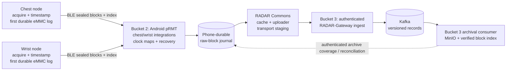
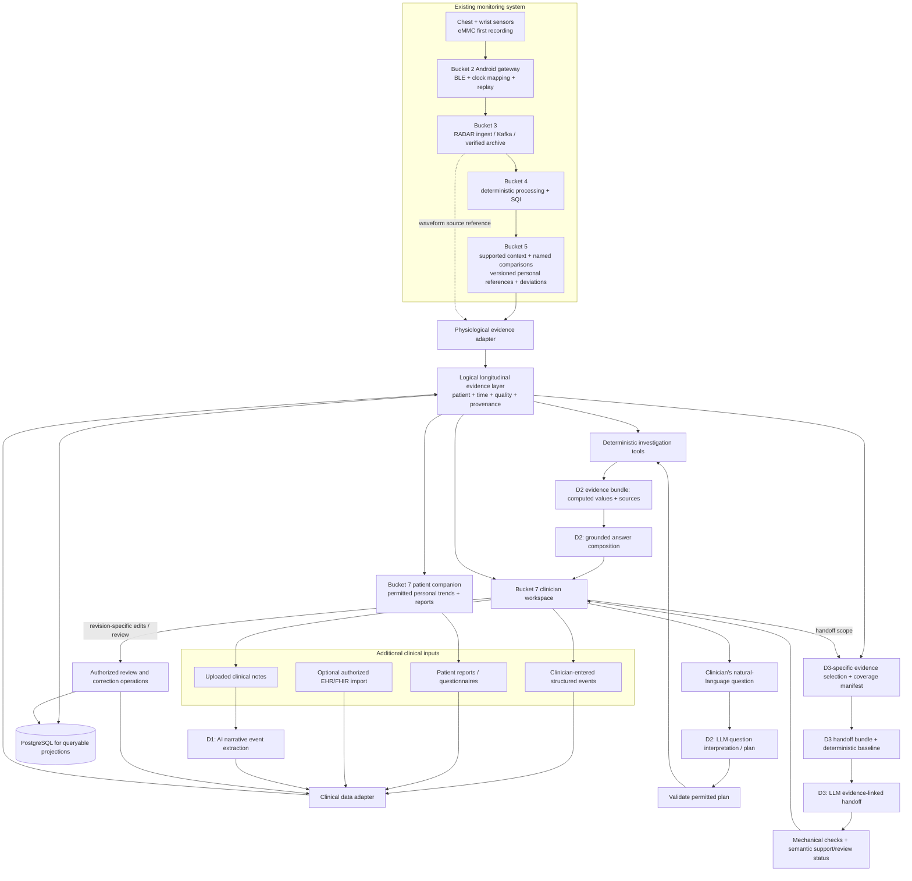
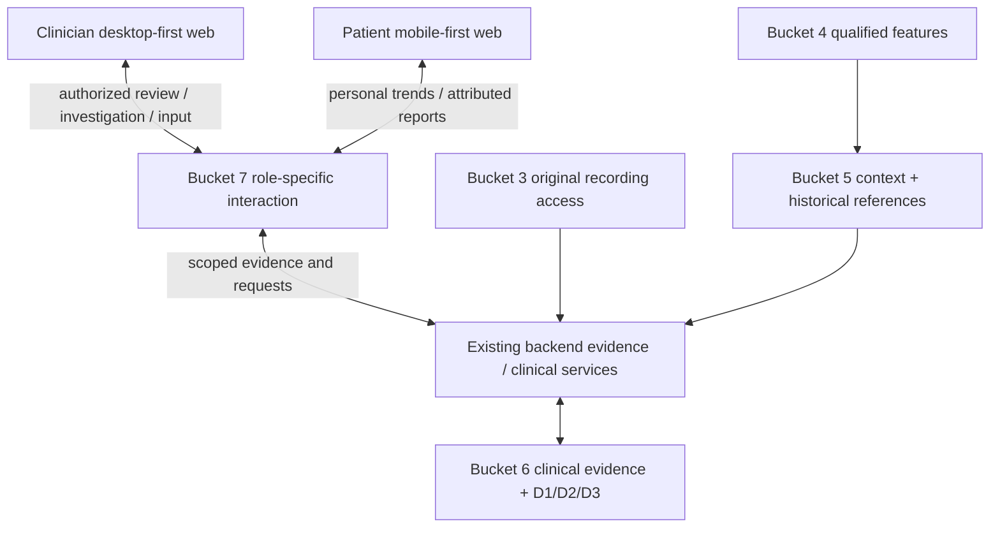
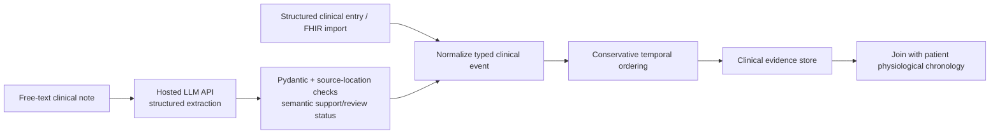
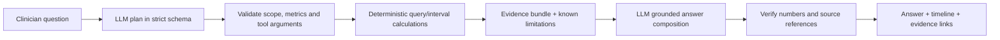

# AUD/SUD Objective Monitoring — Clinical Intelligence Architecture

**Consolidated, audited integrated blueprint — authoritative working design**  
**Version:** 1.6 (retains v1.1–v1.5 decisions; finalizes the 24 November Bucket 7 role-specific longitudinal review and information-presentation design at IDF level) · **Updated:** 24 November 2026  
**Status:** Proposed architecture, **not implemented or device-benchmarked**; **Buckets 2, 4, 5, 6 and 7 are design-ready for the IDF at conceptual, functional and architectural granularity** (not production- or clinically validated). Bucket 1 sensing and Bucket 3 data-infrastructure responsibilities retain their established design status; Bucket 3 verified archival remains an undeployed interface requirement. Bucket 7 selects clinician and patient experiences, information access, interaction and review workflows. Actual models, algorithms, numerical thresholds, interfaces, usability and performance remain to be implemented/tested.  
**Scope:** Seven-bucket architecture and ownership boundaries; v1.2 **Bucket 2**, v1.3 **Bucket 4**, v1.4 **Bucket 5** and v1.5 **Bucket 6 D1/D2/D3** designs retained. **Bucket 7 is now defined at IDF level** as a dual-role clinical-review and patient-monitoring interaction layer using the existing evidence architecture. Bucket 1 sensing baseline and Bucket 3 archive/reconciliation responsibility are preserved; the latter is an interface requirement, **not a deployed claim**.  
**Purpose:** Maintain one consistent project blueprint covering data lineage, upstream recording/transfer, physiological context/personalization, clinical-intelligence D1/D2/D3 workflows, AC-EDA semantics, role-specific longitudinal review and information contribution, evidence contracts, remaining dependencies, tests, and decisions. This **supersedes v1.5 for subsequent design work**, while retaining the separate Bucket 2, Bucket 4, Bucket 5 and Bucket 6 research/decision dossiers and without claiming all seven buckets are implemented.

> **Reading rule and evidence status:** **Established upstream design** means an agreed intended contract, not confirmed working hardware or deployed services. **Selected** means the decision for implementation, not a shipped artifact. **Conditional** means enabled only by a demonstrated requirement. **Verified reference fact** means supported by a named primary source; **engineering decision** is our chosen implementation response; **open dependency** means the required output or validation does not yet exist. Clinical measurements and clinical source documents must retain these distinctions at runtime. This document describes a **capstone engineering system for clinician support and patient participation in supervised monitoring**, not a medical device cleared for diagnosis or treatment.

**Revision integration:** All v1.1 clinical-intelligence simplifications/correctness fixes and the **v1.2 Bucket 2 architecture** remain in force: independent recording, dual-node BLE/pRMT gateway, origin-time blocks, separate clock maps, indexed recovery, phone-durable L2 acknowledgment and Bucket 3-owned independently verified L4 archive coverage. The AD5940 choice remains 100 Hz excitation / 4 complex-impedance estimates per second, calibrated Z archived and quality-qualified admittance derived downstream. **Retained from v1.3:** the 24 November Bucket 4 IDF-ready functional scope, modality-specific processing/quality, measurement support/provenance and focused proof obligations. **New in v1.4:** adopt the reviewed Bucket 5 research recommendations, with narrow clarifications for named-reference comparability, reference-epoch/as-of semantics and the Bucket 5 versus D2 computation boundary. This does **not** approve unmeasured motion thresholds, historical adequacy cutoffs, sensor performance or clinical claims, nor reassign ownership upstream. **New in v1.5:** finalize Bucket 6 with (F1) a claim-specific clinical evidence-use rule, (F2) four bounded D2 investigation classes and explicit operation/episode semantics, and (F3) minimal saved-result evidence/review version binding. Preserve D3's established independent selector and handoff design; adjust only its clinical-action wording. No new AI agents, infrastructure or clinical diagnosis/prediction is selected. **New in v1.6:** finalize Bucket 7 with distinct clinician and patient experiences on a shared backend, progressive disclosure and synchronized longitudinal evidence exploration, contextual D1/D2/D3 interaction, attributed patient reports and evidence/revision-specific review. Clarify role-specific authorization, deterministic presentation aggregates and receipt versus clinical-review/monitoring status. No substantive reopening of Buckets 1–6 or additional inference subsystem is selected.

---

## 1. Executive decision

Build **one evidence-grounded Clinical Intelligence subsystem** extending the AUD/SUD monitoring architecture. It has three **complementary, substantive AI capabilities**:

| Capability | Decision | What AI actually performs | What conventional software performs |
|---|---|---|---|
| **D1. Source-linked clinical-event extraction and patient-journey reconstruction** | **Build** | Understands heterogeneous clinical narrative; extracts atomic facts, assertions, temporal expressions and documented relations | Imports structured clinical data; validates event provenance; stores and orders events; joins them with monitoring intervals |
| **D2. Clinician-directed longitudinal evidence investigation** | **Build; central interactive capability** | Interprets free-form clinical-review questions; constructs constrained tool plans; presents grounded answers | Selects eligible measurements; calculates durations, coverage and comparisons; fetches records; verifies numeric results |
| **D3. Clinically faithful, source-linked summarization and handoff** | **Build as shared-evidence consumer** | Synthesizes verified facts into a coherent, readable longitudinal narrative | Constructs the evidence bundle and deterministic baseline; checks source pointers, numbers, event types and completeness |

**Design principle:** AI is valuable where *language understanding, flexible evidence selection and multi-source narrative synthesis* add capabilities that Buckets 1–5 do not possess. It should **not** replace physiological signal-processing algorithms, quality checks, numeric queries, medication record semantics or the clinician's diagnosis.

**Current implementation baseline:**

- Preserve **Bucket 1 sensing/first-durable-recording ownership** and established Bucket 2–4 responsibilities. **Bucket 2** retains its selected Android transport/recovery design (Section 2.2); Bucket 3 retains its authenticated ingest and independently verified archive-coverage responsibility. **Bucket 4** remains IDF-ready with method/quality/support-linked feature evidence (Section 2.3). **Bucket 5** retains its selected IDF-level context, reference-specific comparability, historical-reference and descriptive-deviation design (Section 2.4), with exact thresholds and device/method validity subject to implementation and testing. **Bucket 6** now has an IDF-ready bounded D1/D2/D3 functional and evidence-flow contract (Sections 5–8), without claiming implementation or clinical validation. **Bucket 7** has an IDF-ready role-specific information and interaction contract (Section 3.2), with actual interface implementation and usability still unverified.
- Use a **hosted LLM API** supporting structured outputs/tool calling **for permitted synthetic/approved data**; do not mandate Qwen3-32B, vLLM or local GPUs. Credentialed clinical datasets and actual records require source-specific data-use and provider checks before any off-premise processing.
- Implement **bounded Python workflows** and validated tool calls; no mandatory LangGraph or unrestricted agent.
- Use **FastAPI/Pydantic**, reusing the existing backend if compatible; use **PostgreSQL** for necessary queryable projections and clinical records; retain existing **RADAR-base / Kafka / MinIO** ownership.
- Build a **logical unified evidence layer**, not an entire duplicate data warehouse or graph database.
- Add **FHIR import adapters** when records require them; do not build a FHIR server or full hospital integration just for the capstone.
- Begin with **WESAD + Synthea + carefully labeled synthetic clinical-note fixtures**, then evaluate on richer restricted datasets and, eventually, authorized real clinical data.
- Deliver one end-to-end vertical slice that exercises **D1 → D2 → D3** before expanding breadth. These are three **reusable, independently callable** capabilities: normal D2 queries need not rerun D1, and D3 may consume already-ingested structured clinical evidence. Demonstrate the same evidence through a desktop-first clinician workspace and mobile-first patient companion, including an attributed patient report and source/revision inspection (Section 12).

### 1.1 What this project is — and is not

**It is:** a clinician-oriented way to integrate physiological evidence with documented clinical events, interrogate patient-specific longitudinal observations with verifiable computations, and create evidence-linked handoffs, together with a patient companion for selected personal monitoring information and attributed self-reporting.

**It is not:** a generic chatbot over sensor plots; a new withdrawal severity score; an autonomous diagnosis engine; an assumed medication-effect estimator; a claim that public stress datasets validate AUD/SUD outcomes; or a literature survey substituted for working engineering.

**Clinical intent:** improve access to and comprehension of the available evidence, while clinical assessment and decisions stay with a qualified professional. No device-specific AUD/SUD outcome labels are required to implement these three information-processing capabilities; such labels would be needed for some distinct future predictive claims.

### 1.2 Defined clinical review objective

**Initial clinical workflow (selected):** longitudinal review of a *documented alcohol-withdrawal monitoring episode* or comparable supervised AUD-monitoring course. The system helps a qualified clinician find quality-qualified physiologic observations, read reported symptoms and assessments, inspect documented medication orders/administrations and produce a transparent longitudinal handoff. It does **not** infer withdrawal severity, treatment efficacy or causation from physiology alone. The underlying interfaces remain broadly reusable for SUD-related review, but a broad SUD diagnostic claim is **not** currently established.

**Meaningful AI requirement:** D1 must extract genuinely variable narrative meaning; D2 must handle compositional clinician-directed questions (e.g., clinical event anchors + signal quality + historical comparison) through executable tools; D3 must organize a source-complete-enough, accurately qualified multi-source account. Merely paraphrasing a dashboard or rewriting a table does not count as sufficient AI contribution. The clinician retains authority and must be able to inspect original sources.

**Claims ladder:** controlled synthetic/replay correctness ≠ integration with implemented Bucket 5 output ≠ hardware-to-interface demonstration ≠ clinical usefulness or clinical efficacy. Report these as distinct results.

---

## 2. Starting point: existing monitoring architecture and its boundaries

The underlying project is a **single continuous physiological acquisition and processing architecture** usable for supervised clinical and remote monitoring. Its seven responsibility buckets are:

1. **Physiological Sensing & Hardware** — chest/wrist acquisition, timestamps, first durable per-sample recording on the nodes.
2. **Synchronization & Data Communication** — custom RADAR pRMT Android gateway with two independent wearable links, per-node clock-domain mapping, indexed live/backfill recovery, phone-durable buffering and authenticated upload; gateway does not synthesize physiological samples.
3. **Data Infrastructure & Management** — RADAR-base participant/source association, authenticated/schema-validated Kafka ingestion, a configured archival path to MinIO, verified block coverage and live/replay access; Kafka acceptance alone does not prove archival.
4. **Signal Processing & Quality Assessment** — deterministic post-acquisition channel reconstruction, calibration, preprocessing, quality evaluation and physiologic feature extraction.
5. **Physiological Context & Personalization** — supported per-node movement and temporal/environmental context; feature- and named-reference-specific comparison eligibility; versioned participant historical references and descriptive deviations; source-linked evidence for Bucket 6.
6. **Multimodal Inference & AUD/SUD Interpretation** — now includes the **clinical-intelligence integration and evidence services** for this project; any separate diagnostic/predictive model is a future, independently justified decision.
7. **Longitudinal Review, Clinical Interface & Information Presentation** — role-specific clinician and patient experiences; longitudinal visualization, progressive evidence inspection, clinical-intelligence interaction, information contribution and revision-specific clinical review.

**The AI extension is downstream of Bucket 5** and must never redefine the already established acquisition or signal-processing ownership.

### 2.1 Upstream hardware under consideration (provisional, not frozen)

The established design considers **two independently wireless nodes** with local eMMC logging, both using the **ESP32-S3-WROOM-1-N16R8** controller:

| Node | Candidate sensor path | Proposed acquisition / useful outputs |
|---|---|---|
| Chest | MAX30005 ECG | Single-lead ECG, nominal **512 samples/s** |
| Chest | ICM-42688-P | Accelerometer and gyroscope, nominal **200 Hz** |
| Wrist/forearm | MAX86173 optical AFE with SFH7016 emitters and two VEMD8080 photodiodes | Multichannel optical acquisitions, nominal **200 frames/s**; retain optical channel identity, gains and timing rather than only a combined waveform |
| Wrist/forearm | **AD5940** (retained) | Two-electrode **AC EDA/skin impedance**; **100 Hz excitation**, **4 complex-impedance results/s**; calibrated **Z = R + jX** in Ω retained; Bucket 4 derives **Y = 1/Z = G + jB** and quality-qualified AC conductance G |
| Wrist/forearm | TMP117 | Skin temperature, nominal **1 sample/s** with averaging |
| Wrist/forearm | ICM-42688-P | Accelerometer and gyroscope, nominal **200 Hz** |
| Wrist/forearm | Ambient temperature/humidity | Environment/context information; selected hardware remains provisional |

**Final EDA hardware decision:** **Retain AD5940, two-electrode AC impedance, 100 Hz excitation, 4 Hz output and the archived calibrated complex-impedance measurement.** The manufacturer's bioelectric EDA circuit and official example establish implementation feasibility. **Do not reclassify 100 Hz AC conductance as standard DC skin conductance**; do not equate WESAD EDA amplitudes or traditional SCL/SCR thresholds with the output without checking compatibility. The provisional board/package choice can change for assembly practicality (e.g., AD5941 package), but a different measurement modality is **not** presently justified. The hardware/electrode arrangement is provisional until calibrated and safely verified.

### 2.1.1 AD5940 AC-EDA decision — engineering basis and exact downstream meaning

The selected method is not an arbitrary repurposing of a bioimpedance part: Analog Devices' AD5940/AD5941 documentation and EDA example describe low-frequency excitation near **100 Hz**, voltage/current acquisition and phase-sensitive complex-impedance measurement through the ADC/DFT path. The official EDA demonstration uses development hardware and a skin-impedance test network; it is **not** an already calibrated custom ESP32-S3 wearable firmware implementation [R17–R19]. Electrode polarization can be less problematic under AC than sustained DC excitation, but this does **not** demonstrate automatic equivalence of the resulting measurements to standardized DC skin conductance [R20–R21].

**Selected end-to-end signal semantics:**

1. **Bucket 1 / wrist firmware:** generate the intended 100 Hz excitation; obtain calibrated complex impedance **Z(t) = R(t) + jX(t)** in Ω at nominal **4 Hz** (each result represents a 100 Hz excitation measurement, **not** 100 samples/s of EDA); archive the complex components, timestamps, AFE configuration, calibration identity and diagnostic/contact status. Retain raw AFE/DFT observations where practical for troubleshooting, not as a compulsory second sensing pipeline.
2. **Hardware/firmware verification:** check the configured gain, transimpedance, phase/sign convention, baseline/offset and ported SPI/interrupt/sequencer logic against known resistor/capacitor networks. Official example code includes evaluation-board/test-network assumptions; **do not copy a test-board baseline into a custom electrode system**. Document uncertainty and valid measurement ranges.
3. **Bucket 4:** calculate **Y(t) = 1/Z(t) = G(t) + jB(t)** for nonzero, valid Z. Specifically, **G = R/(R²+X²)** and **B = −X/(R²+X²)** in S (usually present G in µS). **Neither 1/R nor 1/|Z| is generally identical to G.** Preserve G and B or a reference to Z, calibration/configuration, signal quality, motion and contact flags. Make **G at 100 Hz** the primary candidate EDA time series for longitudinal features; preserve B as measurement context, not an obligatory novel biomarker.
4. **Feature selection:** first publish explicitly AC-derived conductance level/trends and defensible temporal changes. Standard tonic/phasic decomposition or SCR detection libraries (e.g., NeuroKit2/cvxEDA) may be applied to **qualified G** only after the relevant response morphology, sampling rate and assumptions are evaluated. Label any derived outputs as **AC-conductance-derived**. Do not present unvalidated outputs as conventional DC-SCL/DC-SCR equivalents.
5. **Bucket 5 / D2:** treat AC EDA as a quality-annotated participant-specific physiological input. Compatible within-person trend analysis is plausible; broad cross-device thresholds or treatment-response claims are not presently justified.

**Concrete risks worth addressing, without replacing the approach:** the evaluation firmware/board-specific calibration and ESP32-S3 port; electrode/contact/placement (wrist and forearm sites need not be equivalent); motion artifacts and data quality; electrical safety of actual human-worn use. Analog Devices explicitly warns that its evaluation demonstrator/cables must **not** be connected directly to people. Any human-worn custom device requires appropriate current-limiting/isolation/safety review under institutional procedures [R19]. A battery supply alone does not prove safety.

**Switch to DC only on evidence:** repeatable failure of calibrated AC-G to capture useful EDA response under adequate electrode/contact conditions where an appropriate reference succeeds; or an actual requirement for standardized DC SCL/SCR values that cannot be met or justified by AC measurements. Differences from WESAD, cvxEDA or published DC metrics **alone** do not meet this threshold. Do not expand this into a second mandatory research project.

**Reference status:** Manufacturer circuit and firmware prove a *supported measurement pathway*; published AC/DC comparisons support physiological plausibility at their studied frequencies/sites; **neither** proves this custom electrode layout or final wearable is clinically validated.

### 2.2 Buckets 1–3: ownership and selected Bucket 2 architecture (updated 24 November 2026)



**Scope of this update:** Bucket 1 has already been worked upon; its selected sensor paths, acquisition and **first durable per-sample eMMC ownership** remain unchanged. The following is a newly established **Bucket 2 architectural specification**, not a claim that the modules are running. It incorporates the 23 November Bucket 2 research dossier (Sections A–Q), which remains the detailed technical source for version-pinned code review, protocol drafts, throughput assumptions and test procedures. Bucket 3's ingestion/archive contract below is a required **handoff**, not an assertion that its consumer and verification API already exist.

#### 2.2.1 Purpose, boundary, and end-to-end operating model

- **Purpose:** connect the independently recording chest and wrist units to the shared RADAR data pipeline **without confusing wireless delivery with physiological acquisition**, while preserving origin, timing, continuity and recoverability.
- **Node ownership (Bucket 1):** independently acquire/timestamp each modality, durably record it on local eMMC, retain authentic sample and sensor-configuration information, and expose retrievable recording blocks/ranges and device status. No physiological measurement is created by the phone.
- **Gateway ownership (Bucket 2):** enroll/associate physical devices; manage two wireless links; receive live and historical recorded blocks; estimate **separate** device-clock mappings; validate and durably buffer received blocks; detect transfer gaps and replay eligible source ranges; upload raw recordings and timing/continuity metadata using the authorized RADAR route.
- **Backend ownership (Bucket 3):** validate authenticated participant/project/source and Avro contracts, ingest into Kafka, archive the original block contents, resolve duplicates/conflicts and expose **independently verified archive coverage**. Bucket 4 reconstructs/quality-assesses signals and derives features; Bucket 5 adds context, without shifting either function into the gateway.
- **Same architecture in both settings:** supervised and ambulatory use have the same responsibilities and record format; the connection state, network availability, recovery delay and permitted upload connectivity may differ. A disconnected node continues acquisition locally as far as its actual storage/recording policy permits.

#### 2.2.2 Selected transport and RADAR integration

| Component or decision | Selected Bucket 2 design | Important limitation/status |
|---|---|---|
| Wireless topology | **BLE GATT**, one independent bonded/authenticated link per ESP32-S3 chest/wrist node; Android central, nodes peripherals; ESP-IDF NimBLE is the firmware baseline | **Selected**, but sustained dual-link goodput, power and background operation require hardware tests; BLE bonding alone is not proof of physical-device identity |
| Android gateway | **Custom-built RADAR passive Remote Monitoring Technology (pRMT)** app using RADAR Commons; two compiled chest/wrist source providers/services/managers with shared BLE, time and replay code | RADAR does **not** natively implement our dual-node BLE protocol, eMMC range recovery or clock model |
| Release baseline | Research audited pRMT **v1.3.6**, Commons Android **v1.6.6** and the matching radar-commons **v0.15.0** REST sender | Research snapshots, **not a claim the project is already built or deployed**; verify exact compatibility with the chosen server deployment |
| Live and history transfer | Versioned **sealed per-node raw recording blocks**, approximately one second as a starting grouping; same immutable block representation for live and backfill | Actual optical acquisition inventory, canonical encoding and transfer performance must be ratified against Bucket 1 recordings |
| Phone persistence | Private, replayable **SQLite block journal** with a durable transaction boundary **before** acknowledging a node's block | Requires crash/power-loss and storage-pressure tests; SQLite configuration must meet the actual durability policy |
| RADAR upload | Versioned Avro raw-block records and clock-map metadata through the existing authenticated Commons cache/uploader → Gateway/Kafka path | `TapeCache` is **staging**, not guaranteed phone durability or MinIO verification; bounded replay into stock uploader needs an early integration test |
| Network policy | Wi-Fi preferred; explicitly authorized/configured cellular upload for remote operation | Stock RADAR uploader can be Wi-Fi-only by default; network loss must not stop node-local acquisition |

**Verified source-code distinction:** The release audited in the dossier compiles `SourceProvider` implementations into pRMT, creates a `SourceManager` to populate RADAR caches, and uses `TableDataHandler`/`KafkaDataSubmitter` plus a version-matched REST sender for authenticated ingestion. `AbstractSourceManager.send()` is **not** a durable or archived receipt. Audited `TapeCache` writes are asynchronous and its finite/corrupt queues or certain identity-mismatch uploader paths can discard staging records. Therefore the selected design keeps an **independent journal of source blocks for recovery**. These code findings apply to the inspected versions, not automatically to every future RADAR release [R27–R30].

#### 2.2.3 Source identity, recording blocks, and interrupted-transfer recovery

- **Immutable source identity:** distinguish physical device, role, authorized recording session, node boot/clock epoch and a monotonically sequenced block within that epoch. Keep RADAR participant/project/**source** associations separate from unauthenticated advertising names or transient BLE addresses; preserve binding history so a participant switch cannot silently relabel existing recordings.
- **Recording payload:** preserve the actual acquired values, stream/channel identities, original node timestamps or reconstructible timestamp/counter relationships, sensor/configuration/calibration references, stream counts, validity/gap markers and an integrity digest. **PPG retains distinct optical acquisition channels and timing**; AD5940 retains calibrated **R and X** at 4 results/s, not presumed DC conductance. No Bucket 4 filtering or feature computation occurs in Bucket 2.
- **Availability and recovery:** Bucket 1 makes sealed blocks and a persistent, queryable recording index available after reboot. Bucket 2 compares indexed source ranges with its durably received blocks (and confirmed archive coverage), requests missing ranges after reconnection, validates blocks and retries at block boundaries. A repeated block ID with the same digest is idempotent; an equal ID with unequal contents is a conflict, **never silently overwritten**. Original gaps and expired/overwritten ranges are explicitly recorded, not synthesized.
- **Transfer correctness:** a complete, validated, durably committed phone block is eligible for a repeat-safe acknowledgment; a radio notification or a RADAR `send()` call is **not** enough. Live recording receives scheduling priority while spare capacity is used for recoverable historical transfer. Expected throughput/backlog targets remain **engineering estimates until measured**.
- **Local retention:** the node must **not** erase authoritative recordings merely because the phone acknowledged them or a Kafka POST succeeded. A later archive-verified and policy-authorized range may be eligible for retirement; the minimum retention period, capacity, and storage-warning rules are implementation/deployment choices. Finite eMMC/phone space means indefinite losslessness is not claimed.

**Protocol-detail status:** A compact GATT control/status and fragmented block-data design is proposed in the research dossier, not an already deployed standard. The v1 draft still needs an explicit rule for **control messages that exceed the negotiated ATT payload**, in addition to data-block fragmentation. This is a narrow implementation specification item, **not an IDF or Bucket 3 architectural blocker**. The authentic physical-device enrollment method likewise needs concrete implementation and verification, without changing the selected source-association responsibility.

#### 2.2.4 Independent clock domains and temporal provenance

The chest, wrist and Android phone operate on different clocks. **Bucket 1 timestamps samples at acquisition** (including any necessary sensor/FIFO timing relationship); BLE callback or Android reception time cannot replace that source time. **Bucket 2** collects timestamp exchanges separately for each node, uses phone monotonic time as an intermediate reference, and anchors it to UTC with explicit quality information. The selected working method uses repeated four-timestamp exchanges and piecewise device-to-phone drift/offset mappings, with raw observations, boot epochs and mapping revisions retained. Phone wall-clock edits, disconnected intervals and node/phone reboots must not create a false continuous clock.

Publish **original ticks/counters, mapped event-time intervals where defensible, mapping identity, uncertainty/validity and missingness**. A disconnected interval with inadequate clock anchors can be marked uncertain/unmapped rather than assigned invented exact UTC. The initial ~2-minute synchronization cadence and exploratory cross-node 50 ms p95 target in the dossier are **test parameters, not proven clinical requirements**. The established Bucket 4 **10-second windows with 5-second steps** remain unchanged. Beat-level ECG-to-PPG transit-time measurement is **not** a promised use case of this synchronization design.

#### 2.2.5 Distinct receipt and archival checkpoints

| State | Meaning | Permitted claim |
|---|---|---|
| **L0: radio received** | Fragment(s) reached Android memory | No durable receipt or completeness claim |
| **L1: validated** | Full block reconstructed; identity, encoding/length and integrity checked in memory | Validated **in memory**, not persisted |
| **L2: phone durable** | Canonical sealed block committed to the private durable journal under its authorized binding | Wearable may receive **phone-durable acknowledgment**; **not** a deletion or archival receipt |
| **L3: server accepted** | Authenticated RADAR-Gateway/Kafka ingestion reported successful acceptance | Kafka/ingress success only; **not** evidence that a MinIO object exists |
| **L4: archive verified** | Bucket 3 independently verifies the stored block identity and content/digest in MinIO and its manifest | Verified coverage; later source/phone retention may be decided by policy |

**Guarantee selected:** at-least-once transfer/replay attempts with stable IDs and digest-based idempotence—not exactly-once transport, uninterrupted connectivity, unlimited retention, or guaranteed alignment accuracy. Bucket 2 must not mark L4 from upload counters or HTTP success. An acknowledged L2 block remains replayable until archive coverage is verified; journal cleanup after L4 requires an explicit retention/space-reclamation policy. Full-session completeness requires the **authoritative node recording index** plus verified covered blocks (or explicitly classified irretrievable gaps), not merely an apparent end-of-stream event.

#### 2.2.6 Minimal interfaces to adjacent buckets

| Handoff | Required information/behavior | Owner and readiness |
|---|---|---|
| **Bucket 1 → Bucket 2** | Independent acquired raw streams with source timestamps/counters, modality/channel and calibration metadata; eMMC-sealed **immutable blocks**, stable device/session/boot/block IDs, an index supporting range retrieval after reboot, and explicit lost/retired data status | **Bucket 1-owned targeted contract** for implementation consistency. Its prior sensor and recording decisions remain selected; check these metadata/index capabilities during firmware implementation, reopening only the specific missing interface if needed |
| **Bucket 2 → Bucket 3** | Authorized role-specific raw-block records, source/session/epoch IDs, original sample-time descriptors, block digests, gap/status metadata, separate versioned clock-map observations and UTC/uncertainty context where available | **Bucket 2 output contract selected**; Avro schemas/topic registration and runtime authorization are implementation/registration work; example topic names in the dossier are not existing topics |
| **Bucket 3 → Bucket 2** | Authenticated, paginated **verified archive coverage** per authorized source/session/epoch and stable block digest; distinguish missing/unknown, conflicting, uploaded and verified states | **Bucket 3-owned design requirement, not yet demonstrated deployed functionality**; can be implemented within the existing backend, without a new default microservice |
| **Bucket 3 → Bucket 4 and beyond** | Reconstructible raw streams with sensor/channel identities (**including optical slot/LED/photodiode timing and configuration where recorded**), original source ticks/counters, calibration/configuration, clock-map version/uncertainty, gaps/availability, integrity and L3/L4 archive references | Bucket 3 exposes authenticated source records and status; Bucket 4 derives measurement quality/valid-support evidence without equating accepted windows or L3 ingest to uninterrupted samples/L4 archival |

**Data archival clarification:** RADAR-Gateway Kafka acceptance is not automatic archival. Bucket 3 must use a properly configured consumer/storage path to MinIO, verify object content and expose coverage. Logical per-block deduplication/indexing **does not require one physical MinIO object per one-second block**. A duplicate or late clock-map record must not silently change the immutable source recording.

#### 2.2.7 Evidence, operational tests, and IDF readiness

The dossier's provisional planning model estimates roughly **9.29–15.34 kB/s aggregate encoded application data** (nominal **11.31 kB/s**, highly dependent on the unfinalized number of optical readings per frame), approximately **0.8–1.3 GB/day** before practical storage and retransmission variation. Its illustrative eight-hour-backlog/four-hour-catch-up target is an **engineering trial objective**, not a clinically derived service commitment or measured performance. Phone storage pressure, two-link BLE goodput, battery life, Android background behavior, journal durability, clock uncertainty and the actual eMMC/index format require hardware or integration evidence [R31–R33].

**Decisive verification:** (i) produce real node blocks/indexes and confirm source replay; (ii) build/register both custom pRMT sources against the chosen RADAR deployment; (iii) benchmark both BLE links with simultaneous acquisition/backfill; (iv) crash/power-test phone journal + L2 acknowledgment; (v) demonstrate bounded staging/replay to RADAR; (vi) verify Bucket 3 MinIO coverage and duplicate-safe reconciliation; (vii) measure common-stimulus clock alignment, storage and runtime. **The journal → stock RADAR uploader behavior deserves early testing** because it determines whether a controlled sender adapter is needed. Do not infer these outcomes from source-code inspection alone.

**Current readiness:** **sufficiently defined for an IDF** at conceptual, functional and architectural granularity. Exact GATT framing, enrollment proof, timeout parameters, schema syntax, recovery deadline, storage retention periods and physical performance can be refined during implementation and later buckets. This **does not** claim Bucket 2 is built, its end-to-end archival mechanism is operational, or any clinically meaningful precision is validated. A future Bucket 3 dependency may trigger a narrowly scoped Bucket 2 change; the sequential bucket-development rule still applies.

### 2.3 Bucket 4: selected operating model and IDF-ready design (expanded in v1.3)

A **deterministic Python processing service** consumes schema-validated physiological records from Kafka and/or integrity-verified MinIO recordings according to the selected Bucket 3 delivery path, reconstructs channels, performs signal-specific processing and quality assessment, and publishes versioned quality-annotated features with provenance. **Kafka ingestion status is not identical to verified MinIO archival status**; the processing contract must retain the source integrity/verification state and recording gaps appropriately. Live and replay processing share semantics.

The **initial intended feature families** are quality-qualified ECG heart rate (with NN-eligible HRV conditionally), PPG pulse rate, AD5940-derived **100 Hz AC conductance level/trends**, per-node IMU motion/gravity summaries and wrist oscillatory-motion evidence, local skin-temperature measurements/trends, and basic ambient temperature/humidity context. ECG/PPG diagnostic morphology, pulse-transit metrics, conventional DC-equivalent EDA/SCR features and clinical tremor/withdrawal classifiers are **not initial accepted outputs**. Availability of each feature and its measured accuracy remain conditional on valid data and validation. Bucket 4, not the gateway or LLM, owns signal-derived calculations.

**Specific Bucket 4 → Bucket 5 IMU interface extension (established design):** for **each node independently**, aligned **10-second windows every 5 seconds**, with common event-time boundaries and:

- `accel_mean_xyz` (m/s²)
- `gravity_xyz` (m/s²; 0.25 Hz low-pass estimate)
- `linear_accel_rms_xyz` (m/s²; high-pass above 0.25 Hz)
- `gyro_mean_xyz` (degrees/s)
- `gyro_rms_xyz` (degrees/s)
- `orientation_quat` **if** orientation is calculated; otherwise an explicitly documented equivalent/availability status

Existing motion and tremor-*related signal feature* families remain; wrist oscillatory activity must **not** be labeled clinical withdrawal tremor or severity by Bucket 4. **Do not project this IMU-specific 10 s/5 s definition onto every other feature**, which may have different valid windows and resolutions.

### 2.3.1 Feature-support semantics required for downstream duration claims

Bucket 4 may emit an **accepted feature** for a nominal window even when part of the underlying signal was missing or unusable. Therefore, an accepted 10 s feature window does **not** itself prove 10 s of continuously valid physiological observation. The minimal upstream contract must expose, **where such claims are made**, either actual eligible sample-support intervals or a precisely defined coverage/support indicator (e.g., valid-sample fraction, acceptable gap policy, source recording availability and estimator's support rule). An acceptance flag, motion qualifier and comparison-eligibility flag remain separate concepts. If exact support cannot be recovered, downstream reports must describe **eligible feature-window coverage** rather than asserting continuous observed duration.

This is a **small contract clarification**, not a requirement to reprocess every stream or impose the IMU 10 s/5 s framing on all physiologic features. The timestamp/clock mapping and support semantics ultimately need to reflect the implemented pipeline.

### 2.3.2 Bucket 4 functional definition, ownership and IDF readiness (v1.3)

**Selected IDF-ready functional description:** Bucket 4 transforms the independently recorded chest/wrist physiological streams into **method-identified, quality-qualified and source-linked physiological evidence**. It (i) reconstructs actual sensor channels and acquisition timing from Bucket 3 records; (ii) performs justified, deterministic signal conditioning; (iii) checks sensor/contact, waveform/beat and feature-specific reliability; (iv) derives a restrained set of physiological/motion/environmental features; and (v) publishes explicit availability, measured support, timing uncertainty, processing version and provenance for Bucket 5. It prevents noise, absence or partial data from being presented as a reliable continuous physiological state.

**Processing stages (logical components, not six mandated deployables):**

1. **Recording reconstruction and temporal provenance:** validate authorized source/session/epoch/channel/configuration identity; order genuine acquired measurements by source ticks/counters; handle immutable blocks, missing ranges, clock mapping and per-channel calibration. A one-second transport block is *not* a feature window.
2. **Modality-specific conditioning:** apply compatible scaling/calibration, filtering and discontinuity handling for ECG, each actual PPG optical path, complex impedance, the separate chest/wrist IMUs and thermal/environmental sensors.
3. **Layered measurement-quality assessment:** distinguish source availability/integrity, contact/acquisition status, signal artifact, beat/pulse validity, estimator support and feature acceptance. Use same-node IMU as a *possible artifact qualifier*, not an unconditional low-motion pass/fail gate.
4. **Defensible feature extraction:** compute only the metric(s) supportable by the actual signal and declared estimator, with feature-appropriate windows. An accepted ECG-derived HR is not proof of a verified NN series suitable for HRV; clean PPG pulse rate is not automatically morphology-grade PPG.
5. **Support-aware event-time publication:** publish value or explicit unavailable status, units/method, quality/reasons, underlying sample or event support, original references and versioning, retaining separate L3/L4 and clock-confidence states.

**Responsibility boundaries:** Bucket 1 produces/first durably records physical measurements and calibration/status information; Bucket 2 transfers them and supplies independent clock mappings; Bucket 3 owns authenticated ingest, raw archival, verified coverage and raw source access. **Bucket 4 does not resynchronize the nodes, assert archive verification, generate personalized baselines, diagnose AUD/SUD, infer treatment effects or decide patient-specific context comparability.** Bucket 5 owns baselines/deviations and contextual comparison eligibility; Buckets 6–7 own evidence investigation/clinical review. Reopen an earlier bucket only for a *verified missing required handoff*, not to redesign its topology.

**Readiness:** the conceptual, functional and architectural contract is **sufficient for the IDF**, with the exact IDF section determining whether extra detail must be supplied. This is **design-readiness only**: the research dossier is a recommendation record, not evidence that algorithms, device measurements, SQIs or archive integrations are implemented and validated. This boundary does not establish patentability or novelty of individual published signal-processing methods.

### 2.3.3 Initial measurement inventory and feature decisions (v1.3)

| Input | Intended Bucket 4 feature / evidence | Initial scope and scientific qualification |
|---|---|---|
| **Chest ECG** | ECG-derived heart rate, accepted beat/time support; **conditional** NN-qualified RMSSD/SDNN using a consistently defined, justified observation period | R/QRS detection and actual waveform/beat quality are essential. **NN classification/eligibility is not guaranteed by R-peak detection**: if normal-interval support cannot be established, HRV is unavailable while qualified HR may remain available. No ECG diagnostic classification. |
| **Wrist multichannel PPG** | Quality-qualified **pulse rate**, selected optical-channel identity, pulse/channel availability and validity | Preserve each actual LED/photodiode/slot stream, gain and acquisition time; select a suitable channel based on observed signal quality. The precise peak detector/channel ranking is **not yet validated** for this optical layout. No assumed SpO₂, pressure/stiffness proxy, dicrotic-notch or PRV-as-ECG-HRV output. |
| **AD5940 complex skin impedance** | Valid complex admittance **Y = 1/Z = G + jB**; **100 Hz AC-derived conductance G** level/temporal trends; B and original R/X as measurement context/reference | Preserve excitation, phase/calibration, electrode/contact status, physical units and quality. G is **not conventional DC skin conductance or DC SCL/SCR**, and 4 output results/s are not the excitation rate. Defer conventional SCR/tonic-phasic decomposition pending actual compatibility evidence. |
| **Chest and wrist six-axis IMUs** | Established per-node acceleration, gravity and angular-velocity summaries; movement intensity. Conditional **wrist oscillatory-motion** band/peak descriptors | Preserve independent node frames/mounting; gravity-relative inclination may be supported, **not stable absolute yaw or uncalibrated anatomical trunk posture**. An oscillatory-motion feature is not diagnosed withdrawal tremor or severity. The existing 10 s / 5 s vector interface is retained unchanged. |
| **TMP117 skin temperature** | Local skin-surface temperature and qualified trends | Preserve skin site, thermal/contact qualifiers and actual support; **not core-body temperature, fever detection or treatment response**. |
| **Provisional ambient temperature/humidity** | Measured environmental temperature/humidity, simple quality/aggregation | Context supplied for Bucket 5 when the actual sensor/configuration exists; no automatic psychophysiological or EDA compensation claim. |

**Feature scope is functional, not an implementation prescription.** The companion *Bucket 4 Finalization Evidence Research Dossier (24 November 2026)* recommends trial implementations (WFDB XQRS as an ECG reference; independently evaluated PPG pulse detection; qualified AC-G medians/trends; stateful IMU gravity filtering and wrist gyro spectral summaries; thermal aggregates). **Those package choices and numerical defaults are candidate engineering starting points**, not measured results or approved mandatory algorithms. In particular, the dossier's exploratory ECG/PPG 10 s / 5 s, HRV 5 min / 1 min, AC-G 30 s / 15 s and 60 s / 30 s, wrist oscillation 30 s / 15 s, and thermal 60 s / 30 s proposals may be refined with a feature-definition revision. Of the **candidate feature-window schedules**, only the **already established per-node IMU 10 s / 5 s** interface is binding here; its previously selected 0.25 Hz gravity separation remains the design baseline.

**Explicit deferrals:** unvalidated ECG morphology/arrhythmia analysis; PPG vascular morphology, SpO₂, respiratory-derived markers and ECG–PPG transit/arrival timing; conventional DC-equivalent EDA features; full orientation/quaternion or anatomical posture classification without attachment calibration; clinical tremor severity; AUD/SUD withdrawal diagnosis, prediction or drug-effect inference; and any extra machine-learning/data-platform layer absent a demonstrated requirement. Exclusion is from the **initial accepted feature scope**, not a declaration that future research can never support a feature.

### 2.3.4 Measurement validity and minimum Bucket 4 → 5 handoff (v1.3)

**Separate these evidence levels instead of using one universal SQI:**

| Evidence aspect | Owner / meaning | Required downstream distinction |
|---|---|---|
| **Recording/source coverage** | Bucket 1 source index and Bucket 3 authorized raw-block inventory/integrity; known gaps versus not-yet-uploaded/unresolved ranges | Present, missing/irretrievable, conflicting, pending or unknown are different from a bad-quality *observed* signal. |
| **Physical acquisition/contact and waveform quality** | Source diagnostic metadata + Bucket 4 modality-specific checks | Lead/contact/range/artifact/saturation states; usable versus unusable signal and meaningful reasons, with unknown when not detectable. |
| **Beat/pulse and estimator support** | Bucket 4 event/segment validity | A trusted QRS for HR does not establish normal NN intervals for HRV; detectable PPG pulse rate does not validate pulse morphology. |
| **Feature acceptance** | Bucket 4 per-feature rules | Accepted, rejected, insufficient support, not computed, or timing unavailable; a zero measurement is **not** missing data. |
| **Motion qualifier** | Bucket 4 same-node IMU with its own support and clock status | Motion can affect measurement quality but is **not** automatically rejection or a patient-specific comparison judgment. |
| **Personalized contextual comparability** | **Bucket 5**, based on accepted features and individual/contextual criteria | Patient baseline eligibility, comparison-period selection and deviations do **not** originate in Bucket 4. |

**Minimum logical feature record (no prescribed database schema):** authorized participant/session/source/node/measurement site and actual channel or method; feature identifier/meaning, value or explicit unavailable state and unit; nominal event-time window and feature-definition version; original acquisition/clock epoch, mapping identity, UTC confidence/uncertainty; feature-specific quality/acceptance and reason codes; **what original samples, pulse/beat events or qualified signal segments actually support the estimate**, represented by valid support intervals and/or appropriately defined sample/event counts/fractions with their denominator and gap rule; same-node motion/contact qualifier where available; source block/manifests, calibration/config and processing algorithm/revision; separately identified L3 acceptance versus **Bucket 3-confirmed** L4 archive provenance. A feature may be numerically computable in node-relative time yet not eligible for an accurate UTC cross-node comparison.

**Do not conflate nominal time, raw-sample support and a sustained physiological episode.** A valid feature within a ten-second nominal window can have less than ten seconds of usable underlying support. Distinct ECG beat intervals, sparse AC-G/temperature samples and continuous high-rate IMU samples have **different support meanings**: neither a count of isolated observations nor a union of overlapping accepted windows by itself proves continuous physiology. Bucket 4 must provide the available metric-specific evidence; downstream tools compute legitimate coverage with interval union/defined denominators and may **abstain** from sustained-duration claims lacking appropriate evidence. A fractional coverage estimate without sample support geometry cannot be promoted to an exact continuous duration. The exact acceptance thresholds/support geometry belong to method-specific implementation/validation, not the IDF.

### 2.3.5 Live/replay consistency, interface readiness and validation gates (v1.3)

**Processing and reprocessing contract:** For an agreed source, configuration, clock map, algorithm definition and final available samples, live/backfill/replay must converge to equivalent final physiological features and provenance. Carry required filter/detector state across adjacent source blocks, but not across genuine signal gaps, source epochs or sensor-configuration discontinuities without an explicit rule. Original sample order, not network arrival order, controls signal estimation. Duplicate source blocks must not duplicate logical features; conflicting same-ID/different-digest blocks require upstream resolution. Late source recovery or revised time mapping may require **affected-context reprocessing and traceable feature revision/supersession**, rather than silently overwriting original evidence. Exactly how checkpoints, buffers, finality and Kafka schemas are realized is an **implementation** decision.

**Reference implementation caveat:** WFDB `XQRS` and `pyPPG` are useful research/reference detector implementations, **not proven drop-in causal streaming components** for our two-node service. If a referenced algorithm employs noncausal/zero-phase filtering or batch-dependent adaptation, choose a reproducible bounded-lookahead or causal equivalent and explicitly version its live/replay definition before production comparison; offline-only outputs must not silently claim identity with streaming outputs. The IDF does not require this choice now.

**Targeted Bucket 3 → 4 contract:** authenticated raw channels/values, physical units, per-optical-slot timing/identity/gain when applicable, device/session/boot/configuration epochs, source ticks/counters, timing-map version and uncertainty, contact/diagnostics if recorded, explicit source gaps, stable block IDs/integrity and appropriate L3/L4/verified-archive references. These are **required information categories**; exact sensor FIFOs, Avro fields or deployed archive APIs must be checked when implemented. No new Bucket 2 time sync or Bucket 3 archival subsystem is introduced.

**Validation gates, not prerequisites for IDF-level readiness:** independently annotated ECG/NN and PPG pulse tests; actual MAX86173 optical-slot reconstruction and movement/contact performance; AD5940 known-impedance/phase tests followed by *safety-approved* wear/contact assessment before physiological AC-G claims; IMU calibrated gravity/oscillation/reference tests; temperature/contact checks; original-block gaps, duplicate/replay and clock-revision fixtures; Bucket 4→5 support/identity/provenance integration; actual throughput and determinism under live/backfill. Public WESAD/MIT-BIH and synthetic fixtures can demonstrate specified **algorithm or bookkeeping behaviors**, not the custom device's sensor performance or AUD/SUD clinical outcomes. Specific SQI thresholds, exact causal filter/beat detector integration and measured clinical-accuracy claims remain **open proof obligations**.

**IDF readiness decision:** Bucket 4's concept, major functions, intended feature families, interfaces and ownership are **sufficiently described**. Later buckets may require only narrowly scoped additional interfaces; they do not require premature finalization of filters, thresholds, source-topic names or clinician-facing diagnostic claims. Continue to Bucket 5 using this versioned functional contract, reopening only a demonstrated gap.

### 2.4 Bucket 5: Physiological Context & Personalization — selected IDF-ready design (v1.4)

**Purpose and decision:** Bucket 5 transforms **Bucket 4's already quality-qualified, method-identified physiological features** into **context-described and, where justified, participant-referenced physiological evidence**. It establishes what observable conditions accompany a measurement, whether a specified comparison is supported, what a named historical reference represents, and the *descriptive* difference from that reference. It does **not** infer AUD/SUD state, withdrawal severity, clinical normality, treatment response or causation. These are **selected conceptual/functional/architectural responsibilities**, not a claim that the hardware, baselines, thresholds or service are implemented or validated.

The five responsibilities below are **logical functions, not five required deployables**:

| Function | Input / processing responsibility | Intended output / abstention |
|---|---|---|
| **1. Physiological context characterization** | Use accepted time-referenced Bucket 4 IMU, thermal/environmental and relevant source metadata; describe supported device movement and recording circumstances. | Independent chest/wrist motion descriptors and limited supported strata, environmental/clock qualifiers or explicit unknown. |
| **2. Contextual comparability** | Evaluate a **particular target feature against a named reference and documented metric-specific comparison policy**; keep signal acceptance distinct from contextual eligibility. | Eligible / ineligible / indeterminate, reasons and policy identity; separate reference-availability state. |
| **3. Participant-specific historical references** | Select compatible, adequately evidenced history within an explicitly named epoch; construct and maintain versioned descriptive reference snapshots. | Historical center, conditionally spread, reference provenance and unavailable/provisional/supported-descriptive status. |
| **4. Personalized descriptive deviations** | For an eligible comparison, calculate the signed difference between accepted target and compatible reference; describe standard reference-defined periods where supported. | Value in original units and supporting reference/coverage, or explicitly unavailable; **no automatic clinical significance**. |
| **5. Contextual evidence publication** | Preserve original Bucket 4 method/quality/support/clock/source status; attach Bucket 5 context, named comparison, reference snapshot and revision lineage. | Queryable/resolvable physiological evidence for the existing Bucket 6 adapter and Bucket 7 review. |

#### 2.4.1 Input boundary and observable context

**Inherited inputs:** accepted or explicitly unavailable/rejected ECG HR (NN-qualified HRV only if Bucket 4 supports it), quality-qualified wrist PPG pulse rate, **100 Hz AC-derived conductance G** and context for calibrated complex Z, per-node IMU motion/gravity/gyro summaries, skin temperature and provisional ambient conditions. Every feature retains its own interval, physical method/site/configuration, quality/acceptance, metric-specific actual support, clock-map uncertainty, source integrity/archive state, and versioned Bucket 4 provenance. No new physiologic sample or re-filtered waveform is produced by Bucket 5.

**Selected movement context:** retain independent **chest and wrist** continuous movement descriptors, with limited `low` / `elevated` / `unknown` (and `ambiguous` where the evaluated rule needs it) motion strata, **of the relevant mounted node**. Use a simple versioned deterministic rule whose actual cutoff and mounting performance require controlled assessment. The already established **per-node 10-second windows stepped every 5 seconds** belong to Bucket 4's IMU summaries alone; other features retain their own legitimate windows. Map IMU context to each feature's actual support/temporal overlap and clock uncertainty; do not assign a whole long feature interval one motion label from one short IMU window or add overlapping windows as independent duration. Prefer same-node context (chest ECG ↔ chest IMU; wrist PPG/AC-G/temperature ↔ wrist IMU); other-node context is supplementary only when mapped overlap is supportable.

**What context does not prove:** low motion is not sleep, physiological rest, relaxation or matched posture/autonomic state. Wrist movement is not whole-body activity or withdrawal tremor. Gravity-relative tilt is an **optional descriptive qualifier** only with supported mounting/coordinate context; no uncalibrated anatomical standing/supine label or absolute yaw. Clock time/time-of-day, measured local skin temperature and available ambient temperature/humidity are retained as qualifiers rather than universal inferred circadian state or unvalidated physiological compensation factors. Unknown environment, attachment, motion or timing remains unknown.

#### 2.4.2 Comparison eligibility — target, reference and policy specific

**Selected rule:** comparability is **`compare(target observation, named reference, documented metric/context policy)`**. It is **not** an intrinsic permanent Boolean on a Bucket 4 measurement. A feature accepted by Bucket 4 remains an accepted measurement even if ineligible for the requested personalized reference. Preserve the following distinctions:

- **`eligible`** — sufficient accepted feature/support, method/site compatibility, applicable reference and **required** context evidence for this named comparison.
- **`ineligible`** — known material incompatibility (e.g., rejected target, different unbridged measurement method/site, or elevated chest motion versus a low-chest-motion HR comparator).
- **`indeterminate`** — missing or insufficient material evidence (e.g., required node context/clock alignment unknown), not a presumed match.
- **Reference availability (separate)** — no appropriate reference, provisional reference, or supported descriptive reference. `no_reference` is **not a fourth quality/comparability judgment** and cannot be silently converted to `eligible`.

Apply identity/authorization, metric/units, method/site/configuration, Bucket 4 quality and actual support, relevant timing and named-reference compatibility first. Then apply **feature-specific, material** context requirements; record other factors without needlessly making every ambient, orientation and time-of-day condition a mandatory gate. A broader comparison is a **different explicitly labeled reference/policy**, never a silent relaxation of a failed narrow comparison. A simple default comparison can be materialized; additional permitted D2 queries may invoke the same deterministic comparison rules for a different named reference without globally relabeling the feature.

**Initial feature-specific policies:** primary ECG HR reference uses accepted **low-chest-motion ECG HR**, with method/site compatibility and time-of-day qualifier or restriction only when justified by actual historical support; it must not be called proven resting HR. PPG pulse-rate references remain method/site/configuration compatible and **separate from ECG HR** absent tested equivalence. HRV must match NN validity, HRV metric, estimator/window and comparable observation conditions. AC-G references require **100 Hz AC conductance**, compatible electrode/site/calibration epoch, contact and relevant wrist motion; no DC-SCL/SCR crosswalk. Skin-temperature reference needs compatible site/measurement and qualified environment when material. Historical motion/oscillation references are conditional on a real downstream comparison requirement and consistent mounting; **no clinical tremor score**.

#### 2.4.3 Participant-specific historical reference — definition, construction and lifecycle

**Terminology:** a reference describes an **actual recorded epoch**. It is never silently a `healthy`, `pre-withdrawal`, `resting` or treatment-free baseline. A monitored acute-course reference is an **observed-course** reference; a documented pre-episode reference may be labeled as such **only if genuinely measured and sourced**. `Baseline` may remain UI shorthand with the source epoch and reference status visible.

**Selected reference policy:** a named **reference epoch and comparator policy** are supplied by an explicit project/study configuration or authorized clinician/investigator selection. Bucket 5 chooses eligible historical features **within that declared scope**, rather than autonomously deciding which days are clinically normal. It uses qualified prior observations under compatible metric/method/site/context conditions, without selecting observations merely because their values are close to the eventual reference center.

For initial descriptive estimation, construct **non-overlapping supported comparison units** at the feature's meaningful time scale, account for represented sessions/days, and use the **median** as reference center; report **IQR/quartiles only where the historical representation makes them interpretable**. A dense run of overlapping windows is not automatically multiple independent historical assessments. Record reference epoch, measurement definition, comparator rule, number and distribution of qualifying units/days/sessions, underlying support/gaps/exclusions, source IDs, center/spread where justified and reference version. A brief single-session comparison can be validly **provisional**, not a stable personal normal.

**Reference state:** `unavailable` (no eligible history; no personalized difference), `provisional` (limited genuine history; explicitly qualified descriptive center/difference if useful), or `supported_descriptive` (the prespecified independent-history and repeatability/stability criteria for that specific scope have been demonstrated). No universally defensible minimum days, windows or numerical stability tolerance has been established for our device/population; those **validation-backed numerical gates remain implementation decisions**. Until such gates are established and met, do not upgrade a provisional reference simply because many overlapping windows exist.

**Temporal/version correctness:** a published comparison references a **frozen, resolvable reference snapshot**. A new source block, corrected clock map, revised Bucket 4 feature/method, changed reference epoch or policy may trigger a **new version and affected comparison supersession**; prior as-known results remain inspectable. Distinguish (i) physiological **event time**, (ii) the explicit historical reference epoch/cutoff, and (iii) **evidence availability/as-of time**. A live-as-known comparison cannot use observations not available at that time; a later corrected retrospective result is labeled as such, not substituted for earlier knowledge. A continuously self-updating baseline is **not** the default because it could absorb a sustained change without explicit review.

#### 2.4.4 Deviations, longitudinal descriptions and downstream division of work

**Primary numerical description:** for an **eligible** named-reference comparison, `signed deviation = accepted target value − applicable historical reference median`, **in the feature's own unit**. Attach the reference's actual state, epoch, supporting observations and available spread. Zero deviation is a real numerical zero; a missing target, unavailable reference or unsupported comparison produces an **explicit unavailable result/reason**, never zero or an invented estimate. A provisional reference may support only a clearly labeled *provisional descriptive difference*, not a stable or clinically normal comparator.

Bucket 5 may supply **reference-policy-defined descriptive period summaries** from suitable historical measurements and comparisons among such summaries. **Bucket 6/D2** owns ad hoc clinician-directed interval selection and aggregation, event-anchored temporal joins, threshold/max-gap rules, sustained-episode duration and the arithmetic of requested coverage/comparisons; it reads Bucket 5's context/reference definitions and Bucket 4's true sample/event support. No overlap-union of accepted feature windows alone proves continuously measured or elevated physiology. Bucket 5 does not assign statistical anomaly, withdrawal, relapse, clinical deterioration or medication-effect labels. Percent-change, z-score, normality threshold and combined disease-risk models are not required initial outputs.

#### 2.4.5 Minimum Bucket 5 → 6 logical handoff and implementation placement

Preserve the **canonical Bucket 4 observation** and expose a source-linked Bucket 5 annotation/reference, or a queryable combined view, through the already selected **physiological evidence adapter** (Section 5.1). The minimum logical information is:

| Evidence layer | Required meaning |
|---|---|
| **Inherited Bucket 4** | Authorized participant/session/source/node/site/method and units, feature value/availability, real feature interval, acceptance/reasons, **metric-specific sample/event/segment support**, clock uncertainty, configuration/processing version and **separate** L3 versus independently confirmed L4 provenance. |
| **Context annotation (B5)** | Per-node supported motion/descriptors and reasoned unknown states; available time/environmental qualifiers; context-rule version and actual temporal support/overlap. |
| **Reference snapshot (B5)** | Unique resolvable reference ID/version, metric/site/context policy, named epoch, reference state, center/spread-if-supported, history/support accounting, event-time cutoff and **availability/as-of** provenance. |
| **Comparison result (B5)** | Specific target + named reference + policy, eligible/ineligible/indeterminate **and reason** (reference availability separately), signed feature-unit difference if warranted or explicit abstention, rule/revision/supersession identity. |

The illustrative v1.3 Boolean `comparison_eligible` is therefore **superseded as a sufficient semantic contract**; it may be retained as a derived convenience only when its reference/policy is known, and must not replace the richer status. No waveform duplication, arbitrary extra data warehouse, new activity/sleep classifier, mandatory separate service or LLM-based physiological inference is selected. **Preferred implementation direction:** deterministic Python logic with modest, queryable, versioned reference/comparison state using a compatible existing backend/storage path. The exact schema, processing topology and numerical parameters remain implementation choices.

#### 2.4.6 Cross-bucket dependencies, exclusions and IDF readiness

**Bucket 1–3** still own acquisition, original timestamps, transfer/clock mapping and source/verified archival status. **Bucket 4** still owns signal processing, quality, and actual metric-specific measurement support; Bucket 5 cannot repair missing raw support or claim archive L4 from Kafka L3. Actual source site/mounting/configuration identity and feature support must be checked in the serialized Bucket 4 → 5 interface during implementation; if a specific missing field is proven material, reopen **only that upstream handoff**. **Bucket 6** owns clinical data/events, D1 extraction, D2 investigator-directed deterministic calculations and D3 synthesis; **Bucket 7** presents the result with original evidence and caveats. No implied clinical-input feedback loop is needed for Bucket 5's ordinary physiological computation.

**Evidence-status rule:** Public WESAD/other wearable studies support limited engineering trials and methodological motivation but do not validate our AD5940 AC-G, planned dual-IMU context classifications, personal reference thresholds or AUD/SUD clinical conclusions. Use independent fixtures for comparator arithmetic and reference revisions; actual mounted hardware and permitted human testing for movement/context and physiologic reference validity; separate clinical evaluation for claims of usefulness. The companion *Bucket 5 Physiological Context and Personalization Research Finalization Dossier (24 November 2026)* remains the detailed evidence/recommendation record. Its numerical suggestions, reference-adequacy criteria and study findings are **not** actual project measurements.

**IDF-readiness decision:** These selected functions, handoffs, historical-reference rules, output categories and exclusions are **sufficient at conceptual, functional and architectural granularity**. This is **design-readiness only**; no threshold, implementation, physical measurement accuracy, clinical efficacy or patentability is thereby demonstrated. Later Bucket 6 requirements may reopen a **narrow proven interface gap** but do not justify premature redesign of Buckets 1–5.

---

## 3. Current target architecture



**Diagram interpretation:** the upstream `R` node compresses multiple **Bucket 3** stages for readability; authenticated Kafka ingest and **verified MinIO archival** are distinct operations (see Section 2.2), and not every ingested record is automatically verified. Bucket 5 supplies versioned context, named-reference comparisons and descriptive deviations via the **same physiological evidence adapter**; it does not run D1/D2/D3, and D2 remains responsible for requested interval/episode arithmetic. The hosted LLM API participates in D1, D2 and D3, but its calls are initiated by **our backend**. Source records remain controlled by our system. LLM outputs are provisional until validated. PostgreSQL stores only the clinical records and feature projections we need; it need not duplicate the MinIO waveform archive or the entire RADAR data estate. The two Bucket 7 experiences use the existing authorized backend boundary; the patient path receives only permitted personal evidence and submits attributed reports. The displayed arrows are logical flows, not direct frontend access to PostgreSQL, Kafka or MinIO. The independent pRMT gateway remains the wearable transport component.

### 3.0.1 How the AI capabilities relate at runtime

The diagram depicts the complete demonstrable workflow, **not** three mandatory sequential calls for every interaction. D1 runs for relevant *narrative* ingestion; structured FHIR/form events bypass LLM extraction. Persisted D1 output and directly ingested events join the logical evidence layer. D2 runs clinician-directed investigations over authorized, queryable evidence, whether or not D1 was invoked in that session. D3 compiles a broader handoff evidence bundle from the same authoritative evidence layer, **not necessarily the narrower D2 query result set**. The vertical-slice demonstration exercises all three. No generic autonomous agent or clinical decision service is implied.

### 3.1 Boundary between Buckets 6 and 7

- **Bucket 6 / shared services:** clinical-event extraction, temporal normalization, evidence compilation, validated query operations, grounded synthesis workflow services.
- **Bucket 7:** role-specific access and presentation; clinician questions, timelines, investigation results, waveform/document source navigation, editable handoff drafts and review feedback; patient monitoring overview, selected personal trends and self-report submission/history. See Section 3.2 for the selected design.
- **Bucket 6 → 7 result/review contract (v1.5):** Bucket 6 supplies source-linked clinical assertions, structured investigation facts/limitations, D3 handoff drafts, evidence and artifact revision identifiers, and known supersession/currentness qualifications. Bucket 7 presents them and submits edits or review actions for the **specific artifact revision**; changed content does not inherit approval. This establishes the preserved result/review information flow; Section 3.2 now defines how it is exposed to users.
- **Cross-cutting:** backend-enforced role and participant authorization, patient association, provenance, logging, testability and data handling. A patient report accepted by the backend is not necessarily clinically reviewed. The patient-facing interface does not provide a professional-response guarantee.

The exact deployment boundary can be one backend containing separated modules. A physically separate Bucket 6 microservice is **not** a requirement.

### 3.2 Bucket 7: Longitudinal Review, Clinical Interface & Information Presentation — selected IDF-ready design (v1.6)

**Purpose and decision:** Bucket 7 is the role-aware, bidirectional interaction and information-presentation layer of the seven-bucket system. It makes physiological measurements, their quality and support, personalized context, documented clinical evidence and bounded clinical intelligence usable in a coherent longitudinal workflow. Clinicians can review, investigate, inspect sources, contribute clinical records and review handoffs; patients can understand selected personal monitoring information and contribute attributed subjective information. **Abstraction simplifies access to evidence; it does not eliminate access to it or change its meaning.** This is a selected conceptual/functional/architectural design, not a claim of implemented software, measured usability or clinical benefit.

#### 3.2.1 Logical responsibilities and ownership

The five functions below are **Bucket 7 logical responsibilities, not five separate deployables** and not a renaming of Bucket 6's F1–F3 decisions.

| Function | Information used / interaction | Output and responsibility boundary |
|---|---|---|
| **B7-F1. Role-specific information access and presentation** | Authorized physiological/clinical evidence, role, patient and review scope | Clinician and patient views with appropriate information granularity and accessible navigation; authorization enforced by existing backend, not just UI visibility. |
| **B7-F2. Longitudinal physiological and clinical visualization** | Bucket 4 features/support, Bucket 5 context/reference/comparison, D1 clinical assertions and time uncertainty | Synchronized trends, clinical timelines, quality/coverage and progressively detailed evidence; no new signal processing or clinical inference. |
| **B7-F3. Clinical-intelligence interaction** | Clinician documents/questions/review scopes and Bucket 6 D1/D2/D3 results | Source-linked extraction review, contextual investigation results and editable handoffs; existing Bucket 6 services execute the intelligence. |
| **B7-F4. Clinical and patient information contribution** | Structured clinical records, clinician notes, attributed patient check-ins, edits and review actions | Submit information to existing clinical-data/analysis/review services, preserving author, subject, original report, time and revision; no autonomous clinical action. |
| **B7-F5. Evidence inspection and review** | Resolvable original records, measurement and clinical provenance, limitations and artifact revisions | Finding-to-source inspection, clearly differentiated evidence states and revision-bound clinician review; inaccessible or missing source evidence stays explicitly unavailable. |

**Ownership:** Buckets 1–3 retain acquisition/transfer/source access and integrity; Bucket 4 retains measurement derivation/quality/support; Bucket 5 retains contextual comparability and historical references; Bucket 6 retains clinical ingestion/extraction, deterministic evidence computation and synthesis, evidence binding and review-state persistence. Bucket 7 owns selection of presentation, navigation, interaction and submission of requests. Routine summaries (e.g., selected-period medians, coverage fractions) use deterministic authorized evidence operations with declared method/support/denominator; **no LLM call is required to open ordinary views**. Formatting, chart layout and gap-preserving display reduction are presentation work, not new physiological features or analytic truth. D1, D2 and D3 remain independently callable.

#### 3.2.2 Selected users, platforms and access architecture

| Role / component | Selected design | Why / boundary |
|---|---|---|
| **Clinician** | Desktop-first responsive web workspace | Larger screen and precise interaction for multi-channel time-series, document/source inspection, investigations and handoff editing. A separate native clinician app is not needed. |
| **Patient** | Mobile-first responsive web companion; installable PWA where straightforward and supported | Short everyday interactions, accessible personal trends and check-ins; no duplicate native iOS/Android projects. PWA installation/offline behavior is not assumed and is not an IDF prerequisite. |
| **Wearable gateway** | Existing Bucket 2 Android pRMT | Continues independent BLE links, clock mapping, journal, recovery and upload; the patient companion does not replace or duplicate transport. |
| **Application/evidence boundary** | Shared backend and preferably one application codebase with separate role experiences | Reuse existing authorized evidence and clinical-data services. No additional identity platform, frontend framework, database or service is selected merely for Bucket 7. |

**Authorization:** clinician access is limited to assigned/otherwise authorized participants and permitted professional actions; patient access is limited to their own permitted monitoring information and submissions. All evidence queries, source resolvers, model-context construction, input and review requests enforce the relevant scope server-side. Clinical records not included in the routine patient experience are not thereby denied under legitimate record-access or clinician-authorized sharing processes. The initial companion is not a full patient-record portal.



This diagram is a logical application view of Section 3, not a replacement pipeline or a requirement for direct client access to the underlying services. RADAR's existing dashboards can remain engineering tools; the clinician interface is built around the integrated evidence contract rather than a generic sensor dashboard. RADAR aRMT is a reference/conditional reuse path for formal questionnaires, not another mandatory application for initial short check-ins [R58].

#### 3.2.3 Selected information and capability access

**Primary** means routinely presented where relevant; **detail** means accessible through progressive disclosure; **restricted** means available only to authorized professional/technical workflows; **not initial** means not included in the routine patient experience. Exact default card arrangement is an implementation choice, not a change in access scope.

| Information / capability | Clinician experience | Patient experience |
|---|---|---|
| Monitoring time, data availability and recording gaps | Primary, with metric-specific coverage and detail | Plain-language availability, recency and missing-data states |
| Accepted ECG heart rate | Primary and detailed history | Familiar descriptive measurement and history |
| PPG pulse rate and conditional NN-qualified HRV | Detail; separate measurement definitions | Not displayed separately initially |
| AC-derived conductance, admittance and calibrated complex impedance | AC-G feature detail (may be surfaced where relevant); impedance/admittance technical detail | Not initial |
| Chest/wrist movement, optional oscillatory-motion evidence | Relevant movement/context primary or detail; oscillation detail, not clinical tremor | Simplified node-attributed movement history; no oscillation/severity metric |
| Skin temperature and environmental context | Relevant local skin temperature; environmental detail | Local skin temperature optional metric detail with explanation; no standalone ambient dashboard |
| Signal quality, support, clock uncertainty, source and archive states | Essential qualifications visible; detailed technical status on inspection | Simple availability/recency and limitations; no SQI or L0–L4 technical dashboard |
| Named historical references, eligibility and deviations | Accessible with policy/epoch/status and limitations | Descriptive measurement trends, no initial baseline-deviation judgments |
| Raw waveform and original clinical sources | Authorized on-demand inspection; technical detail where available | Not routine |
| Clinical assessments, orders/administrations and D1 assertions | Source-attributed clinical timeline, detail and review | No automatic exposure; own submitted reports/history available |
| D2 investigations and D3 handoffs | Professional capability and evidence/revision review | Not exposed as patient-facing AI |
| Structured entry, document upload and corrections | Authorized clinical contribution and review | Own short structured report and optional narrative; submission history |

Do not infer sleep, stress, recovery, clinical normality or withdrawal state from this presentation. A documented clinical assessment can be viewed as supplied evidence; it is not an independently generated system diagnosis.

#### 3.2.4 Clinician information architecture and interactions

**Selected four-level progressive disclosure:** (1) concise patient/period overview, including availability, relevant observations, documented clinical events and material limitations; (2) longitudinal exploration with synchronized physiological/contextual and clinical-event tracks; (3) detailed processed feature and clinical assertion inspection, with quality/support, method, context, named reference and source status; (4) original source inspection, including short waveform/recording intervals and original note spans/structured fields where authorized and available. D2 and D3 can link across levels; they are not additional levels. This preserves access to processed measurements rather than forcing clinicians to rely on summaries.

**Selected workspace:** simple authorized patient selection (identity, monitoring periods, latest available evidence, basic search/filter); within a patient, four sections — **Overview, Timeline, Clinical records, Handoffs** — sharing patient/time scope, a contextual D2 investigation panel and an evidence inspector. No population-level risk ranking. Routine overview statistics are descriptive, calculated deterministically from supported features, and labeled with scope and coverage rather than implying clinical normality. No default AC-G or other metric placement is irrevocably fixed by a mock-up.

| Visualization / interaction | Selected behavior |
|---|---|
| Multimodal longitudinal explorer | Separate vertically aligned time-series (small multiples) on a common time axis, with physical units; channel visibility, range selection, zoom/pan and synchronized inspection/crosshair. |
| Context and clinical-event tracks | Movement context and availability aligned to physiological observations; distinguish source-attributed event types/action status; use intervals/uncertainty markers when event times are approximate. |
| Personalized comparison | Labeled named-reference median line, IQR band only when supported, explicit provisional/reference status; optional signed-deviation representation in physical units. Never a clinical normal range. |
| Quality, coverage and episodes | Visible gaps and material exclusions; distinguish nominal feature-window coverage, actual valid support and feature-defined episode grouping/bridged gaps; never join absent measurements into a falsely continuous trace. |
| Multiscale exploration | Broad period summaries → finer feature observations → short original recording intervals. Select authorized time-bounded data and gap-aware display resolution without inventing samples or aggregations. |
| Detailed evidence inspector | Reusable metric-specific pattern: value/time/method, quality and support, context, comparator, provenance and source retrieval. Bounded on-demand waveform display, not a new full medical-grade waveform analysis workstation. |
| Source-document review | Original text with supporting spans, structured source fields and assertion status; retain uncertainties and contradictions. |

**Core interactions:** select patient/period/channel, inspect synchronized values, select clinical event/interval, toggle supported references, drill into evidence and invoke D2 with the visible effective scope. Side-by-side historical period comparison is a useful enhancement after the core works; arbitrary graph builders and saved custom layouts are not initial requirements. Use consistent modality encodings, clear units, text/symbols alongside color, readable typography and accessible keyboard/mobile interactions. Exact chart libraries, styling, screen density and display-resolution algorithms are deferred.

The hierarchical and longitudinal design is supported as a design direction by VISION, CarePortal and research on patient-generated health-data dashboards [R53–R55]; these are not evaluations of this AUD/SUD interface.

#### 3.2.5 Clinician interaction with Bucket 6 (preserve D1/D2/D3)

- **D1 / clinical records:** clinician enters structured observations or uploads a note; use the existing adapter/extractor; inspect assertions beside original source spans and submit corrections/review to the backend. Unassessed or unsupported candidates remain inspectable as candidates, not affirmative timeline events or precise anchors. Preserve F1 evidence-use and mention-versus-occurrence semantics.
- **D2 / investigation panel:** contextual entry from overview, selected interval, metric/episode, clinical event or existing result. Patient and time/metric scope are visible and editable within authorization. Present the effective question, concise grounded answer, structured computed facts (including units/denominators), relevant evidence view, exclusions/uncertainty, source links and as-used revision/generation context. Reuse Q1–Q4 and the deterministic fallback, not a generic medical chatbot or an internal prompt/tool-trace viewer. Link findings back to the selected evidence and original sources where resolvable.
- **D3 / handoffs:** clinician selects patient/period/focus; existing independent evidence selector creates the D3 bundle and manifest. Expose the deterministic structured handoff and AI draft from the same bundle, supporting evidence, limitations and review state. Allow source inspection, editing and revision-specific approval; changed/regenerated content never inherits approval. A reviewed handoff is not automatically submitted to an EHR or published to patients. Export is an optional convenience.

**Clinical authority:** Bucket 7 collects and communicates clinician review; the backend persists it for the specific artifact revision (Section 5.3). Mechanical validation, semantic support and actual qualified review remain distinct. Known currentness/supersession is shown only where checked/known; no background stale-result monitoring is selected. The UI must not make an uncertain/absent source look verified or imply that an investigation result establishes cause or treatment effectiveness.

#### 3.2.6 Patient experience and information contribution

**Selected navigation:** **Today** (recent data availability, selected measurements and check-in access/status); **Trends** (personal descriptive measurement histories with simple ranges); **Check-ins** (short self-report and own submissions). Prefer plain-language labels, large touch targets, readable charts and nonjudgmental communication. Consumer wearable platforms illustrate summary-to-detail and time-range navigation [R56–R57]; adopt those interface patterns, **not** their health scores or clinical interpretations.

**Initial physiological information:** accepted ECG heart-rate summaries/trends, simplified wrist-device movement history and optional local skin-temperature detail. Do not present HRV, AC-G, oscillatory-motion metrics, reference deviations or separate pulse rate as initial patient-facing metrics. A daily descriptive median is not resting HR; between-day differences may reflect movement, measurement support or sampling/coverage differences. Identify what the statistic represents, its time scope and any material data limitations; if evidence is inadequate, display an unavailable state. Do not show body/core temperature, sleep states, recovery/readiness/stress, clinical risk or withdrawal severity unless independently justified in a future workstream (not selected here).

**Short structured check-in:** capture relevant patient-reported symptoms, experiences, craving, sleep or side-effect context, with optional narrative. Exact question set, wording, frequency and reminders require supervising clinical-team input and are not fixed by the IDF. Preserve the original report, author/experiencer attribution, submission timestamp, occurrence time or approximate interval where provided, and explicit answered/skipped/denied distinctions. Structured reports go directly to the established clinical-data adapter; optional narrative can use D1 with the existing evidence-use rules. The form is not a validated withdrawal scale and must not produce a composite severity score. Reports entered by a clinician on behalf of a patient retain the attribution distinction.

**Submission and monitoring semantics (required):** distinguish (i) backend acceptance of a report, (ii) availability of the report/evidence for authorized retrieval and (iii) actual clinical review. A success message requires confirmed backend acceptance; a submitted report does not imply clinical review or immediate response. For passive monitoring, display the latest available measurement/receipt and distinguish those timestamps where relevant. Recent backend data do not prove current BLE connectivity, uninterrupted recording, verified archive coverage or live clinician observation. Local connection/troubleshooting remains with pRMT. Missing or delayed information must not imply that the patient is safe or unwell.

**Clinical communication boundary:** the companion supports supervised monitoring and does not provide self-managed withdrawal treatment, continuous clinical surveillance, emergency messaging, automated triage or a patient-facing medical AI. Clearly communicate the absence of a guaranteed immediate response and provide clinician-approved instructions for contacting the care team and seeking urgent help independently of readings. The ASAM withdrawal-management guideline informs the supervision boundary [R59]; it does not establish our application's clinical validity. Actual report protocol, contact guidance and clinical sharing policy require approval before clinical use.

#### 3.2.7 Minimum interfaces and targeted dependencies

| Logical handoff / operation | Requirement and owner |
|---|---|
| Buckets 3–5 → existing evidence access → B7 | Authorized, bounded retrieval of processed observations, context, references, feature-specific quality/support, source availability, clock/revision provenance and original recording references where retrievable; retain established semantics. |
| Bucket 6 → B7 | Source-attributed assertions, D2 results/computed facts/limitations, D3 drafts and evidence manifest, source and artifact revisions, review/currentness qualifications. Preserve the v1.5 result/review contract. |
| B7 → Bucket 6 | Authorized clinical inputs, patient-attributed reports, clinician investigation and handoff scopes, corrections and specific-artifact review actions. Backend remains responsible for validation, ingestion, calculation and review persistence. |
| Role-specific access policy | Enforce clinician authorized-participant and patient own-permitted-record restrictions, including source resolvers and professional endpoints. No new identity system is mandated. |
| Routine summaries / chart reads | Expose existing deterministic evidence operations for bounded time-range/metric reads and supported summary/coverage results, without language-model planning for ordinary rendering. Add minimal access interfaces/projections only if required. |
| Patient input | Expose a patient-authorized submission/history path into the existing clinical-data contract; retain receipt/availability/review distinction. |

These are narrow application-level extensions/clarifications, not substantive reopening of Buckets 1–6. Bucket 3 raw retrieval and L4 archival remain unimplemented dependencies; no new sensing, context classifier, computation subsystem or clinical-inference service is requested. No server-side live device-connection state is presumed; introduce a separate gateway diagnostic handoff only if a demonstrated future requirement warrants it.

#### 3.2.8 Proportionality, demonstration and readiness

**Core implementation:** clinician patient selection/overview, synchronized timeline, processed-feature and source inspection, D1 entry/review, contextual D2 and D3 review; patient own-record access, mobile overview/trends, structured check-ins/history and clear availability/monitoring limitations. Shared authorization and evidence interfaces serve both. Meaningful but nonessential enhancements: side-by-side period comparison, PWA installation, reviewed export, protocol-justified reminders and user-tested metric preferences. Do not introduce composite health/risk scores, autonomous alerts, EHR management, treatment management, real-time professional messaging, gamification, separate native apps, a full waveform workstation or a demonstration-only frontend.

**Demonstration:** extend the existing Section 12 gold-labeled synthetic/public-replay scenario. Demonstrate patient report ingestion, available physiological recording and feature evidence, context/reference and quality, D1 source-linked clinical chronology, D2 compositional investigation, finding-to-source navigation and D3 revision-specific review. Make actual engineering visible through genuine interactions, not simulated intelligence or decorative architecture animations. Clearly distinguish synthetic fixtures, public replay, implemented physical-system demonstration and authorized clinical evaluation. The UI cannot establish any upstream implementation or clinical claim that has not actually been demonstrated.

**Evaluation:** task-based clinician and patient comprehension, navigation, reporting and evidence/review correctness; retain the Section 10.5 conventional timeline versus D2/D3 comparison and test unauthorized access, unsupported presentation, missingness, attribution and revision invariants (Sections 10.6, 16). Accessibility references guide implementation [R60–R61]; do not claim conformance or user benefit without testing.

**IDF readiness:** the five responsibilities, users/platforms, information-access boundaries, principal visualizations and interactions, bidirectional handoffs, review and patient contribution are sufficiently defined at conceptual, functional and architectural levels. The 24 November Bucket 7 readiness assessment identified no substantive upstream reopening or outstanding fundamental design decision. Exact frontend stack, API/schema syntax, defaults/card layout, visual style, PWA/caching, chart resolution, check-in questions/cadence, clinical contact instructions and usability/performance targets are implementation/consultation/validation work, not missing IDF-level architecture. The exact IDF section may request further detail; this decision establishes neither patentability nor actual implementation, measurement validity, clinical usefulness or clinical effectiveness.

---

## 4. The source of every piece of data

### 4.1 Operational data lineage and availability

| Input used by AI | Original producer / owner | Access path into the new subsystem | Present status / caveat |
|---|---|---|---|
| ECG / PPG / impedance / temperatures / IMU / ambient raw samples | Chest and wrist sensor nodes, Bucket 1 | First-durable eMMC source blocks → Bucket 2 BLE/phone journal → RADAR Gateway/Kafka → configured Bucket 3 MinIO archive | **Selected design**, hardware/archival path not implemented; Kafka acceptance is not automatic archive verification |
| Sample timestamps / clock mapping / recording integrity | Bucket 1 original ticks and stream counters; Bucket 2 two clock maps, continuity and L2 receipt; Bucket 3 source checks and L4 archive verification | Versioned raw-block/time-map metadata, recording manifests and downstream feature provenance | Preserve independent clock epochs, uncertainty, source gaps and **L2/L3/L4 distinctions**; no invented precision |
| ECG HR (conditional NN-qualified HRV), PPG pulse rate, AC conductance trends, IMU motion/oscillatory movement, temperature/environment features | Deterministic Bucket 4 methods | Versioned, quality/valid-support-annotated Bucket 4 feature record / Bucket 5 adapter | **IDF-level feature scope selected**; method-specific acceptance and real-device measurement validity are unverified; no clinical withdrawal/tremor diagnosis |
| Signal-quality indices and acceptance reasons | Bucket 4 | Quality fields in feature evidence | Queries must distinguish accepted, rejected and absent observations |
| Supported device-motion/time/environmental context; named-reference comparability; versioned historical reference and descriptive deviations | **Bucket 5** | **Minimal physiological evidence adapter**, with B4 feature/source links and B5 reference snapshots/comparison results | **IDF-level logical design selected in v1.4**; exact schema, motion/history numerical gates and real published data are unimplemented/unvalidated; no healthy-normal or clinical diagnosis claim |
| Participant association / recording session | RADAR-base participant/project/source registration plus Bucket 2 physical-device/session binding | Authorized participant/session/source lookup with immutable device/recording identity | Prevent cross-patient or chest/wrist misassociation; advertisement name alone is insufficient |
| Waveform drill-down | **Verified** Bucket 3 MinIO recordings when archived | Reference resolver (source/block ID + interval + archive state), not LLM context dump | Viewer may reuse existing archive interface; full new viewer is optional; pending/unarchived blocks are not claimed retrievable from MinIO |
| Clinician assessments, structured symptoms, treatment events | Clinical professionals / authorized care systems | Manual structured entry or import | **Additional source required**; not created by sensors |
| Medication **orders** | Ordering record, if supplied | Structured event / FHIR `MedicationRequest` adapter or qualified note extraction | Must never automatically imply a dose was given |
| Medication **administrations** | Administration record, if supplied | Structured event / FHIR `MedicationAdministration` adapter or narrative report with explicit evidence status | Narrative report of administration is not automatically verified structured administration |
| Clinician progress notes / discharge notes | Clinical professional or EHR | Document upload/import → D1 extractor | **Additional source required**; source text retained with provenance |
| Patient-reported symptoms, craving, sleep or side-effect context | Patient or clinician-recorded patient statement | Simple form/questionnaire, imported entries, optional RADAR app | Self-reported, timestamped; never misrepresented as clinician observation |
| Historical clinical chronology | Normalized clinical events from the above | Evidence-layer retrieval across time | **Derived**, not an independent source |
| Investigation plan | Hosted LLM API, D2 | Validated typed structured output | **AI-derived instruction**, not evidence |
| Investigation numbers and comparisons | Our deterministic query engine | SQL/Python operations over eligible evidence | **Computed results**, subject to correct definitions and source coverage |
| Narrative handoff | Hosted LLM API, D3 | Synthesis from a bounded evidence bundle | **Draft interpretation of documented evidence**, not an original record |

**No hidden clinical information source exists.** If clinicians, patients or an EHR do not provide clinical events, the AI cannot truthfully reconstruct undocumented symptoms, medication administration or interventions.

### 4.2 Data sources for development, integration and validation

| Dataset / source | Role now | What it cannot establish | Access |
|---|---|---|---|
| **WESAD** | Real, synchronized **chest/wrist physiology and accelerometry**; time filtering, quality/coverage and controlled query scenarios; E4 wrist EDA is 4 Hz | Not our MAX86173/AD5940 100 Hz AC output; no planned wrist/chest gyroscope channels; not AUD/SUD withdrawal outcomes or actual medication course | Public dataset; check original license/acknowledgment requirements |
| **Synthea** | Synthetic patient/encounter/condition/medication/observation records, exportable as FHIR or CSV; tests structured clinical ingestion | Not a real clinical ground truth; does not automatically provide the exact withdrawal-note and administration scenario desired | Public generator |
| **Curated synthetic clinical notes** | Explicitly annotated narrative symptoms, uncertainty, negation, time and order-vs-administration scenarios | Not proof of generalization to real clinician prose | **Must be authored and gold-labeled by project team** |
| **Controlled combined replay scenarios** | Link WESAD-derived feature timeline with **fictional** clinical history on a defined common time axis | **Not** actual clinical outcomes for WESAD participants; no inferred medication response | Created by project team; keep synthetic association explicit |
| **EHRSQL** | Later and/or parallel benchmark of natural-language clinical query interpretation, temporal conditions and abstention | Does not validate our sensor-specific eligibility arithmetic or clinician UX | Public repo/questions; underlying clinical databases may be restricted |
| **n2c2 / i2b2** | Later clinical extraction, assertion and temporal-task evaluation | Domain mismatch may remain; data may be access-controlled | Dataset-specific access requirements |
| **ArchEHR-QA** | Evidence-grounded clinical QA and source-attribution benchmark | Not AUD/SUD monitoring performance | Credentialed PhysioNet access |
| **MIMIC-IV / MIMIC-IV-Note** | Later realistic clinical records and narrative evaluation | Not paired with our wearable setup; credentialed data **cannot be treated as freely uploadable to hosted APIs even if de-identified** | Credentialed PhysioNet use agreement; service-specific restrictions [R22] |
| **MIMIC-IV-BHC / StanfordMIMI benchmark** | Longitudinal summarization benchmark/reference implementation | Not a drop-in evidence-linked wearable handoff engine | Code public; associated clinical data restricted/credentialed as applicable |

**Critical integrity rule:** pairing WESAD physiology with synthetic/Synthea records yields a **fictional integration test**, not a real patient's longitudinal course. Label all such records as synthetic and do not claim any causal association between a synthetic medication and observed WESAD physiological values.

### 4.2.1 Dataset governance and scope of validation

**WESAD + Synthea + separately authored notes are a fictional integration scenario**: their temporal linkage is an explicitly fabricated alignment, not patient-level causal or outcome evidence. WESAD does not provide the custom board's complex impedance, either gyroscope stream, patient-specific AUD treatment outcomes, or independently labeled Bucket 4/5 SQI; any such fields in a fixture must identify their provenance as **computed, simulated or injected**. Use external EHRSQL, n2c2, ArchEHR-QA and MIMIC benchmarks only for precisely aligned evaluation tasks and report limits separately. EHRSQL's public questions and shuffled evaluation resources may suffice for some tests without privileged original hospital databases [R12].

**Data-access rule:** PhysioNet's 24 September 2025 notice specifically addresses sending credentialed MIMIC data to online LLM APIs: de-identification does not waive its data-use restrictions. Local processing is recommended; permitted API use requires verified contractual/data-handling conditions (including zero retention, training and human-review restrictions) and compliance with the particular dataset's agreement [R22]. Keep hosted inference selected **only for data whose use is authorized**. Do not quietly send credentialed records to a conventional consumer API. This rule also applies to authentic institutional notes and patient data according to their permissions.

### 4.3 How clinical information enters the final system

Choose the **least complex viable intake**:

1. **Clinician structured entry:** `event_type`, timestamp/interval, symptom/assessment/medication status, author/source and optional note.
2. **Clinician note upload or import:** retain the original document, then execute D1.
3. **Patient form/questionnaire:** initial Bucket 7 mobile-first companion provides short structured self-reports and optional narrative with original content, source identity, submission/occurrence time and explicit *reported* status. Structured data bypass LLM extraction; narrative may use D1. RADAR aRMT remains conditional reuse if a formal questionnaire requirement warrants it (Section 3.2.6).
4. **Authorized FHIR/EHR import, when available:** map the relevant resource fields to our internal event contract. A full FHIR server is not required to consume exported FHIR JSON.

The data path must remain usable with only options 1–3; no hospital partnership is required to start the capstone.

---

## 5. The shared evidence model: minimal but precise

**Selected approach:** a **logical unified evidence layer** exposing two primary kinds of evidence: (A) physiological intervals/observations, and (B) clinical events/documents. Persist only what the actual query and handoff workflows need. Preserve the source of truth rather than copying everything into an elaborate new platform.

### 5.1 Physiological evidence contract (target adapter schema)

```json
{
  "observation_id": "obs_001",
  "participant_id": "P001",
  "metric": "heart_rate",
  "node": "chest",
  "window_start_utc": "2026-11-10T09:00:00Z",
  "window_end_utc": "2026-11-10T09:00:10Z",
  "value": 104.2,
  "unit": "bpm",
  "quality": {"status": "accepted", "sqi": 0.94, "reason_codes": []},
  "support": {
    "evidence_kind": "feature_window",
    "valid_sample_fraction": 0.8,
    "valid_support_intervals_utc": null,
    "coverage_method": "bucket4_valid_sample_fraction",
    "continuous_observation_proven": false
  },
  "context": {
    "chest_motion": {"stratum": "low", "status": "supported", "rule_version": "motion_v1"},
    "available_environment": "not_shown_in_example"
  },
  "comparison": {
    "status": "eligible",
    "reason_codes": [],
    "policy_id": "low_chest_motion_ecg_hr_v1",
    "reference": {
      "reference_id": "base_02",
      "status": "provisional",
      "epoch_start_utc": "2026-11-09T09:00:00Z",
      "epoch_end_utc": "2026-11-09T18:00:00Z",
      "as_of_utc": "2026-11-10T08:59:00Z",
      "center": 87.9,
      "unit": "bpm"
    },
    "deviation": {"value": 16.3, "unit": "bpm", "method": "target_minus_reference_median", "status": "provisional_descriptive"}
  },
  "provenance": {
    "feature_record_id": "feat_010",
    "source_recording_id": "rec_038",
    "processor_config_id": "bucket4_config_01",
    "bucket5_revision_id": "b5_rev_01"
  }
}
```

**Illustrative contract only; none of these values are actual Bucket 5 measurements or a deployed schema.** The example illustrates an *eligible but provisional* named-reference comparison: the numerical difference is descriptive, **not** a supported personal-normal or clinical conclusion. `context` describes supported observations; `comparison` is **specific to its named policy and reference**, not a permanent truth about the feature. A real implementation must resolve the reference snapshot, history/support accounting, reason/status and revision links from source data. The `support` fields illustrate an accepted feature with only partial underlying sample availability. A `valid_sample_fraction` cannot recover gaps or prove continuous duration; if unavailable upstream it remains unknown. `valid_support_intervals_utc` is optional only where not available or not required for the intended claim.

**Minimum necessary fields:** participant; metric/modality/site/method and physical units; value; source event-time and clock uncertainty; Bucket 4 quality/acceptance and actual support/coverage semantics; **separate supported Bucket 5 context annotation**; comparison status **for a named reference and policy** with reasons; resolvable historical reference identity/epoch/state/as-of and deviation if supported; source and processing/revision provenance. A reference may be unavailable, provisional or supported-descriptive independently of feature acceptance; no reference is not an invented zero deviation. Add further fields **only** for supported questions. Feature-specific windows and signal validity rules remain owned upstream. Bucket 5 comparison records may be materialized for a selected default reference or evaluated under a different explicit policy for a D2 request.

**For EDA:** a derived record must distinguish `ac_conductance_100hz` (µS), optional `ac_susceptance_100hz` (µS), and original `complex_impedance_100hz` (Ω). These example names are *contract suggestions*, not published Bucket 5 schema. Keep excitation frequency, calibration and contact validity in provenance; do not silently map an AC amplitude to `dc_skin_conductance`.

#### 5.1.1 Measurement support versus episode duration

1. **Recording availability:** raw samples were present for the requested time.
2. **Feature availability:** a computed metric record exists for a nominal window.
3. **Feature acceptance:** the metric-specific quality rule accepted that estimate.
4. **Named-reference contextual eligibility:** the accepted estimate can support a comparison under the **specific reference and policy**; reference availability is separately reported, and context eligibility is not a universal feature property.
5. **Valid sample support:** how much of the underlying interval was actually measured and usable; exact valid support intervals are preferable when duration claims demand them.
6. **Sustained episode duration:** computed only using a *predefined* threshold, maximum gap, minimum duration and metric-specific eligibility rule; this is **not automatically** the union of feature windows.

**Report the correct quantity:** when only window acceptance is available, label a result *eligible feature-window coverage*. Say *continuously observed elevated HR for N minutes* only if the upstream data and episode construction rules actually establish this. Overlapping windows must never be summed; unioning them is necessary but **not sufficient** for proving continuous observation. The denominator (requested wall-clock interval, available recordings, or another defined interval) must always be reported.

---

### 5.2 Clinical event contract

| Field / concept | Requirement |
|---|---|
| `event_id`, `participant_id`, `encounter_id?` | Stable **source-supported assertion/mention** identity, patient association and optional encounter; do not assume each row is a distinct real-world event |
| `event_type` | Symptom report, observed sign, assessment, medication order, medication administration, intervention, follow-up, etc. |
| `concept` and `original_text` | Normalized concept **plus** original wording where needed |
| `assertion` | Present / absent / uncertain / conditional / historical as appropriate |
| `experiencer` | Patient or other explicitly stated experiencer |
| `evidence_class` | Structured clinician record, structured administration, narrative report, patient self-report, inferred extraction |
| `action_status` (where applicable) | Preserve documented medication/intervention action state and original source status; an order, completed action, held/not-done action and reported use must not be equated |
| `event_time_start/end`, `time_precision` | Occurrence instant/interval and precision; `unknown` permitted |
| `documented_at` | Separate documentation timestamp |
| `source_id` and `source_locator` | Document/record identity and exact span or structured resource field path |
| `structural_validation`, `source_validation`, `semantic_support_status`, `clinical_review_status` | **Separate** schema/source checks, whether the cited span supports the asserted meaning, and qualified human review; source pointer existence is not semantic verification |
| `relation` (optional) | Explicit documented before/after/overlaps/associated-with links and uncertainty where timestamps are imprecise |
| `occurrence_id?`, `occurrence_link_status` | Optional link between documentary mentions of **one supported underlying occurrence**; unresolved/unknown supported; never count mentions as unique administrations without evidence |

**Mandatory distinctions:**

- **Medication order ≠ medication administration ≠ patient-reported medication use.** FHIR R4 models these distinctions with different resources.
- A clinical **observation** differs from a **patient report** or a clinician's **assessment**.
- **Time written ≠ time occurred.** The extractor must preserve approximate, historical and unknown times rather than invent precision.
- **Temporal proximity ≠ causation.** Even a correctly reconstructed intervention timeline does not prove treatment effectiveness.
- A real document identifier and text span do **not**, by themselves, prove the extraction's semantics are right.

### 5.2.1 Clinical assertions, occurrence identity and verification states

**Source mention ≠ occurrence:** two notes may describe the *same* diazepam administration; two genuinely separate administrations may also have similar wording. Keep every source-supported mention with its own evidence pointer. Link mentions to one `occurrence_id` only when a structured record identifier or other sufficiently strong, inspectable evidence establishes identity. A null/unknown occurrence link is permitted. A D2 count of **mentions** must never be mislabeled as a count of distinct administrations. No compulsory full deduplication graph or copy-forward reconstruction is needed.

**Validation has four non-interchangeable levels:**

| Level | Meaning and selected method |
|---|---|
| Structural validity | Pydantic/JSON schema and allowed source/event-type consistency checks. |
| Source location validity | Source document/FHIR record and exact locator exist, are authorized and match the recorded text/field. |
| Semantic support | Whether that span genuinely supports the *assertion, experiencer, action status and time*; test with annotated cases, targeted checks and human review of consequential ambiguity. **Not** guaranteed by schema or locator checks. |
| Clinical review | Qualified clinician has explicitly approved/edited an extracted event or handoff; remain `not_reviewed` until that occurs. |

Example: *"Patient denied tremor at 09:00 but later described mild tremor"* supports **absence** at 09:00 and **later presence**, not a positive tremor at 09:00. A fabricated positive claim could have a valid span. The system must not call it 'clinically verified' merely because that span exists. The same rule applies to D3 citations.

**Time uncertainty:** preserve relative text and documented time separately from event bounds; use certain `before/after` only where supported, otherwise represent `possibly_before`, `overlaps_possible` or `unknown` as necessary for the particular query. Structured medication orders and administrations remain different source classes; a note reporting a given dose is not automatically a verified `MedicationAdministration` record.

**Shared clinical evidence-use rule (selected for D1/D2/D3, v1.5):** An authorized record may support only the **source-attributed assertion, action status, occurrence identity and temporal precision** actually established by its source and assessed semantic support. Orders, held/not-done actions and narrative-reported use must not become definite completed administrations. Unassessed narrative extractions remain inspectable **candidates**, not affirmative facts or exact anchors; invalid or unsupported assertions are excluded from affirmative computations and handoff claims. Negative, uncertain and historical assertions remain evidence of their *documented meaning*. Count distinct occurrences only where supported, preserve material contradictions and unresolved links, and do not silently convert a report into an independently verified occurrence. **Semantic support is not clinician approval or proof of real-world truth**; a correctly source-attributed, supported claim can remain unreviewed. This same rule governs D1 publication, D2 selection/calculation and D3 evidence compilation/composition, without a new adjudication subsystem.

### 5.3 Evidence bundle and source references

Each D2 answer and D3 handoff should receive a bounded bundle containing:

- Exact query / investigation parameters and time scope.
- Selected physiological interval IDs, feature definitions, eligibility, missingness and aggregation results.
- Selected clinical **mention IDs and known occurrence links**, assertion/evidence classes, semantic/reviewer status and uncertainty.
- Referenced source documents and original feature/recording IDs.
- Numeric results **already calculated by trusted code**.
- Explicit limitations: unavailable history, incompatible baselines, missing recordings or support intervals, ambiguous event times, unresolved occurrence identity and missing/contradictory clinical evidence.
- **Evidence selection manifest:** retrieval scope; included/excluded source categories, retrieval policy, eligible-event counts, known unresolved contradictions and source coverage. This is required for D3 handoff selection, not a large new data platform.

A reference can be resolved, for example, as `(source_type, source_id, optional field/span/time-range)`. This need not be a graph database or embedding index. The system must support navigation back to original notes, structured clinical events or waveform archives where available.

**Saved-result evidence binding (selected v1.5):** Each D2/D3 run retains its authorized scope, operation/definition identity, computed facts, selected source/clinical/feature/context/reference revisions, and generation/as-of context with the resulting artifact. Dependent steps use a **consistent evidence bundle/view**, so earlier and later revisions are not silently mixed during one run. Corrected or additional evidence never silently rewrites a saved answer or handoff; regeneration creates a new artifact revision. Any clinician review applies only to the revision actually reviewed. A stored result describes its *as-used evidence*, not guaranteed currentness; currentness or known supersession is displayed only where checked/known. Historical source access remains subject to authorization and retention, and unavailable old evidence is identified honestly. No automatic reopening check, permanent history, distributed snapshot system or background regeneration is mandated.

### 5.4 Temporal correctness requirements

- Normalize event-time comparisons to UTC while preserving input timezone, original text and precision.
- Do not sum overlapping windows to compute coverage. Work with unioned eligible time intervals **and actual support semantics**; feature-window union is not proof of continuous measured time.
- Separate **recording availability**, **feature-window availability**, **feature acceptance**, **valid sample support**, **low-motion eligibility**, **context comparability** and **sustained-episode definition**. They answer different questions.
- Do not treat absent data as physiologically normal.
- Preserve named historical-reference epoch, context/eligibility policy, descriptive status, source configuration and version when comparing periods; report when comparisons are invalid or incomparable. Keep the reference's source-event cutoff **distinct** from its evidence-availability/as-of snapshot; later recovered evidence can revise a retrospective view but cannot rewrite an earlier live-as-known result.
- Keep independent chest/wrist clocks and source metadata available for debugging time alignment.
- Distinguish **fully documented, narrative-reported, approximate and unknown** clinical times; unresolved or overlapping bounds must not silently turn into exact ordering.
- Count **documentary mentions** and **distinct supported clinical occurrences** separately; do not infer medication effect from chronological proximity.

Plain PostgreSQL range/multirange operations and/or tested Python interval algorithms are sufficient for the initial scope. **TimescaleDB is not a prerequisite.**

---

## 6. D1 — Source-linked clinical event extraction and patient-journey reconstruction

### 6.1 Clinical gap and objective

The wearable may show sustained activation or changing physiology, but does not know what the patient reported, what medication was ordered/given, what a clinician observed, or which intervention was documented. D1 adds these **new information sources** to the longitudinal record.

**AI role:** extract structured, atomic, source-supported facts from variable language and recognize negation, uncertainty, temporal expressions and the distinction between reports, observations and actual recorded actions.

**Non-AI role:** ingest structured events directly, enforce semantics, validate source locations, normalize timestamps, store events and join them with physiological intervals.

### 6.2 Selected execution path



1. **Ingest:** preserve source document/structured resource, author/source type, document timestamp, participant and encounter association if known.
2. **Structured-first:** if a fact is provided as a trustworthy structured resource, map it directly rather than asking an LLM to rediscover it.
3. **Narrative extraction:** send only relevant note sections plus allowed timestamp/encounter context to a hosted model. Ask for **atomic** facts with source spans, event class, assertion, experiencer, temporal expression and confidence/ambiguity flags. Require structured output.
4. **Validate without overclaiming:** Pydantic type/schema validation; confirm spans and structured field paths exist and are authorized; check event-type/status consistency against available structured facts; reject unsupported record IDs. **A valid span does not prove semantic correctness**: mark semantic-support and clinician-review states separately; flag consequential or ambiguous assertions.
5. **Resolve time conservatively:** straightforward absolute dates and anchor-based relative times can be handled with deterministic rules; use model interpretation where phrasing requires it. Keep approximate bounds when exact time is not supported.
6. **Normalize, persist and order:** retain mention-level identities and source/document revisions. Link multiple mentions to one clinical occurrence only when sufficiently supported; retain unresolved links otherwise. Deduplicate only obvious same-source duplicates/retries. Do **not** build full copy-forward detection or generalized event reconciliation until actual errors justify it.
7. **Publish:** events become independently queryable alongside physiological intervals under the shared **Section 5.2.1 clinical evidence-use rule**. AI-extracted content remains labeled by **source, structural, source-location, semantic-support and clinical-review states**; unassessed/unsupported candidates are not promoted to definite occurrences or temporal anchors. Source-linked extraction does not automatically become authoritative clinical truth.

### 6.3 Example

*Synthetic note:* “Patient reported tremor beginning around 08:30. Diazepam ordered at 09:00. Nurse documented administration at 09:20. At 10:15, the patient reported less tremor.”

| Time | Event | Status / evidence |
|---|---|---|
| ~08:30 | Tremor onset | Patient-reported, approximate onset |
| 09:00 | Diazepam ordered | Order (not administration) |
| 09:20 | Administration documented | Structured administration if corroborated; otherwise **narrative-reported** administration |
| 10:15 | Reduced tremor | Patient-reported change |

D1 may display these alongside HR/HRV, motion and other metrics. It may **not** infer that diazepam caused a subsequent physiologic change merely because the events are close in time.

### 6.4 Reuse decision

- **Mandatory initially:** hosted model with structured extraction + Pydantic validations + precise source pointers.
- **Conditional:** [medspaCy](https://github.com/medspacy/medspacy) for section segmentation, negation/uncertainty and custom patterns if tests show concrete failure modes; **not** mandatory for every note.
- **Reference only:** [Kim et al. longitudinal patient-journey extraction validation artifacts](https://github.com/MyOwnMed/glp1_nature2026_extraction_validation), cTAKES and temporal extraction literature. The referenced validation repo must not be mistaken for a complete production extractor.
- **Original engineering:** event schema, narrative prompts, semantic verification, temporal linking to Bucket 5 and patient-specific provenance.

### 6.5 D1 test cases

Gold-labeled notes should cover present/negated symptoms, uncertainty, historical mentions, retrospective onset, ambiguous dates, medication orders vs administrations, changes in symptoms, copied/repeated notes, **multiple mentions of one underlying occurrence**, different authors and contradictions. Evaluate event type, span support **versus semantic support**, assertion, event-time fidelity, occurrence counting, omissions, unsupported additions and escalation/review flags **separately**. Avoid evaluating solely against cases or answers authored by the same prompting model.

---

## 7. D2 — Clinician-directed evidence investigation

### 7.1 Principal clinician question

> “During periods of sustained heart-rate elevation, how much of the evidence came from eligible low-motion recordings, and were similar changes present earlier in the patient's history?”

This task requires flexible interpretation of a question containing several constraints, *but it does not require the model to perform arithmetic*.

**AI role:** map the clinician's intent to allowed metrics, definitions, time ranges, filters, tool operations and a grounded explanation.

**Conventional software role:** retrieve records, intersect quality and motion intervals, calculate coverage and trends, compare eligible historical periods and produce numeric evidence.

A harder, representative question is: *"Between the reported onset of tremor and the documented administration of diazepam, what quality-supported physiological changes occurred, and were similar changes present beforehand?"* This demands clinical-event lookup, uncertainty-aware temporal anchors, a defined physiological feature/eligibility rule and a matched historical comparison—not arithmetic by the model and not just keyword-to-filter matching.

**Selected initial D2 question classes (v1.5; composable operation families, not four agents):**

| Class | Supported clinician-directed investigation | Essential result and boundary |
|---|---|---|
| **Q1 — Observation/coverage** | Retrieve accepted method-specific physiology, relevant context and usable evidence in a requested interval | Descriptive observations/aggregates, labeled feature-window coverage or actual metric-specific support where justified, denominator and gaps; no invented continuity |
| **Q2 — Named historical comparison** | Compare eligible target observations against an **explicitly selected Bucket 5 reference and policy** | Descriptive unit-preserving differences, reference epoch/version/status, eligible/excluded support and qualifications; no healthy-normal claim |
| **Q3 — Feature-defined episodes/recurrence** | Apply an **explicitly configured/authorized episode rule** to qualifying feature records and comparable earlier observations | Defined episode intervals, grouping gaps, window/support coverage and historical qualifying episodes; not clinically diagnosed withdrawal or guaranteed continuous elevation |
| **Q4 — Clinical chronology/event-anchored multimodal review** | Retrieve source-attributed clinical events, resolve supported anchors, then analyze compatible physiology/context/history between them | Qualified chronology, numbers, source links, uncertainty and abstention; also covers simple clinical-event lookup and may compose Q1–Q3 |

The same **four typed tool families** in Section 7.2 implement these classes. Q1/Q2 are descriptive foundations; Q3 is a specified feature-level operation; Q4 is the central compositional demonstration. Additional modalities participate only when actually supported by Bucket 4/5 evidence. These classes do not authorize unrestricted medical question answering.

### 7.2 Initial typed tool interface

| Tool family | Operation boundaries / examples |
|---|---|
| `query_observations` | Retrieve by authorized participant, metric/method, interval, Bucket 4 quality/support, Bucket 5 context and **named-reference/policy-specific** comparison status/version; list observed intervals |
| `analyze_intervals` | Calculate support-aware accepted/low-motion **feature-window** coverage, sample-supported duration when available, interval union/intersection, explicitly defined sustained episodes, uncertainty-aware event-anchored spans and compatible historical comparisons |
| `query_clinical_events` | Find documented orders/administrations, symptoms, assessments and note-derived events with **source/action/assertion/occurrence status**, supported times and F1 admission; do not equate mentions with distinct occurrences |
| `resolve_evidence` | Resolve evidence IDs to underlying clinical source text, source-record pointers, raw waveform references and metadata |

**Implementation:** typed Python functions + allowlisted enums, validated parameters, read-only database access and deterministic computations. The model cannot execute arbitrary SQL, invent metric definitions, bypass participant restrictions or perform unsupported computations in prose. Every selected operation has a typed input/output contract; dependent operations reference **previous validated results**, not free-form model-written intermediary values.

**Bucket 5 contract for these tools (v1.4):** context annotations are feature-linked; reference snapshots and `eligible`/`ineligible`/`indeterminate` outcomes are **identified by comparator policy and named reference**, with reference-unavailable/provisional/supported status separately represented. `query_observations` can retrieve these or request a supported comparison under a different explicit policy; `analyze_intervals` retains ownership of clinician-chosen periods, interval union, coverage denominators and sustained-episode rules. Neither the LLM nor an implicit global `comparison_eligible` Boolean decides the actual reference or numerical truth.

### 7.3 Executable planner contract (typed, bounded and compositional)

The plan must be a **real executable dependency graph of a few allowlisted steps**, not just a list of tool names. Illustrative plan for a clinician question using clinical-event anchors:

```json
{
  "intent": "compare_ecg_hr_between_clinical_events_and_named_history",
  "participant_scope": "authorized_context_only",
  "steps": [
    {
      "id": "onset",
      "tool": "query_clinical_events",
      "args": {
        "concept": "tremor",
        "event_role": "patient_reported_onset",
        "selection": "unique_supported_or_clarify"
      }
    },
    {
      "id": "administration",
      "tool": "query_clinical_events",
      "args": {
        "concept": "diazepam",
        "event_type": "medication_administration",
        "action_status": "completed",
        "evidence_class": "structured_administration",
        "selection": "unique_supported_or_clarify",
        "anchor_role": "documented_effective_time"
      }
    },
    {
      "id": "target_interval",
      "tool": "analyze_intervals",
      "args": {
        "operation": "between_event_anchors",
        "start_ref": "onset",
        "end_ref": "administration",
        "uncertainty_policy": "preserve_bounds_or_abstain"
      }
    },
    {
      "id": "target_evidence",
      "tool": "query_observations",
      "args": {
        "metric": "heart_rate",
        "method": "chest_ecg",
        "interval_ref": "target_interval",
        "quality": "accepted"
      }
    },
    {
      "id": "comparison",
      "tool": "analyze_intervals",
      "args": {
        "operation": "compare_to_named_reference",
        "target_ref": "target_evidence",
        "reference_binding": "authorized_named_reference",
        "policy_binding": "selected_bucket5_comparator_policy",
        "use_bucket5_eligibility_and_reference_version": true
      }
    }
  ],
  "output": "evidence_linked_comparison"
}
```

**Illustrative JSON only, not a deployed schema or hard-coded default:** `authorized_named_reference` and `selected_bucket5_comparator_policy` are **bindings to an explicit authorized selection or applicable configured policy**, never LLM-invented identifiers. The completed structured administration is illustrative; if the question instead concerns a narrative-*reported* administration, change the **question/anchor class explicitly**, not silently. An actual use must resolve the source-supported event identity and appropriate action status/time. Tool names are selected from the four existing families; `operation` values are **allowlisted sub-operations**, not a new expression engine. Runtime types and validated intermediate results must reject cycles, unsupported metrics, ambiguous event matches, invalid patient scope or missing references. An uncertain onset does not become an exact time. No episode definition is required for this event-anchored comparison unless an episode operation is actually requested.

For the original principal HR-elevation question, the model may instead select a simple `query_observations → analyze_intervals` plan with an **explicitly configured/authorized D2 feature-episode definition** (which may use an appropriately selected Bucket 5 numerical reference). The clinician/study configuration, not the model, supplies the criterion, minimum span, allowed gap and relevant eligibility rule. **Bucket 5 owns historical reference/compatibility, while D2 owns requested episode construction.** The model must not invent numerical thresholds or substitute an unnamed baseline.

**Scope discipline:** support a defensible inventory of clinician questions (including genuinely compositional ones) rather than marketing unrestricted 'ask anything' analytics. Structured filters and the conventional timeline remain the baseline for assessing D2's value.

### 7.4 Execution and answer contract



**Question/answer semantics (v1.5):** For each selected Q1–Q4 operation, resolve only the required authorized participant/time scope, metric/method/site/unit, requested statistic and **denominator**, quality/context predicate, **named Bucket 5 reference and policy** where applicable, source-supported clinical event/anchor identity and time bounds, and **configured/authorized episode definition** where requested. Explicitly applicable defaults may be used; materially ambiguous selections require clarification, supported conditional/partial reporting or abstention. The LLM cannot invent definitions, event times, clinical conclusions or comparisons. A result returns the effective question/scope, operation/definition and source revisions, trusted computed values with units/denominators, missing/excluded evidence, uncertainty, comparison status, resolvable source references and an answerability status. A deterministic result remains accessible if narrative composition fails.

The answer must distinguish: requested interval; raw recording availability (if known); **eligible feature-window coverage** versus actual **valid sample support** (where available); accepted-quality and low-motion fractions; denominator; missing periods; metric-specific sustained-episode criteria; earlier comparable history; clinical **mentions versus known occurrences**; event uncertainty; source references and reasons a claim cannot be made.

**Coverage example, illustrative only:** if the requested interval is 120 minutes and the union of eligible low-motion **feature windows** spans 56 minutes, report **56/120 minutes of eligible feature-window coverage** (and the denominator). Report 56 minutes of truly valid or continuously elevated physiology **only if** independent sample-support/episode rules justify that interpretation. Never add overlapping windows, infer normality in the other 64 minutes, or treat accepted-window length as automatically equal to full raw-sample coverage.

**Feature-defined episodes (Q3):** Apply a declared metric/feature criterion, minimum grouping span, gap rule and eligibility to qualifying feature records. Distinguish **grouping interval, qualifying feature-window coverage, actual valid measurement support when established, and bridged/unobserved gaps**. A gap permitted for grouping is not measured elevation; window-level estimates do not establish instantaneous or continuous elevation. An earlier recurrence comparison applies the **same or explicitly compatible definition** to genuinely comparable history, preserves any relevant Bucket 5 reference/policy identity and reports missingness/denominators. No clinical withdrawal episode, arbitrary anomaly score or continuous-elevation claim is an initial output.

**Denominator discipline:** a fraction of elevated-window evidence observed under supported low motion uses the qualifying-window union as its denominator; a low-motion fraction of the entire review interval uses the requested interval instead. If low motion was itself mandatory to select the qualifying episodes, a resulting 100% low-motion share is a consequence of that definition, not an independent discovery. If the requested quantity is ambiguous, clarify or distinctly label the available interpretations.

### 7.5 Reuse decision

- The open-source [M3](https://github.com/rafiattrach/m3) system is a credible **reference** for conversational clinical database querying, read-only access and reproducible query results. **Do not transplant** its MIMIC-specific schema or generic SQL agent into our wearable evidence model without reason.
- [EHRSQL](https://github.com/glee4810/EHRSQL) is a useful **benchmark** for language-to-query / temporal reasoning and unanswerable questions, not a replacement for our interval gold tests.
- Conventional timeline/filter/search remains the **baseline**. D2 must prove that flexible questions make evidence discovery measurably easier or more correct on the chosen tasks.

### 7.6 D2 validation invariants

- Numeric results equal independent reference calculations for the same verified inputs.
- Overlapping feature windows never inflate **eligible window coverage**, and window coverage is not mislabeled as continuous raw observation or sustained physiological episode duration.
- Quality-rejected and missing intervals are not misclassified as normal measurements.
- The time/participant/metric/units, actual EDA measurement modality when used, coverage method and relevant baseline version match the query.
- Questions requiring missing metrics or unsupported algorithms produce an honest limitation, not a plausible fabricated answer.
- Repeated/rephrased questions should resolve to equivalent operations when semantically equivalent.
- Dependent event-anchored plans execute with defined intermediate-result bindings; uncertain anchors cause qualified bounds/abstention rather than silently assumed exact times.
- Counts of clinical mentions do not become unsupported counts of distinct events; all comparisons preserve provenance and patient scope.
- Q1–Q4 answerability and resolved operation meanings pass independently authored cases: completed versus non-administration status, ambiguous anchors, named-reference/provisional state, explicit episode definition, supported versus bridged gaps, and the correct **numerator and denominator** for each requested fraction.

---

## 8. D3 — Clinically faithful, evidence-linked longitudinal summarization and handoff

### 8.1 Objective

A multi-day course might combine physiological intervals, patient self-reports, structured assessments, note-derived facts, interventions, missingness and unresolved contradictions. D3 turns **the already verified evidence** into an organized account suitable for clinical review and handoff.

**AI role:** narrative organization, multi-source synthesis, maintaining chronology and communicating uncertainty.

**Conventional software role:** exact fact selection, numeric calculations, evidence limits, source pointer resolution, deterministic baseline summary, factual and citation checks.

### 8.2 Workflow

1. Clinician chooses patient and review period (and optionally handoff focus).
2. Deterministic selector compiles a chronological **D3-specific evidence bundle** with IDs, computed metrics, and a compact **selection/coverage manifest**; it is not restricted to the possibly narrower set from an earlier D2 query.
3. Produce a **deterministic structured handoff** from precisely the same bundle for baseline and fallback.
4. Hosted LLM composes a narrative using **only the bundle**, with claim-level source IDs.
5. Validate that citations resolve and that numeric values, event classes, event ordering and required structured facts have not been changed. **Separately evaluate semantic support and important-fact recall**: a real citation does not establish that its cited span supports the claim, and perfect fidelity to an incomplete bundle does not prove a complete handoff.
6. Flag ambiguities, unsupported statements and known unselected/omitted categories; clinician reviews/edits the resulting **draft**. Do not label the draft clinically verified solely from automated checks.

**Do not assume a second LLM saying “looks correct” is a reliable fact-checker.** Begin with deterministic consistency and citation checks; add targeted semantic adjudication or reviewer checks where necessary.

#### 8.2.1 Selection completeness is a separate testable requirement

**Selector correctness** asks whether relevant source material entered the bundle. **Narrative correctness** asks whether D3 accurately described the chosen bundle. A D3 summary can be fully faithful to three included notes yet omit a fourth, clinically important note because the selector excluded it. Source-citation checks cannot detect such a retrieval failure. The compiler should therefore record: review time/participant scope; included source types and expected event categories; selected and excluded records with policy/reasons; known missing records/coverage; mandatory facts; unresolved conflicts; and a compact count/manifest suitable for independent auditing.

The evidence policy is **bounded, explicit and task-specific**: a broad handoff selects more than an HR-only D2 query, but does not require dumping all waveform samples or every unrelated historical document into an LLM. For test cases, compare the manifest and selected bundle to independently adjudicated relevant evidence. A structured retrieval-and-selection policy is the first solution; an embedding index is not required.

### 8.3 Initial handoff format

1. Review period, monitoring coverage and known missingness.
2. Key observed physiological patterns, quality and contextual comparability.
3. Chronological documented symptoms, patient reports, observed signs and assessments, with relevant medication/intervention records retaining their **actual action status, source class and temporal precision**, when available and relevant.
4. Temporal co-occurrences **without causal overstatement**.
5. Contradictions, uncertainties, unresolved **occurrence links**, relevant source-coverage gaps, unselected categories and absent information.
6. Source references for each substantive claim and clinician review status.

**Important comparison:** AI handoff **versus deterministic handoff using identical input evidence**. Without a demonstrated improvement in multi-source coherence, comprehension or preservation of relevant facts, the deterministic account remains an appropriate fallback. Both methods are limited by the **same source-selection policy**, which must itself be evaluated.

### 8.4 Reuse decision

[StanfordMIMI/clin-bhc-summ](https://github.com/StanfordMIMI/clin-bhc-summ) supplies useful benchmark and summarization pipeline patterns. Its hospital-course model is **not** an off-the-shelf evidence-linked wearable handoff service. We adapt its evaluation ideas and retain our provenance-aware evidence compiler as original engineering.

---
## 9. Full architecture audit — decisions, reasoning and revisions

The earlier blueprint contained **unnecessary fixed technology choices**, premature infrastructure and a few constraints that would have made implementation slower without improving the three AI tasks. The audit below is authoritative for this version: **revised recommendations supersede the earlier choices**.

### 9.1 Primary over-engineering and unnecessarily restrictive choices

| # | Earlier assumption / decision | Why it was unnecessarily restrictive or premature | **Revised recommendation** | When to reconsider |
|---|---|---|---|---|
| 1 | **Local Qwen3-32B inference with vLLM** required | Adds GPU provisioning, inference deployment, memory/throughput tuning before any clinical AI function works | **Hosted LLM API** with structured outputs/tool calling; provider/model behind a small client abstraction | Self-host only for proven privacy, cost, throughput or offline requirements |
| 2 | **LangGraph is mandatory** for all workflows | The initial tasks are bounded extraction, planning, execution and synthesis, not necessarily long-lived autonomous agents | **Plain Python workflows + provider SDK + Pydantic**; explicit fixed steps and tool limits | Add LangGraph for demonstrated durable resumability, complex branches, approval checkpoints or long-running workflows |
| 3 | **PostgreSQL + TimescaleDB** from the beginning | Time-series labels alone do not justify a second extension/operational layer | **PostgreSQL only** for selected projections and clinical events; use native range/multirange operations or tested Python | Add TimescaleDB if observed volume/ingest/query performance demands it |
| 4 | **Full FHIR R4 ingestion platform / server** | Our first data will be manual entries, documents and synthetic exports; a full EHR platform solves unneeded enterprise problems | Minimal **internal clinical-event schema**, simple importers for relevant FHIR JSON/CSV records | Expand integration for an actual EHR contract and resource coverage |
| 5 | **medspaCy as mandatory first stage** | An unconditional NLP pipeline introduces complexity without measured gains for our exact notes | Start with **direct structured LLM extraction**, deterministic validation; add medspaCy selectively | Recurrent section, assertion or entity errors show that targeted rules improve accuracy |
| 6 | **Adapt M3/MIMIC clinical SQL runtime** | M3's schema/queries differ fundamentally from our context/eligibility-aware wearable model | Implement **native typed physiological investigation tools**; borrow M3 design/test patterns | Reuse code if concrete overlap, rather than theoretical similarity, warrants adaptation |
| 7 | **Large generic planning framework** | More abstraction than the initial four tool families require | **Constrained JSON/tool plan + explicit validator + bounded dispatcher** | Broader clinician queries demonstrably require composition or policy support beyond current design |
| 8 | **Ten tables and elaborate relationship schema** upfront | Premature normalization and bookkeeping for unknown usage patterns | **Small relational schema** carrying source-linked observations/events and stored outputs | Split tables/relations once real queries and revision semantics justify it |
| 9 | **Separate deployable AI microservice** | Adds authentication, networking, deployment and failure boundaries before they help | **Modules in existing backend or one small FastAPI service**, whichever integrates most cleanly | Separate service when lifecycle, scaling or trust boundary needs become real |
| 10 | **Several independent LLM-based verifier stages** | Additional model judgments can add latency and errors without proving fact support | **Deterministic source, numeric, type and timeline checks first**, targeted semantic checks as evaluated | Introduce learned verification where measured semantic failures require it |
| 11 | **Kafka pipeline for every clinical-note job** | Occasional note upload does not necessarily need another distributed processing path | **Simple ingestion + bounded processing**; reuse existing Kafka only where it adds recovery/integration value | Move to queue/worker for actual throughput, retries, concurrency or durability needs |
| 12 | **All large external benchmarks before integrating** | Needlessly blocks a functioning vertical slice and can consume time in dataset access | **Gold fixtures and real physiological replay first**, then targeted external benchmarks | External evaluation remains required for stronger generalization claims |

### 9.2 Additional restrictive assumptions and execution-order corrections

| # | Earlier assumption / decision | Why it was restrictive | **Revised recommendation** | Non-negotiable boundary |
|---|---|---|---|---|
| 13 | **Materialize all evidence into a new unified store** | Duplicates RADAR/MinIO and creates unnecessary ETL | **Logical evidence layer**; persist only query-needed projections and clinical records | Preserve stable provenance and source accessibility |
| 14 | **Finalize all Bucket 5 details before any AI coding** | Creates dependency on unfinished integration schema | Define a **minimal adapter contract now**; use representative fixtures and map final Bucket 5 output later | Validate compatibility against actual upstream output before claiming real integration |
| 15 | **Obtain real clinical notes before D1/D3 development** | Not necessary for initial working software | Use **synthetic annotated notes + Synthea**; later test permitted realistic data | Never claim synthetic notes prove performance on real clinicians' documents |
| 16 | **Each direction needs its own infrastructure** | Duplicates source retrieval, event semantics and verification | **One evidence backend and three separately testable AI modules** | Do not blur the three distinct functional tasks |
| 17 | **General-purpose sophisticated longitudinal reconciliation** | Hard duplicate detection/copy-forward semantics not always needed on day one | Start with source-linked events and conservative ordering/obvious dedupe | Do not equate repeated text with repeated clinical occurrence |
| 18 | **Heavy temporal NLP for every time expression** | Explicit timestamps are better handled with deterministic parsing | Deterministic parse when reliable; **LLM only for genuinely narrative time expressions** | Never manufacture exact times from vague notes |
| 19 | **New waveform viewer from day one** | UI work outside central AI tasks | **Keep waveform source references** and use existing archive retrieval; add UI drill-down when useful | Source references must remain resolvable |
| 20 | **Fix one LLM model for all three capabilities** | Extraction, planning and synthesis have different strengths/costs | Start with a convenient hosted model; **benchmark per task and allow model routing** | Record model IDs, prompts and settings for reproducibility |
| 21 | **Permanently exclude vector retrieval/embeddings** | Makes a legitimate future narrative search option impossible by decree | Use structured queries + PostgreSQL full-text initially; **pgvector** if justified | Semantic results must remain linked to original documents and exact facts |
| 22 | **Finish D2, then all of D1, then all of D3** as three independent projects | Postpones integration lessons and a complete demonstrable capability | **End-to-end D1→D2→D3 vertical slice first**, then deepen each | Keep deterministic query engine robust; avoid shallow chatbot shortcut |
| 23 | **Full clinician comparative study before working system** | User-study logistics are premature without correct software | Establish functionality and factual correctness first; **small supervised review after stabilization** | Clinical usefulness cannot be claimed from software tests alone |
| 24 | **Arbitrary fixed 90%/98%/100% scores as proven acceptance requirements** | No underlying benchmark or measured baseline justified the exact values | Record task-specific baselines and failures; use defensible thresholds based on actual test design | Deterministic invariants (e.g., no fabricated source IDs) remain hard requirements |

### 9.3 Decisions explicitly **retained**, not simplified away

| Kept requirement | Reason it is essential rather than over-engineering |
|---|---|
| **Traceable evidence IDs / source linkage** | D1, D2 and D3 must show what actual record supports a claim |
| **Structured model outputs and input validation** | Typed execution and automated testing require machine-readable interfaces |
| **Distinct clinical evidence classes and assertion status** | Report, observation, medication order and administered dose have different meaning |
| **Correct temporal identity, alignment and uncertainty** | Clinical chronology is unusable if times are invented or cross-node alignment is wrong |
| **Deterministic physiological/numeric operations** | LLM arithmetic and free-form statistical inference are unacceptable substitutes |
| **Quality, missingness and contextual comparability** | Otherwise apparent trends can be measurement artifacts or incomparable intervals |
| **Read-only and bounded query execution** | Prevents accidental data modification and unsupported operations |
| **Fact/citation verification and abstention paths** | Required to expose uncertainty and avoid unsupported clinical claims |
| **Repeatable tests and external validation where meaningful** | A working demo alone is not evidence of reliability |
| **Clinician decision authority** | These capabilities assist clinical review; they do not diagnose or prescribe |

### 9.4 Explicit technology choices as of this version

**Scope note:** the table below specifies the **clinical-intelligence/AI implementation**, not the programming language of every upstream wearable, Android or RADAR component. Bucket 2 uses ESP32 firmware plus a custom Android/RADAR integration as defined in Section 2.2; the later Bucket 2 audit does not require changing the AI stack.

| Area | **Selected for initial implementation** | Conditional / reference only |
|---|---|---|
| Language | **Python** | — |
| Backend | **FastAPI** if no compatible existing Python backend route; avoid redundant service | Separate microservice if independent scaling needed |
| Contracts | **Pydantic / typed JSON schemas** | — |
| Inference | **Hosted API** with structured output/function calling; exact model/provider benchmarked | Self-hosted vLLM/Qwen for demonstrated later need |
| Orchestration | **Plain Python functions**, bounded dispatch and explicit control flow | LangGraph for durable orchestration/human interrupts |
| Storage | **PostgreSQL**, minimal materialized projections; existing MinIO/RADAR stores retained | TimescaleDB, graph database if actual queries demand them |
| Time operations | **SQL and deterministic Python tested against gold intervals** | Additional engines only if measurement supports them |
| Clinical intake | **Structured form/CSV/FHIR JSON import + note uploads + optional patient form** | Full EHR/FHIR server integration when an EHR exists |
| Narrative extraction | **LLM structured extraction with verification** | medspaCy / spaCy rules if measured improvement |
| Narrative retrieval | **Source IDs, patient/time filters, PostgreSQL full-text** | pgvector / vector embeddings for proven semantic-search gap |
| Investigation tools | **Four typed tool families** | M3 as inspiration, not a required dependency |
| Handoff | **LLM synthesis plus deterministic baseline** | StanfordMIMI routines for benchmark comparison/adaptation |
| Evaluation | **Gold fixtures, WESAD, Synthea, reproducible calculations** | EHRSQL, n2c2, ArchEHR-QA, MIMIC-IV when permitted and relevant |

**Reasoning summary:** select the least complicated stack that can actually fulfill the feature's correctness contract; retain pathways to scale or add specialized tooling without locking them into the first implementation.

### 9.5 Subsequent critical audit — targeted correctness changes (current authoritative decisions)

The second technical audit **did not justify undoing** the 24 simplifications above. It identified the following narrower requirements missing or under-specified in v1.0:

| Issue | Evidence / actual impact | **Final engineering decision** | Not required |
|---|---|---|---|
| LLM schema/source check ≠ clinical semantic support | Correctly formatted extraction can misread negation, time or medication status while quoting a real span | Four separate validation states; independently annotated semantic tests; clinician-review state for consequential cases | General-purpose second/third LLM verifier cascade |
| Accepted feature window ≠ fully observed time | An eligible 10 s feature can be supported by less than 10 s valid raw recording | Add support semantics, constrain coverage vocabulary and sustained-episode definitions | Replace Bucket 4 or universal resampling |
| Two notes ≠ two unique administrations | Multiple documentary mentions can refer to one clinical occurrence | Preserve mention IDs; optional evidence-supported occurrence link; mark unresolved and count separately | Full patient-journey entity-reconciliation engine |
| Faithful summary ≠ complete evidence selection | D3 can omit an important note before the LLM sees it | D3-specific selector, coverage manifest and evidence-selection recall tests | Generic RAG platform or graph DB |
| Intent JSON ≠ executable multi-step question | Event-anchored comparisons need bound intermediate results and defined uncertainty handling | Typed dependent steps over four tool families | Open-ended agent/SQL planner |
| Replay ≠ full hardware/clinical integration | WESAD/Synthea do not prove actual Bucket 1–5 or real clinical outcomes | Explicit three-stage validation claims; later adapter test against real Bucket 5 outputs | Premature hospital-scale trial |
| Credentialed de-identified data may still restrict API use | PhysioNet policy specifically covers MIMIC/online LLM usage [R22] | Hosted API for permitted data; per-dataset compliance decision before restricted/real data | Mandatory self-hosting during synthetic-data development |
| AC EDA measurement ≠ DC skin conductance | ADI supports 100 Hz impedance EDA; standard libraries/data often use DC conductance [R17–R21] | **Retain AD5940 AC**; archive Z and derive qualified G/B; calibrate/validate, avoid DC equivalence claims | Replace sensor with DC solely for library convenience |

### 9.6 What was *not* found

No sourced reason to mandate Qwen/vLLM, LangGraph, TimescaleDB, a FHIR server, medspaCy, M3's runtime, a large SQL agent, graph/vector storage, independent microservices, a general event-reconciliation layer, or a new waveform-viewer project. The previous audits also did not demonstrate that AC EDA is unsuitable for the intended multimodal monitoring role. No unsupported medication-effect inference, withdrawal score, autonomous clinical action or general AUD/SUD prediction is authorized by this design.

**Audit principle:** correct the validity of evidence and claims; do not inflate the stack.

### 9.7 Bucket 2 architecture research integration — new in v1.2

The **23 November 2026 Bucket 2 Finalization Research Dossier** audited version-matched RADAR pRMT/Commons/Gateway source and chose **two BLE GATT wearable links into a custom pRMT gateway** rather than a Wi-Fi or independent-app redesign. **Separate role-specific plugins** reuse RADAR source registration and authenticated upload, while a narrow custom transport, two-clock mapper, immutable phone journal and indexed backfill are implemented around the existing stack. These are **selected engineering decisions**, not evidence that the software runs on devices.

The audit identified **real receipt-boundary distinctions**: a BLE notification is not a journal commit, RADAR's asynchronous finite `TapeCache` and `AbstractSourceManager.send()` are not durable delivery confirmations, and successful RADAR-Gateway/Kafka acceptance is not proof of MinIO archival. Therefore **L2 phone-durable acknowledgment** and **L4 Bucket 3 verified coverage** have separate contracts. This does **not** require a second full backend or abandoning RADAR. The journal/uploader interface, recording-index representation, final device enrollment method and measured clock/transport envelope remain targeted implementation checks rather than obstacles to IDF-level architectural readiness.

**No change to D1/D2/D3:** these upstream decisions only improve the trustworthiness of sample origin, event-time mapping, availability and archive provenance presented by Buckets 4–5. The detailed research and evidence trail remain in the accompanying Bucket 2 dossier [R27–R33].

---

### 9.8 Bucket 4 evidence research and IDF-readiness integration — new in v1.3

The **24 November 2026 Bucket 4 Finalization Evidence Research Dossier** examined the established upstream sensor/clock/archive decisions, the required downstream Bucket 5→6 support semantics, ECG/PPG/AC impedance/IMU/thermal signal methods and feasible validation. Its status remains **research recommendations**, not independently verified project implementation. The accompanying review established that **Bucket 4 is sufficiently defined for the IDF at conceptual, functional and architectural granularity** without fixing every algorithm parameter, hardware calibration value or runtime schema.

**Integrated now:** a restrained initial function set (quality-supported ECG HR; conditional verified-NN HRV; optical-channel-aware PPG pulse rate; correctly named AC-100-Hz G level/trend; established per-node IMU summaries and optional oscillatory-motion evidence; skin/ambient thermal measurements); distinct recording/source, acquisition/contact, waveform/event, feature acceptance, motion, and Bucket 5 comparison semantics; a minimal feature-specific underlying support/provenance handoff; source-time/clock uncertainty; and final feature consistency after late-block recovery. The research's candidate detector packages, non-IMU window schedules, SQI thresholds and physiological accuracy results are **not** silently promoted to fully ratified, measured or clinically established facts. Sections 2.3.2–2.3.5 give the authoritative integrated design boundary; Section 17 points to the full companion evidence record.

**No upstream or clinical-intelligence redesign:** Bucket 1 original data and first durability, Bucket 2 independent clock/transport, Bucket 3 L3/L4, Bucket 5 patient-specific context, and D1/D2/D3 remain in their existing buckets. Only exact missing *interfaces* may be reopened when demonstrated by implementation. No new GPU, learned inference system, full orientation/morphology stack or additional services are necessary to make Bucket 4 IDF-ready.

### 9.9 Bucket 5 physiological context/personalization finalization — new in v1.4

The 24 November *Bucket 5 Physiological Context and Personalization Research Finalization Dossier* was reviewed against v1.3 and adopted at **IDF conceptual/functional/architectural granularity**, with three focused clarifications: **(i)** context is feature-linked while comparisons are **named-reference/policy-specific** (reference availability is separate); **(ii)** reference epochs are explicitly selected/labeled and distinguish physiological event-time membership from evidence-availability/as-of state; and **(iii)** Bucket 5's reference-defined descriptive summaries do not take over D2's clinician-directed interval/episode arithmetic. Section 2.4 is the authoritative integrated Bucket 5 design, and Section 5.1 gives the minimum downstream semantics.

**Selected without expanding upstream scope:** independent chest/wrist limited motion context; feature-specific comparison eligibility and reasons; anchored, versioned participant historical references (median and IQR only where justified); unavailable/provisional/supported-descriptive states; signed original-unit differences; replay-safe derivation lineage and conservative abstention. No fixed motion cutoffs, universal minimum historical days, clinical normality threshold, activity/sleep diagnosis, new sensing channel, learned classifier, extra data warehouse or D1/D2/D3 redesign is mandated. **Existing Bucket 4 feature/support/method and Bucket 2/3 clock/archive responsibilities are preserved.** Actual measurement validity, numerical gates and software integration remain proof obligations, not design-completeness claims.


### 9.10 Bucket 6 clinical-intelligence IDF closure — new in v1.5

The reviewed 24 November *Bucket 6 Clinical Intelligence Research and Finalization Dossier* and subsequent *Bucket 6 Final Decisions and IDF-Readiness Closure* report were considered against the authoritative v1.4 blueprint. **Selected at IDF conceptual/functional/architectural level:** **F1**, one claim-specific clinical evidence-use rule across existing D1/D2/D3; **F2**, bounded composable D2 question classes Q1–Q4, explicit operation/denominator/feature-episode semantics and corrected named-reference/episode ownership in the illustrative planner; and **F3**, lightweight evidence-version-bound saved results and artifact-specific review. D3 retains its independently selected source bundle, deterministic baseline and synthesis/fidelity checks; only medication/clinical event wording is clarified. Sections 5–8 contain the operative decisions.

**No new architecture:** no separate evidence-adjudication service, autonomous diagnosis or prediction, mandatory second-model verifier, arbitrary SQL/agent, permanent revision archive, full distributed snapshot, real-time stale-result monitoring or additional Bucket 4/5 computation. An earlier saved output is pinned to its as-used evidence; **automatic checking for newly relevant evidence whenever it is opened is not required**. Correctness of the actual software, selected numerical episode criteria, real data permissions, clinical utility and patient/device measurements remain unverified. No previous bucket is reopened merely to support stronger clinical claims.

**Bucket 6 IDF readiness:** its concept, bounded functions, evidence flows and Bucket 6→7 handoff are sufficiently defined; this is **design readiness only**, not an implemented or clinically verified system. This review makes no patentability finding.

### 9.11 Bucket 7 role-specific longitudinal review and information-presentation closure — new in v1.6

The 24 November Bucket 7 design and IDF-readiness assessment extended the v1.5 clinician interface into **two role-specific experiences on the same evidence/backend architecture**. Section 3.2 is the authoritative selection: desktop-first clinician web, mobile-first patient web (PWA installation conditional), five logical responsibilities, four-level progressive disclosure, synchronized multimodal timeline and source inspection, contextual D1/D2/D3 interaction, and patient Today/Trends/Check-ins with bounded descriptive information and attributed reports. No new physiological or clinical inference is selected. Research on hierarchical and patient-generated-data visualization and consumer wearable interfaces motivates the interaction choices [R53–R61], not a claim of validated AUD/SUD usability.

The final readiness review resolved three narrow integration clarifications: (i) explicitly extend the prior clinician-only interface boundary to patient information access and contribution with role-specific backend authorization; (ii) ordinary overview/trend/coverage statistics use existing deterministic evidence operations, not new Bucket 7 physiological calculations or mandatory LLM calls; (iii) distinguish report acceptance, evidence availability and clinical review, and do not equate recent data with live device connection or professional supervision. Exact default metric/card placement is an implementation choice; it does not change authorized information scope. No Bucket 1–6 redesign, mandatory native app, separate database, clinical alerting/triage, risk scoring or second intelligence layer is required.

**Bucket 7 IDF readiness:** sufficiently defined at the requested conceptual, functional and architectural granularity, subject to any specific question in the actual IDF. Implementation, accessibility, clinical consultation and actual usability/clinical validation remain open. This does not establish patentability of conventional interface patterns.

---

## 10. Validation plan — functionality, correctness and clinical utility are different claims

### 10.1 Four validation layers

| Layer | Specific claim | Evidence to produce |
|---|---|---|
| **A. D1 event extraction** | Narrative meaning is captured as source-linked clinical events | Annotated gold notes, per-field and per-event metrics, assertion/time/status error analysis |
| **B. D2 executable investigation** | Natural-language questions produce correct deterministic answers over valid evidence | Gold plans, gold SQL/Python interval calculations, time/eligibility test cases, abstention tests |
| **C. D3 synthesis** | Handoffs preserve important facts and provide correct source references | Gold fact sets, deterministic comparison, unsupported-claim and omission audits |
| **D. End-to-end integration** | Physiology and controlled clinical events join correctly through all three AI tasks | Replayable combined scenario, exact reference timelines and expected output facts |

**Order:** tests with controlled answers → replay with public physiological data → external clinical NLP/QA benchmarks → clinician-facing review of representative cases, as resources permit.

### 10.2 Concrete gold-standard evaluation cases

1. **Overlapping windows:** two 10 s IMU windows with 5 s step cover **15 s**, not 20 s, assuming complete valid coverage.
2. **Missing data:** unavailable/quality-rejected periods decrease eligible coverage; cannot be counted as normal or abnormal evidence.
3. **Contextual filter:** the same HR value in incompatible activity contexts may not be a valid baseline comparison.
4. **Medication status:** “diazepam ordered,” “diazepam held,” or a structured `not-done` administration cannot generate a completed administration event or dose anchor.
5. **Time expressions:** “reported today that tremor started last night” has documentation time distinct from occurrence period.
6. **Negation:** “denies nausea” must not be an affirmative nausea occurrence.
7. **Uncertain narrative:** “may have received medication” or an unassessed extraction must not become a definite administration or exact clinical anchor.
8. **Cross-source contradiction:** a note and structured record disagree; retain sources and flag contradiction rather than silently selecting a convenient version.
9. **Unanswerable question:** absent respiration or absent structured administration records lead to appropriate limited response/abstention.
10. **Unsupported summary statement:** a generated claim with no matching evidence ID is removed/flagged rather than presented.
11. **Chronological synthesis:** handoff accurately preserves before/after ordering despite note-entry times differing from event times.
12. **Synthetic pairing disclosure:** cases combining WESAD physiology with fictional Synthea events must carry synthetic linkage metadata.
13. **Accepted-but-partial window:** a nominal 10 s accepted feature with 70% sample support must not automatically become 10 s of continuously valid signal.
14. **Feature-episode semantics:** a permitted grouping gap, a disallowed gap and an overlap produce correctly differentiated grouping spans, qualifying-window coverage and actual valid support (if available) under a **declared Q3 rule**, with no bridged gap counted as measured elevation and each fraction using the right denominator.
15. **Duplicate clinical mention:** two notes describing the same known administration yield two mentions but one supported occurrence; unresolved links remain explicitly uncertain.
16. **Semantically unsupported real citation:** valid source ID/span with incorrect negation or event status must fail semantic-support evaluation despite passing structural/source checks.
17. **D3 retrieval omission:** a relevant note absent from the selected evidence bundle is detected by a selection-recall/manifest test, not covered up by faithful narrative synthesis.
18. **Compositional D2 plan:** supported clinical-event anchors (including action status/identity) → bounded comparison interval → method-specific quality-filtered observations → **named-reference/policy** comparison execute with typed intermediate references; uncertain or multiply matched anchors do not get invented precision.
19. **AC EDA trace:** a known complex impedance produces the correct conductance/susceptance, including signs, units, and invalid-Z handling; AC features are not mislabeled as DC EDA.
20. **Actual upstream adapter:** a real Bucket 5 record, once available, maps to patient/time/unit/quality/support/provenance fields without fabricated support or baseline meaning.
21. **Restricted benchmark data:** a credentialed sample is never sent to a hosted provider without verified data-use permission and suitable provider processing conditions.

**Additional Bucket 5 v1.4 reference/eligibility gold cases (complement, not replacements for cases 1–21):**

22. **Reference-specific eligibility:** the same accepted ECG HR is eligible for a named low-motion reference, ineligible for another incompatible reference, or indeterminate when required motion context is missing; no single permanent feature-level eligibility Boolean is asserted.
23. **No reference and provisional history:** zero eligible past units yields explicit unavailable reference/deviation; a short earlier supported period permits only a labeled provisional descriptive comparison, not normality.
24. **Overlapping history:** repeatedly overlapping 10 s/5 s windows do not count as independent assessment days/sessions or create spurious reference confidence; verified comparison-unit/coverage arithmetic matches an independent answer.
25. **As-of and correction:** a late-recovered earlier block creates a new retrospective reference/derived comparison with supersession, while the original live-as-known reference remains reproducible without unavailable-at-the-time evidence. A saved D2/D3 artifact still refers to the clinical and physiological revisions it used; correcting a documented administration or regenerating an artifact does **not** silently rewrite its prior facts or transfer clinician review to changed content.
26. **Method/context compatibility:** AC-100-Hz G never consumes a DC-SCL baseline; ECG and wrist PPG references remain separate without validated equivalence; different site/configuration or unresolvable cross-node timing leads to a reasoned mismatch/indeterminate result.

**Bucket 5 validation separation:** independent synthetic/gold fixtures can establish policy and arithmetic correctness; controlled actual-device motion/mounting tests and repeatability observations are required for context-threshold/reference measurement validity; neither establishes AUD/SUD clinical outcomes or a healthy baseline. The 24 November Bucket 5 dossier contains the more detailed T1–T8 verification program.


### 10.3 Metrics and criteria

| Function | Metrics to report | Correctness approach |
|---|---|---|
| D1 extraction | Precision/recall/F1 by entity/relation; assertion, occurrence identity, semantic-support and temporal accuracy; source-span correctness | Independently annotated notes and held-out tests; human review of consequential mistakes |
| Bucket 5 context/references | Per-node motion-rule concordance on controlled labeled movement; comparator truth-table accuracy; reference arithmetic/history-support and as-of/version reproducibility | Separate controlled mounting/reference evidence for measurement validity; independently calculated synthetic feature/reference fixtures for engineering correctness; **no clinical-accuracy inference** |
| D2 planning | Valid-plan rate; executable-plan rate; correct tool/metric/filter selection; accuracy on paraphrased and unanswerable questions | Gold plans and exact query results |
| D2 arithmetic | Window-union, valid-support and episode-duration correctness **as distinct quantities**; missingness, baseline eligibility and interval uncertainty | Independent reference interval calculations and property tests |
| D3 handoff | Evidence-selection recall **and** essential-fact recall in text; factual/semantic precision, chronology fidelity, unsupported-claim rate, source attribution | Gold source inventories and fact sets; independent reviewer spot checks; deterministic handoff baseline |
| System | End-to-end replay pass rate; real Bucket 5 adapter mapping status; source resolution; API failures, latency, cost, data-access compliance | Reproducible replay and implementation-level integration tests **reported separately** |
| Reviewer value (later) | Evidence-finding accuracy/time, omission rate, comprehension, preference and workload | Small controlled clinician-facing task evaluation |

**Hard invariants versus performance goals:** A test must fail for fabricated evidence IDs, incorrect patient scope, unsupported medication-status promotion or arithmetic inconsistent with trusted calculations. Statistical extraction accuracy thresholds should be **set after measuring task/dataset baselines**, not assumed from the earlier arbitrary “90/98/100%” numbers. Those earlier figures were aspirational examples, **not measured results or universal criteria**.

### 10.4 Dataset-specific limitations

- **WESAD:** 15-subject laboratory stress/affect study with chest and wrist signals, but not AUD/SUD treatment or device-equivalent impedance/PPG. Good for stream/interval/query correctness, not clinical outcome prediction.
- **Synthea:** generates synthetic records including FHIR R4/CSV; good for data interchange and synthetic clinical event sequences, but not automatically a gold narrative extraction dataset.
- **Gold notes:** must be authored/annotated independently from the model outputs; avoid leakage between prompts, examples and test sets.
- **EHRSQL:** clinical text-to-query competence, including temporal and unanswerable cases, but not our exact physiological feature definitions.
- **n2c2/MIMIC/ArchEHR-QA:** improve realism and external validity but may need access approvals and will still not prove usefulness in the final AUD/SUD hardware setup.

#### 10.4.1 The three distinct integration/evidence claims

1. **Controlled software/replay correctness:** WESAD-derived and fictional clinical fixtures traverse the actual stored evidence/query/LLM workflows; results match independent expected outputs. **Does not prove hardware integration or AUD treatment effects.**
2. **Implemented upstream compatibility:** at least one real Bucket 4–5 feature record, with quality, calibration/method, support and source IDs, passes the adapter without semantic guesswork. **Does not by itself prove every sensor or clinical outcome.**
3. **Physical-to-clinician integration:** actual acquired/recovered/provenance-verifiable device recording makes it through the intended upstream pipeline into the clinical interface and source navigation. **Not established until demonstrated.**

Beyond those, improved clinician task performance requires a **separate small, controlled review**, and improved health outcomes require evidence not expected from this capstone alone.

### 10.5 Clinician evaluation after the integration is correct

Compare (A) conventional timeline/filters, (B) timeline plus D2 investigation, and (C) timeline plus D2 and D3. Reuse the **same adjudicated cases**, measure correct findings and omissions, and balance presentation order. This supports claims about evidence access and comprehension—not independent proof of improved medical outcomes.

### 10.6 Bucket 7 role-specific interaction evaluation (v1.6)

Assess task completion, correctness, time/effort, omissions and comprehension using independently specified scenarios; do not treat polished visuals as evidence of correct clinical interpretation. Retain Section 10.5's clinician comparison of conventional timeline/filters versus D2 and D2/D3 support. Initial software/fixture tests precede any authorized formative clinical/patient evaluation.

| Role | Representative evaluation tasks | What to check |
|---|---|---|
| Clinician | Select patient/interval; locate supported physiology, motion context and a named reference; distinguish an order from administration; inspect approximate clinical events and source spans; ask a Q4 question; drill down to original available evidence; correct D1 and review a revised D3 handoff | Accurate evidence finding, scope/quality/reference comprehension, source fidelity, appropriate limitations, efficient navigation, revision-specific approval and no unsupported clinical conclusion |
| Patient | Identify latest available measurement, view heart-rate/movement trends, explain missing information, submit a report with occurrence/submission time, locate history and explain whether a clinician is actively watching | Understandability, task burden, attribution/time correctness, no false success or reassurance, and comprehension of the absence of guaranteed professional response |
| Both / engineering | Cross-role and cross-patient access; unavailable data, qualified references/episodes, source resolution, report receipt and artifact revisions; accessible labels and interactions | Hard authorization and evidence-presentation invariants, with actual accessibility/usability tested rather than assumed |

Actual clinician or patient evaluation requires appropriate approvals. Do not set arbitrary acceptance thresholds or claim clinical effectiveness from fixture correctness, a small formative usability study or a capstone demonstration.

---

## 11. Implementation contracts and minimum backend design

### 11.1 Thin application boundaries

A single backend can expose three main operations:

| API | Input | Core action | Output |
|---|---|---|---|
| `POST /clinical-documents/ingest` | Authorized participant, source document/structured record, timestamps | Store source; direct ingest or D1 extraction; validate events | Accepted/flagged events and source IDs |
| `POST /investigations` | Authorized participant, clinical question, time scope | D2 plan → validate → execute → gather evidence → compose | Structured answer, computed facts, references, limitations |
| `POST /handoffs/generate` | Authorized participant, time scope and optional focus | Deterministic bundle → baseline + D3 synthesis → verify | Source-linked handoff draft with review status |

Additional internal methods, **not model-exposed unrestricted endpoints**:

- `list_available_metrics(participant, period)` — reflects **actually supported** metrics and their definitions.
- `get_patient_feature_evidence(...)` — Bucket 5 adapter / queryable projections, resolving supported context, comparator policy, reference snapshot/status/epoch/as-of and source/revision lineage; a different named comparison is evaluated by deterministic Bucket 5 rules rather than an LLM-estimated Boolean.
- `query_observations(...)`, `analyze_intervals(...)`, `query_clinical_events(...)`, `resolve_evidence(...)` — the **four** D2 tool families with typed dependent-step result references and uncertainty rules.
- `compile_handoff_evidence(...)`, `render_deterministic_handoff(...)`, `verify_claims(...)` — with separate **evidence-selection manifest**, mechanistic consistency and semantic-support/review statuses.

**Idempotence:** imported document/structured resource should be keyed by stable source ID plus version/content digest so retries do not create duplicate new **mentions**. Cross-source mention/occurrence links are optional and explicitly supported by evidence. **Authorization:** every query, source resolver, imported record and model-context construction step stays scoped to the approved participant and available records. **Trust boundary:** treat uploaded notes and retrieved document text as untrusted **data**, not instructions to the planner or backend; source text must not acquire tool permissions or change authorized patient scope.

**Bucket 7 application access (v1.6):** expose authorized time-range/metric reads, supported deterministic summary/coverage operations and source resolution for ordinary chart rendering without mandatory D2 planning. Provide the patient-authorized self-report submission/history path and clinician correction/revision-review actions using the existing clinical-data and evidence/review contracts. Server-side role and participant checks apply to every path; no direct frontend database/archive access. Exact endpoint names, response schemas, frontend framework and deployment topology remain implementation choices; the three principal clinical-intelligence operations above are unchanged.

### 11.2 Minimal relational storage proposal

Avoid treating exact table count as an architectural goal. A simple starting layout is:

| Table / logical record | Core data |
|---|---|
| `clinical_documents` | Participant, source type, original document location/content digest, recorded time, upload/import metadata |
| `clinical_events` | **Mention-level** event fields, assertion/time, document reference/structured path, separate validation/review states and optional occurrence reference (nullable when unresolved) |
| `feature_projection` **only if needed** | Participant, metric **and modality**, time range, value/unit, accepted-quality/valid-support semantics, context/baseline, Bucket 4–5 source ID |
| `investigation_runs` | Question, validated plan, execution status, computed results, **as-used evidence and definition revisions**, generation context, model/version metadata |
| `handoffs` | Review scope, **evidence-selection manifest and as-used evidence revisions**, structured fact bundle, deterministic baseline, draft/artifact revision, mechanical/semantic check outcomes and clinician-review state **for that revision** |

Optional relationship tables or revisions can be added when duplication, temporal associations or audit requirements justify them. **Saved-result consistency is a logical contract, not a requirement for event sourcing or automatic stale-result checks.** **Do not copy raw waveforms** from MinIO into PostgreSQL.

### 11.3 Suggested source-tree layout

```text
clinical-intelligence/
├── api.py                    # three public endpoints and authorization glue
├── settings.py               # model provider, DB, logging and limits
├── contracts.py              # Pydantic event / feature / plan / bundle schemas
├── model_client.py           # hosted LLM wrapper, structured output, retries
├── ingestion/
│   ├── physiology.py         # Bucket 5 adapter, queryable projections if needed
│   └── clinical.py           # structured entry / JSON / FHIR / note ingestion
├── extraction/
│   ├── extract.py            # D1 structured narrative extraction
│   └── validate.py           # source spans, assertions, time, review flags
├── evidence/
│   ├── repository.py         # authorized evidence access
│   ├── intervals.py          # testable interval/coverage arithmetic
│   └── sources.py            # note / waveform / feature source resolver
├── investigation/
│   ├── tools.py              # four typed tool families
│   ├── plan.py               # plan validation and bounded execution
│   └── answer.py             # grounded answer construction
├── handoff/
│   ├── bundle.py             # fact and source selection
│   ├── baseline.py           # deterministic handoff
│   └── summarize.py          # D3 generation and verification
├── eval/
│   ├── fixtures/             # synthetic notes, physiological features, events
│   ├── gold/                 # independently annotated expected answers
│   └── run_evals.py          # repeatable task/whole-system evaluation
└── tests/
    ├── test_extraction.py
    ├── test_intervals.py
    ├── test_investigation.py
    └── test_handoff.py
```

This is a **suggested module organization**, not a requirement to introduce an entire new repository if code can fit cleanly into the existing backend.

### 11.4 Hosted LLM API integration

- Support **structured outputs** for D1 event objects, D2 investigation plans and D3 claim/source annotations.
- Use **tool/function calling** where the provider supports it; the backend remains the executor and source of numeric truth.
- Expose a provider-neutral `extract_events`, `plan_investigation`, `compose_answer` and `draft_handoff` abstraction; retain model selection flexibility.
- Validate response completion/refusal/schema/business constraints; implement finite retries and explicit failure/abstention behavior.
- Log model ID, version, input evidence IDs, prompt/schema version, tool traces, elapsed time and approximate cost (avoid persisting unnecessary sensitive plaintext).
- Use **minimal necessary context** for each call; do not upload the entire raw waveform archive or all unrelated notes to the model.
- **Do not send identifiable real patient data to a third-party API** without an approved provider/data-processing arrangement, permissions and applicable institutional/legal review. **De-identification alone is not sufficient for credentialed datasets**: PhysioNet's MIMIC policy restricts third-party/online processing and requires a separately verified compliant arrangement. Use synthetic or otherwise *permitted* data initially [R22].
- Treat retrieved note text as untrusted input that may contain malicious instructions. The model proposes only typed plans; backend authorization, tool allowlists, source identity and source resolution cannot be overridden by text inside a note.

### 11.5 Integration with existing RADAR infrastructure

- **Do not change** acquisition, the now-selected Bucket 2 gateway, Bucket 3 ingestion or Bucket 4 deterministic processing **to accommodate LLMs**. The Bucket 2 journal/clock/recovery additions address physiological recording reliability **independently of** the AI extension, as specified in Section 2.2.
- The AI physiology adapter reads Bucket 5 outputs (or their queryable published representation) and resolves Bucket 3 provenance **only for actually available/verified source records**, preserving clock-map uncertainty, source gaps and archive-coverage status when source retrieval is relevant. It must preserve **AC-vs-DC EDA modality**, support/coverage semantics, calibration/configuration, units and metric-specific windows, not invent them.
- Reuse Kafka only if an existing event path makes processing natural; otherwise synchronous/bounded document ingestion is acceptable for initial throughput.
- Only add source-recording waveform retrieval when an investigation or UI needs it. Keep feature queries and raw waveform retrieval as different operations.

---

## 12. The first complete vertical slice

### 12.1 Single scenario

**Scenario (synthetic):** A physiological replay includes an interval satisfying a configured patient-specific HR elevation definition. During nearby time periods, a synthetic clinical note records tremor onset, a medication order and a distinct documented administration. A clinician asks how much sustained elevation is supported by valid low-motion data, whether similar physiology occurred earlier, and how the documented events line up.

The application must execute the following:

1. Import a WESAD-derived **compatible feature fixture** with explicit timestamps, origin, **computed/injected quality and support flags where necessary**, context and provenance. Do not pretend this is a direct Bucket 5 output, an AUD case, an AD5940 AC-EDA trace, or a gyroscope-containing device capture.
2. Import a Synthea-derived or manually constructed synthetic patient record and a gold-labeled clinical narrative. Assign a fictional common time axis and mark the linkage as synthetic.
3. Run **D1** to produce events with source spans, assertions and medication-state distinctions.
4. Run **D2** to map the clinician question into typed dependent operations; calculate **clearly named feature-window coverage versus valid raw support** where available, compare permitted historical periods, and retrieve event mentions without double-counting supported occurrences.
5. Return an answer with computations, source IDs, missingness/uncertainty and a browsable timeline.
6. Run **D3** on a **D3-specific, manifest-audited bundle** compiled from the shared evidence layer (which may be broader than D2's query bundle). Compare deterministic baseline and AI draft using the **same D3 bundle**; inspect semantic support and omitted source facts separately.
7. Evaluate all intermediate artifacts against independent expected results.

### 12.2 Pass criteria for the vertical slice

- All three AI capabilities execute (real hosted inference for the language functions, not stubbed responses).
- All selected query operations run against actual stored/test feature rows.
- Every displayed computation matches independently calculated gold results; feature-window coverage is not mislabeled as continuous raw observation or sustained episode duration.
- Clinical events preserve correct subject, type, assertion, status and time precision.
- Every cited source resolves to the correct underlying fixture or original file; valid citation location is **not** asserted to guarantee semantic correctness.
- Handoff makes no unsupported medication/causal claim; includes required timeline facts, a source-selection manifest and semantic-review state; exposes omissions/uncertainties; supports mention-versus-occurrence distinction.
- The scenario is clearly labeled **synthetic clinical context + public physiological replay**, not clinical efficacy evidence.

### 12.2.1 Concrete clinical investigation to demonstrate

In addition to the principal HR-elevation example, use one **compositional** question that links *reported tremor onset*, *documented medication administration*, *quality-supported HR or motion evidence* and *an earlier comparable period*. Explicitly preserve whether the administration is structured, narrative-reported or uncertain. Include two notes describing a single known event; an approximate onset time; an accepted feature window with incomplete raw support; and a relevant note that a deliberately truncated selector might omit. The expected intermediate plans, event identities, interval arithmetic, selected sources and handoff facts must be independently authored. This demonstrates why D1, D2 and D3 each perform substantive work and catches the key audit findings without requiring a second architecture.

### 12.2.2 Bucket 7 demonstration extension (v1.6)

Use the same fictional patient, time axis and independently specified expected results as Sections 12.1–12.2.1. Demonstrate the patient companion showing available descriptive trends, submitting an attributed check-in and displaying confirmed receipt/history (not clinical review); then the clinician workspace shows that report and the D1 clinical assertions alongside supported physiological trajectories. Inspect an accepted feature's context, named reference and support; execute a real Q4 investigation with composable Q1–Q3 operations as appropriate; navigate from a computed finding to its sources; generate and review the D3 draft against its deterministic baseline and show that a changed revision is not preapproved. Use actual available sources or clearly labeled fixture/replay evidence; do not simulate backend acceptance, verified archive access, clinical review or real model execution.

The synchronized timeline, contextual D2 investigation and finding-to-source inspection make genuine integration visible to mentors. Engineering interfaces may separately demonstrate transport/archival tests. No mentor-only frontend, decorative AI orchestration screen or new unsupported clinical capability is required. Explicitly label fixture versus public replay versus actual hardware versus clinical evaluation. Evaluate the interface tasks in Section 10.6 in addition to the original vertical-slice pass criteria.

### 12.3 Why this build order is superior

It immediately exercises the real integration and tests where AI matters, while keeping the backend small. It avoids both failure extremes: (i) a generic LLM dashboard pretending to be a solution, and (ii) months of database/orchestration/framework work without demonstrating the three actual AI capabilities.

---

## 13. Practical implementation roadmap

| Phase | Deliverable | Engineering content | “Done” means |
|---|---|---|---|
| **0 — data and contracts** | Minimal evidence adapter + fixture dataset | Map Bucket 5-like records **with method/quality/support**, create mention-level clinical events, occurrence links and source refs | A complete synthetic patient/time evidence scenario loads and is queryable with no falsely inferred coverage or EDA semantics |
| **1 — deterministic engine** | Four typed query families | Support-aware interval algebra, quality/motion filters, event-anchor dependencies, historical comparisons, source retrieval | Independently specified numerical/temporal gold queries all pass |
| **2 — D2 investigation** | Natural-language question → validated plan → computed answer | Hosted API, Pydantic plan, bounded dispatcher, evidence-linked answer | Clinician questions reliably execute or correctly abstain on test cases |
| **3 — D1 extraction** | Clinical notes → verified events | Structured extraction, source spans, assertion/temporal status, conservative persistence | Gold note test cases produce inspectable event records |
| **4 — end-to-end D1+D2** | Joint clinical/physiological investigations | Cross-source temporal queries and evidence timeline | The synthetic medication/symptom/HR scenario can be investigated correctly |
| **5 — D3 handoff** | Source-linked handoff draft | D3-specific selector + coverage manifest, deterministic baseline, AI synthesis, structural/semantic evaluation | Gold source evidence and facts preserved; correctly identified claims and review status visible |
| **6 — strengthen and compare** | Reproducible technical evaluation + Bucket 7 clinician workspace and patient companion | Integrate role-specific views, longitudinal/source inspection, patient input and revision review; benchmark extensions, reviewer feedback, performance/cost evaluation | End-to-end role-specific tasks, evidence and authorization checks pass; per-task metrics, limitations and errors reported rather than assumed |

**Execution note:** Phases 2–5 can be developed as a short vertical slice rather than waiting for *all* D2 query variants or D1 event types. The table records logical dependencies, not a demand to complete every feature sequentially.

**The most immediate task:** define the minimal physiologic evidence adapter and a realistic, gold-labeled, mixed physiological/clinical scenario; then implement `query_observations` and `analyze_intervals` and wire a hosted-model planner to them. This is the shortest path to meaningful AI behavior.

---

## 14. Assumptions, limitations and unresolved dependencies

### 14.1 Assumptions being made

| ID | Assumption | Why it is necessary | Verification |
|---|---|---|---|
| A1 | Bucket 4–5 feature data and provenance will be accessible in a sufficiently precise form | D2 cannot analyze what it cannot retrieve or define | Verify against actual published records and configurations |
| A2 | Physiological quality, missingness, **valid measurement support** and **named-reference/policy-specific** contextual comparability can be represented explicitly | Prevents misleading baseline and interval/sustained-duration comparisons | Bucket 4 support/interface tests plus Bucket 5 policy/reference/availability-state fixtures; qualify claims if unsupported |
| A3 | Clinician/patient narrative or structured clinical events will be available eventually | Needed to exercise D1 and the full multi-source D3 on actual patients | Start with imports/manual forms; real integrations require permission |
| A4 | Authorized participant/source binding and node clock maps can be established with adequate **measured** uncertainty | Required for faithful clinical/physiological chronology | Compare Bucket 2 source/session binding, original ticks, UTC anchors and uncertainty against independent timing/identity tests |
| A5 | At least one **permitted** model access path can meet **measured** extraction, planning and synthesis requirements | Model is a tool, not presumed flawless; restricted data may not go through an ordinary hosted API | Hold-out evaluation by task plus source/provider data-use review |
| A6 | The selected bounded Q1–Q4 inventory can be implemented by the existing four typed tool families | Makes D2 testable without an unrestricted query agent | Evaluate representative and unanswerable questions, resolved definitions and gold calculations |
| A7 | Public/synthetic data can establish engineering correctness before real combined data exists | Allows present implementation and regression tests | Independent gold answers and source integrity tests |

### 14.2 Real limitations and constraints

1. **No existing real paired AUD/SUD dataset** from our proposed hardware with synchronized clinical notes, administrations and ground-truth outcomes is established in this design. Synthetic pairing tests software integration, not real treatment responses.
2. **Clinical data is external to Buckets 1–5.** Without entry/upload/EHR integration, D1 cannot reconstruct a genuine clinical course and D3's strongest multi-source value is unavailable.
3. **Sensor modalities are not perfectly interchangeable.** WESAD wrist conventional EDA/BVP and chest ECG are not the AD5940 **100 Hz AC impedance**, MAX86173 optical channels or planned dual-node gyroscope outputs. AC conductance G is a defensible electrodermal candidate but not validated as numerically equivalent to DC SCL/SCR. Human-worn AD5940 circuit safety, calibration and electrode placement are not proven by the vendor's evaluation example.
4. **LLM extraction can be factually wrong despite schema adherence.** Span existence checks alone do not prove the relationship, assertion, occurrence identity, chronology or clinical meaning is correct; mechanical, semantic and clinician-review states are distinct.
5. **D2 is bounded by the available evidence and its defined tools.** It cannot responsibly invent an unsupported metric or analysis.
6. **D3 can omit important information despite accurate citations on included statements.** Need evidence-selection recall/manifest **and** narrative essential-fact recall; citation resolution alone is insufficient.
7. **Temporal associations do not demonstrate causal or therapeutic effects.** No unsupported medical diagnosis, treatment effectiveness or withdrawal severity claim is inferred.
8. **Privacy/security and dataset permissions affect real-data deployment.** Hosted APIs are practical for synthetic or other permitted data; identifiable patient records need approval, and credentialed **de-identified** MIMIC data can still prohibit ordinary third-party API transmission [R22].
9. **Cost, latency and hosted model quality are unmeasured.** Select a model/provider based on evaluation, not naming or theoretical capability alone.
10. **The existing upstream design is not equivalent to a completed integrated build.** Bucket 2's BLE goodput, clock alignment, L2 durability, uploader staging and Bucket 3 L4 coverage remain **implementation-verification dependencies**, alongside the **now IDF-defined but not implemented** Bucket 5 output/reference semantics and hardware/data availability.
11. **Clinical utility is not yet demonstrated.** Correct software behavior is not proof of improved clinician decisions or patient outcomes.

**Bucket 7 limitation (v1.6):** the selected interfaces have not been implemented or evaluated. A patient view is not continuous clinical supervision or an emergency response service; data receipt does not prove current BLE connection or clinical review. Actual source access, summary accuracy, role-based authorization, usability, clinical-approved reporting/contact guidance and human-use suitability must be tested or approved before claiming those capabilities in clinical use.

### 14.3 Remaining decisions before real-system integration

| Open item | Current stance | Resolution criterion |
|---|---|---|
| Exact Bucket 5 adapter mapping | **IDF-level logical contract selected (Sections 2.4, 5.1); exact operational mapping not built**; representative fixtures accepted | Inspect actual Bucket 4/5 feature and reference records, units, comparator reasons, support, as-of and provenance without filling absent data |
| Queryable Bucket 5 access | **Logical reference/comparison lookup selected; deployment path open**; no duplicated raw-data store | Reuse compatible existing access if available; otherwise minimal queryable projection of references/context/comparison lineage |
| Bucket 5 numeric context/reference support gates | **Functional policy and unavailable/provisional/supported states selected; thresholds unvalidated** | Controlled node-motion trials and participant-level repeatability/stability trials establish material cutoffs before promoting `supported_descriptive` status; IDF concept does not require numbers |
| First clinical data feed | **Open**; use synthetic notes/manual events now | Select upload, form or authorized FHIR source based on realistic capstone scenario |
| Hosted model/provider | **Not locked** | Evaluate extraction/planning/synthesis, API features, privacy terms, latency and cost |
| D2 Q1–Q4 implementation and evaluation | **Initial question classes and operation semantics selected in v1.5; no remaining IDF-level inventory decision** | Implement bounded plans and evaluate representative queries, ambiguous anchors, definitions, denominators and unavailable outcomes |
| Source/semantic verification coverage | **Contract defined; accuracy unmeasured** | Implement text/FHIR source resolvers, mechanical checks, independent semantic gold evaluations and clinical-review status |
| Acceptance metrics | **Benchmarks defined, measured thresholds not locked** | Establish real baselines, failure analysis and independently adjudicated outcomes |
| Actual runtime deployment boundary | **One compatible backend preferred** | Fit existing codebase, throughput and access-control needs |
| Bucket 2 stock RADAR uploader/journal integration | **Architecture selected; integration unverified** | Demonstrate bounded journal→RADAR staging, real source binding, safe retries/duplicate behavior and a reliable replay/reconciliation pathway; use a small controlled sender adapter only if evidence requires it |
| Bucket 3 verified archive coverage | **Cross-bucket contract selected; backend not yet demonstrated** | Implement and test authorized per-source/session/epoch block-ID+digest coverage after actual MinIO read-back verification; do not equate Kafka success with L4 |
| Bucket 4 exact processing/feature acceptance | **IDF-ready functional scope; numeric algorithms/quality thresholds not locked** | Test chosen ECG/NN and optical pulse methods against independent labels; verify AC impedance calibration, IMU/thermal performance and actual support rules before claiming measured accuracy |
| Bucket 4 replay and feature publication | **Logical versioned/revisionable contract selected; implementation untested** | Use original-block recovery, gaps and clock-revision fixtures to verify equivalent final features and correct source/coverage provenance, including L3 versus L4 |
| Bucket 7 role and evidence-access integration | **Role-specific logical contracts selected; implementation unverified** | Demonstrate backend authorization, bounded deterministic chart/summary reads, source access, patient submission/history and revision-specific clinician review; no upstream redesign unless a concrete missing handoff is found |
| Bucket 7 presentation and patient reporting | **Information hierarchy, initial metric scope and interaction patterns selected; detailed UI/clinical protocol open** | Prototype/test missingness, quality/context/reference/episode presentation, accessibility and actual user tasks; agree clinical check-in wording/cadence/contact instructions before clinical use |

### 14.3.1 Conditional physical-sensing decisions that remain open without changing the AI design

- **AD5940 calibration and electrode layout:** validate custom board AFE configuration, expected 100 Hz impedance response, contact/placement and human-worn safety. Archive the method details. **Do not change to DC merely because algorithms and WESAD report DC EDA.**
- **Exact PPG optical channel mapping and sensor output:** retain channel identity/gain/timing as previously designed; verify the actual published records before adapting algorithms.
- **Bucket 1 → Bucket 2 recording/index compatibility:** during firmware integration confirm that the already-selected node-local acquisition and eMMC recording can provide immutable sealed block identities, stable boot epochs, sample timestamps/counters, retrievable ranges and loss/retention reports. Reopen **only the specific missing interface** if needed; do not redesign sensors because protocol details are still provisional.
- **Upstream support semantics:** Bucket 4's **IDF-level logical support/quality/clock contract is defined** (Sections 2.3.1, 2.3.4); actual metric-specific estimators, thresholds and support geometry must be validated in implementation. **Bucket 5** owns specific reference/context eligibility and historical-reference versions; **D2** owns question-specific interval and sustained-episode calculations. No new upstream modality is requested.
- **Actual patient/clinical data intake:** real notes and medication records remain an independent input; sensors alone cannot supply these events.

These are concrete integration or validation dependencies—not pretexts to mandate extra frameworks or freeze every upstream implementation detail before writing the AI subsystem.

### 14.4 Material blockers versus avoidable delays

**Real blockers for specific claims:** a missing source cannot be queried; missing valid-support semantics preclude claims of fully observed episode duration; clinical event times/occurrences cannot be invented; unapproved **identifiable or credentialed** data cannot be sent to an ordinary API; the official AD5940 bench demonstrator is not human-wearable as supplied; AUD/SUD outcome prediction cannot be validated from WESAD stress labels; and **verified MinIO archival/complete block coverage cannot be claimed before Bucket 3 actually implements and tests the L4 check**.

**Not blockers to implementing the system:** no local GPU, no full FHIR server, no production hospital EHR, no exact final Bucket 5 schema yet (if the adapter is tested against representative fixtures), no LangGraph, no TimescaleDB, no vector database, and no device-specific withdrawal labels for the three chosen information-processing tasks.

---

## 15. Boundaries, future extensions and what does **not** count as success

### 15.1 Success is defined by specific working behaviors

- D1 produces structurally and source-locator-valid clinical **mentions** from narratives, distinguishes occurrence links and reports separately assessed semantic support, uncertainty and treatment status. Do not imply source-pointer checks prove semantic correctness.
- D2 transforms **compositional** clinician questions into bounded, dependency-aware allowed operations; computes correctly over **support-aware, quality-aware** longitudinal evidence; distinguishes clinical mentions from known occurrences and provides traceable answers.
- D3 compiles an auditable **selection/coverage manifest** and generates a coherent account whose important selected facts, timestamps, medication semantics and evidence references survive mechanical and semantic evaluation, against a deterministic baseline using the same bundle.
- The complete workflow functions on an openly described replay scenario with repeatable evaluation, and its limitations are honestly reported.
- Bucket 7 presents the same qualified evidence through role-specific experiences, supports finding-to-source clinician inspection and actual revision-specific review, and accepts attributed patient reports without implying clinical review or immediate response.

### 15.2 Deliberately not selected now

- Generic chat UI without real event extraction, query execution and attribution.
- LLM-generated physiological severity score, relapse risk or withdrawal diagnosis.
- Autonomous decisions about medication, intervention or discharge.
- Independent “AI” preprocessing of raw ECG/PPG in place of Bucket 4.
- Mandatory model fine-tuning, custom training dataset collection or sensor-specific labels for these tasks.
- Full clinical data lake, graph DB, separate vector DB, arbitrary text-to-SQL agent, exhaustive automated EHR workflows, or a large model-serving GPU cluster.
- Clinical effectiveness claims based only on synthetic data, WESAD or usability demonstrations.
- Patient-facing clinical AI, composite health/risk scores, automatic clinical alerts/triage, medication-management or real-time professional messaging, native-app duplication, gamification and demonstration-only interfaces; no established requirement supports them in the initial Bucket 7 scope.

### 15.3 Future additions only with justified requirements

- Semantic note retrieval / embeddings (for concept searches not handled by structured/full-text retrieval).
- medspaCy or specialized temporal NLP (for measured extraction weaknesses).
- LangGraph durable workflows (if real multi-step orchestration or clinician approvals require it).
- TimescaleDB or larger query infrastructure (if profiling reveals limitations).
- Integration with a real EHR/FHIR server when an authorized clinical source exists; native patient application or additional patient features only if a demonstrated requirement exceeds the selected mobile-first web companion.
- Device-specific physiological prediction ML/DL (as a **separate** research and validation workstream with appropriate outcomes, labels and evaluation criteria).

---

## 16. Engineering verification checklist

The following is the minimum checklist before describing a feature as implemented. The existing clinical-intelligence checks remain unchanged; the new upstream checks apply when claiming **Bucket 2 implementation or hardware-to-archive performance**, not as prerequisites for writing its IDF concept/architecture.

**Bucket 2 — new implementation verification gates (v1.2):**

- [ ] Bucket 1 node recordings expose original acquisition timing, persistent immutable block IDs, sensor channel descriptors, range indexes, reboot epochs and explicit loss/retirement reports; compare decoded blocks with eMMC originals.
- [ ] Two custom pRMT source providers build/enroll and produce properly authorized, schema-accepted role-specific raw-block/clock-map records on the actual selected RADAR deployment.
- [ ] Both simultaneous BLE links sustain measured **actual** combined live rates and a defensible documented backlog-recovery goal with the phone screen off; power and runtime are measured, not assumed.
- [ ] Android control and data frames work at **actual negotiated ATT MTUs**, including large control-message handling, reconnection and bounded memory.
- [ ] Device identity enrollment, source/participant/session binding and source-switch handling prevent silent relabeling or wrong-patient archival.
- [ ] A node receives L2 ACK **only after** its validated raw block is durably committed on Android; crash, power-loss and disk-pressure tests distinguish L0/L1/L2.
- [ ] Replayed duplicates and interrupted transfers preserve immutable ID/digest and exactly represent known test-block ranges and gaps; no claim of exactly-once delivery is made.
- [ ] Journal→RADAR cache/uploader staging is bounded and recoverable under cache-full, identity mismatch, retry, crash and server outage; any sender-adapter change is evidence-driven.
- [ ] Bucket 3 verifies MinIO source blocks/digests and exposes authenticated L4 coverage; Kafka POST acceptance alone never marks a source archived, and local-retention cleanup follows an explicit policy.
- [ ] Independent clock-drift/cross-node timing measurements demonstrate actual uncertainty against a common stimulus, including disconnection, reboot and wall-clock edits; unresolvable periods are marked as such.

**Bucket 4 — signal processing and quality verification gates (v1.3; not IDF prerequisites):**

- [ ] Reconstruct exact source-order samples, channel identities and optical slots with original ticks/clock-map uncertainty and calibration/configuration from real Bucket 3-accessible node recordings; verify missing/duplicate/conflicting blocks retain their distinct states.
- [ ] Validate ECG R/HR accuracy and normal-beat/NN eligibility separately; withhold HRV when accepted NN evidence is inadequate instead of fabricating corrected normal intervals.
- [ ] Validate per-channel wrist optical pulse detection and chosen channel-selection/acceptance rule under rest, motion, poor contact and optical disturbances against an independently measured pulse/ECG reference; defer unsupported morphology/SpO₂ claims.
- [ ] Verify AD5940 complex-Z phase/sign and calibrated 100 Hz G/B against characterized impedance standards, then require safety review and actual contact/physiological validation before any human-worn AC-G efficacy claim.
- [ ] Check per-node 10 s / 5 s IMU summaries, gravity-vs-motion filtering and wrist oscillation features against controlled reference motion; do not infer absolute yaw, anatomical trunk orientation or withdrawal tremor severity without appropriate evidence.
- [ ] Verify skin-temperature/ambient units, sensor-site/contact availability and meaningful missingness/temporal-support semantics; do not equate skin with core temperature.
- [ ] Test feature-specific valid sample/event support, clock uncertainty, non-overlap coverage, quality status/reasons and B4→B5 provenance using independently specified fixtures.
- [ ] Demonstrate live/replay consistency across transport segmentation, source-gap recovery, late blocks, algorithm changes and clock-map revisions; explicitly version any causal versus offline processing differences and preserve superseded evidence.

**Bucket 5 — context/personalization verification gates (v1.4; not prerequisites for IDF design readiness):**

- [ ] Reconstruct feature-linked **independent chest/wrist motion contexts** from actual accepted IMU summaries with correct overlap/support, unknown and mounting states; verify against independently observed controlled movements before claiming context accuracy.
- [ ] Apply named **feature/reference/policy-specific** comparator rules and reasons; preserve B4 accepted HR during context mismatch, separate comparison ineligible/indeterminate from no-reference, and never silently broaden a failed narrow policy.
- [ ] Construct explicitly scoped historical references from supported, non-overlap comparison units, tracking distinct days/sessions/gaps, center and only justified spread; show unavailable/provisional status unless supported descriptive criteria have actual repeatability evidence.
- [ ] Verify live-as-known versus corrected-retrospective **event-time/availability-as-of** reference membership; late records and algorithm/clock revisions create traceable new snapshots and comparison supersession rather than overwriting prior evidence.
- [ ] Check signed unit-preserving deviations and explicit unavailable states, including AC-G versus DC incompatibility, ECG versus PPG reference separation and site/configuration changes; never infer clinical normality, withdrawal or treatment effects.
- [ ] Confirm Bucket 5 → 6 adapter resolves named reference/policy/status/epoch/reasons/source and revision while preserving Bucket 4 quality, true sample/event support, clock uncertainty and separate L3/L4; D2 retains episode/coverage arithmetic.


**Existing clinical-intelligence and physiology verification checks:**

- [ ] A documented origin and source owner exists for every input field.
- [ ] Physiology adapter returns correct units, **modality/method (including AC vs DC EDA)**, timing, context, valid-support/coverage semantics, eligibility and provenance.
- [ ] An actual or simulated feature query runs against persisted/queryable data, not fabricated LLM calculations.
- [ ] Clinical structured records and narratives use differentiated evidence **and action** statuses; the shared F1 rule excludes `not-done`/held medication, unassessed candidates and unsupported assertions from completed-event counts/anchors.
- [ ] Extracted note facts include resolvable source spans and original timestamp metadata; schema/source-location, semantic-support and clinician-review states are distinct.
- [ ] Unsupported or ambiguous facts can be flagged or excluded without inventing replacements; duplicate mentions are not counted as distinct administrations without an occurrence identity basis.
- [ ] The D2 Q1–Q4 plan is checked against allowlisted metric/tool schemas, **typed step dependencies**, explicitly authorized episode definitions and **named B5 references/policies**; patient authorization cannot be overridden by note text.
- [ ] Interval union, overlap, **feature-window vs valid-support vs sustained-episode** semantics, missingness and comparisons pass independently authored gold tests.
- [ ] Investigation result values, units, coverage denominators and citations are sourced from tool results; Q3 episode spans/bridged gaps are not called continuous elevation and Q4 ambiguous anchors are qualified or rejected.
- [ ] Saved D2/D3 artifacts retain the exact relevant evidence/definition revisions and as-used context; regenerated or edited artifacts do not silently inherit earlier review, and unverified currentness is not asserted.
- [ ] D3 and its deterministic baseline receive the **same D3-specific** selected evidence; the evidence-selection manifest is tested separately from narrative correctness.
- [ ] Generated handoff claims survive source/numeric/event-type checks **and separate semantic-support evaluation**; clinician-review status is visible and not preapproved.
- [ ] Test artifacts clearly distinguish synthetic clinical histories from original WESAD participant records.
- [ ] API model/version, prompt/schema version, costs, errors and evidence IDs are logged reproducibly.
- [ ] Privacy, patient authorization and **dataset-specific use agreements** are checked before any real or restricted clinical data is exposed to an external API.
- [ ] The end-to-end synthetic replay and its gold answers are reproducible from a clean setup.
- [ ] The README and results distinguish **working software**, **benchmark accuracy** and **clinical usefulness**.

- [ ] AD5940 calibration is checked against known impedance standards; custom-board offsets and frequency/DFT configuration are documented; clinical outputs label G as **AC conductance at 100 Hz**, not DC SCL/SCR.
- [ ] Human-worn electrode and AFE use is permitted under applicable electrical-safety and institutional review; an Analog Devices development board has **not** been used on a person against the vendor's warning.
- [ ] WESAD-derived features identify injected/computed quality/coverage and fictional clinical linkage; no absent wrist gyro, custom optical channel or AD5940 trace is passed off as genuine WESAD data.
- [ ] Evaluation reports distinguish controlled replay, actual Bucket 5 interface mapping, physical-system demo and clinician review findings.

**Bucket 7 — role-specific interaction and evidence presentation verification gates (v1.6; not IDF prerequisites):**

- [ ] Backend rejects unauthorized patient/clinician cross-role, cross-patient, professional-operation and original-source access; do not rely on UI visibility for access control.
- [ ] Routine overview and trend/coverage results come from supported deterministic operations with correct time scope, method, units, denominator and availability; ordinary chart rendering does not require LLM planning.
- [ ] Synchronized charts preserve actual time/uncertainty, metric identity, missing/rejected intervals and source revisions; do not turn display reduction into new physiological estimates or fabricate continuity.
- [ ] Named reference and comparison policy/status, provisional history, actual support and qualifying-window/grouping/bridged-gap distinctions are retained at appropriate presentation levels; no clinical-normal or continuous-elevation claim is invented.
- [ ] D1 source spans/attribution and order-versus-administration/mention-versus-occurrence distinctions survive visualization; unassessed candidates are not presented as established events.
- [ ] Contextual D2 effective scope, computed facts, denominators, evidence and limitations are inspectable; D3 deterministic/AI representations and manifest use the same selected bundle and specific artifact review state; changed content does not inherit approval.
- [ ] Finding-to-source navigation resolves correct authorized measurements/documents, or reports unavailable evidence honestly; raw waveform display does not claim unverified archive retrieval.
- [ ] Patient check-ins preserve original report, attribution, occurrence/submission times and skipped/denied distinctions; confirmed receipt, evidence availability and clinical review are differentiated; failed requests do not show submission success.
- [ ] Patient-facing views are plain-language and gap-aware; distinguish local skin temperature, wrist movement and descriptive heart-rate statistics from core temperature, whole-body activity, resting HR, recovery, withdrawal or risk. Recent data do not imply current BLE connection or clinician observation.
- [ ] Patient-facing monitoring limitations and clinician-approved contact/urgent-help instructions are visible before clinical use; no emergency messaging, continuous supervision or automated triage is implied.
- [ ] Run Section 10.6 user tasks, basic accessibility checks and the extended Section 12 demonstration; clearly distinguish fixtures, public replay, real hardware integration, usability and actual clinical evidence.

---

## 17. References and reusable software

These are **engineering resources or evaluation references**, **not** claims that a ready-made system already implements our complete architecture. This document consolidates our prior design discussion and checks key public documentation; it does not replace a formal critical literature review.

### Data, standards and technical foundations

1. **WESAD**, UCI dataset. Chest and wrist physiological/motion streams; 15 participants; stress-affect labels. https://archive.ics.uci.edu/dataset/465/wesad+wearable+stress+and+affect+detection
2. **Synthea**, synthetic patient generator; FHIR R4/CSV and other exports. https://github.com/synthetichealth/synthea
3. **HL7 FHIR R4 MedicationRequest** (order/request). https://hl7.org/fhir/R4/medicationrequest.html
4. **HL7 FHIR R4 MedicationAdministration** (administration event). https://www.hl7.org/fhir/R4/medicationadministration.html
5. **PostgreSQL range/multirange documentation**, native interval operations. https://www.postgresql.org/docs/current/functions-range.html
6. **Structured model outputs API guidance**, JSON-schema-constrained output and business-validation boundaries. https://developers.openai.com/api/docs/guides/structured-outputs
7. **pgvector** (optional vector search within PostgreSQL). https://github.com/pgvector/pgvector

### Clinical NLP, investigation and summarization

8. **medspaCy** clinical NLP library; optional tested processing components. https://github.com/medspacy/medspacy
9. **M3: MCP for EHRs**, reference for conversational access to MIMIC databases, not a drop-in wearable solution. https://github.com/rafiattrach/m3
10. **EHRSQL**, benchmark for practical EHR text-to-query tasks. https://github.com/glee4810/EHRSQL
11. **ArchEHR-QA v1.4**, credentialed evidence-grounded clinical QA dataset. https://physionet.org/content/archehr-qa-bionlp-task-2025/1.4/
12. **MIMIC-IV**, critical-care clinical data resource, credentialed as applicable. https://mimic.mit.edu/docs/iv/
13. **MIMIC-IV-Note**, clinical narrative corpus. https://physionet.org/content/mimic-iv-note/
14. **n2c2 clinical NLP datasets**, access conditions depend on dataset. https://n2c2.dbmi.hms.harvard.edu/data-sets
15. **StanfordMIMI/clin-bhc-summ**, hospital-course summarization code and benchmark reference. https://github.com/StanfordMIMI/clin-bhc-summ
16. **Computable patient-journey extraction validation artifacts** (not the proprietary production extractor). https://github.com/MyOwnMed/glp1_nature2026_extraction_validation

### AC EDA, hardware calibration, measurement standards and data governance (added after audit)

17. **Analog Devices AD5940/AD5941 datasheet and product documentation**, manufacturer details on low-power impedance instrumentation, phase-sensitive measurement, package options and skin impedance. https://www.analog.com/en/products/ad5940.html
18. **Analog Devices AN-1557: Implementing the AD5940 and AD8233 in a Full Bioelectric System**, describes the ~100 Hz EDA impedance measurement path. https://www.analog.com/en/resources/app-notes/an-1557.html
19. **Analog Devices official AD5940 EDA example and documentation**: https://github.com/analogdevicesinc/ad5940-examples and https://wiki.analog.com/resources/eval/user-guides/eval-ad5940/software_examples/ad5940_eda — evaluate reference-firmware calibration/test-board assumptions; **vendor warning: demo cables must not be connected to humans**.
20. **Boucsein et al., Publication recommendations for electrodermal measurements (2012)**, describes DC/AC approaches, phase-sensitive conductance and capacitance separation and reporting/calibration requirements. https://doi.org/10.1111/j.1469-8986.2012.01384.x
21. **Pabst et al., Comparison between the AC and DC measurement of electrodermal activity (2017)**, empirical method comparison at the specific studied settings; **not** automatic calibration of this wearable. https://pubmed.ncbi.nlm.nih.gov/28000290/
22. **PhysioNet, Use of MIMIC Data with Large Language Models and Online Services (24 September 2025)**, explicit restrictions/conditions on using credentialed data with third-party APIs. https://www.physionet.org/news/post/llm-responsible-use/
23. **NeuroKit2 EDA documentation/source**, conventional conductance-oriented phasic/tonic and SCR algorithms (including cvxEDA); only conditionally reusable on qualified AC-derived G. https://neuropsychology.github.io/NeuroKit/functions/eda.html
24. **RADAR-base pRMT / wearable integration references**, see the newly audited version-pinned upstream integration and specific cache/ingress semantics in [R27–R33]; do not infer native MinIO verification from generic RADAR capability. https://radar-base.org/
25. **HL7 FHIR R4 MedicationStatement**, supports distinctions between recorded/report-based medication use and orders/administrations. https://hl7.org/fhir/R4/medicationstatement.html
26. **ASAM Clinical Practice Guideline on Alcohol Withdrawal Management**, clinical framing for supervised withdrawal monitoring; no clinical scoring capability is created by the present AI system. https://www.asam.org/quality-care/clinical-guidelines/alcohol-withdrawal-management

### Bucket 2 source-code and official engineering references (v1.2, added 24 November 2026)

27. **RADAR pRMT Android v1.3.6**, audited SHA `e0200c40d46cff12f044ae6a689496b16791001a`; compiled provider registration, app build, and declared Commons Android dependencies. https://github.com/RADAR-base/radar-prmt-android/tree/e0200c40d46cff12f044ae6a689496b16791001a
28. **RADAR Commons Android v1.6.6**, audited SHA `27580076eb2eab765cad3574ed0163391881cac0`; `SourceProvider`, `SourceService`, `AbstractSourceManager`, `TapeCache`, `CacheStore`, `TableDataHandler`, `KafkaDataSubmitter`. The inspected cache may flush asynchronously or discard under specific full/corrupt/mismatched-identity conditions; this is **not** a universal claim about future versions. https://github.com/RADAR-base/radar-commons-android/tree/27580076eb2eab765cad3574ed0163391881cac0
29. **RADAR Commons v0.15.0**, audited SHA `48a59b024c7bbbb4fe3f35e0cf3abd124ab04d30`, version-matched Android `RestSender` / `RestTopicSender`, distinct from newer default-branch sender APIs. https://github.com/RADAR-base/radar-commons/tree/48a59b024c7bbbb4fe3f35e0cf3abd124ab04d30
30. **RADAR-Gateway**, audited SHA `1273e15c1860c5b347d89025eb5e4355a1ecfbd4`, authenticated Kafka topic POST and separate optional file-upload endpoint; neither alone establishes verified downstream MinIO archival. https://github.com/RADAR-base/RADAR-Gateway/tree/1273e15c1860c5b347d89025eb5e4355a1ecfbd4
31. **RADAR-Schemas**, audited SHA `a05361538391f7a4b8765588a501fe1f85f523ea`, schema/Avro registration foundation; the proposed chest/wrist block and clock-map topics are **not** proven existing topics. https://github.com/RADAR-base/RADAR-Schemas/tree/a05361538391f7a4b8765588a501fe1f85f523ea
32. **Official ESP32-S3 BLE and Android BLE references:** https://docs.espressif.com/projects/esp-idf/en/stable/esp32s3/api-guides/ble/overview.html ; https://developer.android.com/develop/connectivity/bluetooth/ble/background ; https://developer.android.com/reference/android/bluetooth/BluetoothGatt ; https://developer.android.com/develop/background-work/services/fgs/service-types
33. **Clock and on-phone storage semantics:** https://docs.espressif.com/projects/esp-idf/en/stable/esp32s3/api-reference/system/esp_timer.html ; https://developer.android.com/reference/android/os/SystemClock ; https://www.sqlite.org/pragma.html#pragma_synchronous

**Companion research record:** *Bucket 2 Finalization Research Dossier — Synchronization & Data Communication*, 23 November 2026; detailed evidence links, design alternatives, resource scenarios, proposed GATT/Avro/SQLite structures, failure table and test gates. **The present blueprint captures the selected integrated architecture and boundaries, not every implementation-level protocol draft.**

**Evidence-strength note for the new sources:** the ADI documentation establishes circuit/application support, not a custom-device safety certification. AC/DC comparison literature establishes viability under tested configurations, not numerical interchangeability. PhysioNet's restrictions are operational governance requirements, not a rationale for mandatory self-hosting on synthetic datasets.


### Bucket 4 physiological methods and signal-quality references (v1.3)

The **companion** *Bucket 4 Finalization Evidence Research Dossier — Signal Processing & Quality Assessment* (24 November 2026) contains the full modality-specific research, decision register, limitations, T01–T11 proposed test cases and **[E01–E28]** source-by-source evidence list. Selected high-value primary/official entry points are below; they **do not** certify our custom device or establish numerical performance thresholds:

34. **Task Force (1996), Heart rate variability: standards of measurement, physiological interpretation and clinical use** — NN/HRV definitions, consistent recordings; not proof of our wearable NN classification. https://doi.org/10.1161/01.CIR.93.5.1043
35. **Sassi et al. (2015), Advances in heart rate variability signal analysis** — HRV methodology, validity caveats. https://pubmed.ncbi.nlm.nih.gov/26177817/
36. **WFDB Python `XQRS` processing documentation** — reference ECG QRS detection, not an automatically validated incremental wearable detector. https://wfdb.readthedocs.io/en/latest/processing.html
37. **Orphanidou et al. (2015), Signal-quality indices for ECG and PPG** — purpose-specific wearable HR-quality assessment; no universal threshold for our placement. https://pubmed.ncbi.nlm.nih.gov/25069129/
38. **Charlton et al. (2022), Detecting beats in the photoplethysmogram: benchmarking open-source algorithms** — independent PPG detector comparison framework, not exact MAX86173 wrist qualification. https://doi.org/10.1088/1361-6579/ac826d
39. **Goda, Charlton & Behar (2024), pyPPG** — PPG detection/morphology reference; its offline processing and underlying validation require compatibility checks for live optical-channel use. https://doi.org/10.1088/1361-6579/ad33a2
40. **Analog Devices MAX86173 official documentation** — programmable optical sequencing/receive chains; actual optical channel cadence and configuration are project-specific. https://www.analog.com/en/products/MAX86173.html
41. **Boucsein et al. (2012), Publication recommendations for electrodermal measurements** — AC/DC measurement/reporting distinctions, not 100 Hz custom-device physiological validation. https://doi.org/10.1111/j.1469-8986.2012.01384.x
42. **TDK ICM-42688-P product documentation** — six-axis hardware properties, not validated body posture/tremor severity. https://www.invensense.tdk.com/en-us/products/consumer/icm-42688-p
43. **MacRae et al. (2018), Skin temperature measurement using contact thermometry** — measurement site and mounting limitations, not a core-temperature estimator. https://doi.org/10.3389/fphys.2018.00029
44. **SciPy `filtfilt`/`sosfiltfilt` documentation** — difference between forward-backward offline filtering and causal/stateful processing. https://docs.scipy.org/doc/scipy/reference/generated/scipy.signal.filtfilt.html

**Evidence and decision status:** The references justify considering methods and define limitations; the 24 November dossier's exact feature windows, library suggestions, sensor tests and expected results remain research/engineering recommendations. Bucket 4's selected IDF-level functional/architectural scope is recorded in Section 2.3, not implicitly extended by every candidate in the companion dossier.

### Bucket 5 context, within-person references and validation methodology (v1.4)

45. **Quigley et al. (2024), Publication guidelines for human heart rate and heart rate variability studies in psychophysiology — Part 1** — metric/setting/context reporting; **does not validate our device's baseline rule**. https://doi.org/10.1111/psyp.14604
46. **Quer et al. (2020), Inter- and intraindividual variability in daily resting heart rate in 92,457 adults** — motivation for individual references, **not a validated monitored-withdrawal HR reference algorithm**. https://doi.org/10.1371/journal.pone.0227709
47. **Rousseeuw & Hubert (2018), Anomaly detection by robust statistics** — general mathematical motivation for robust median/spread; **not evidence of clinical normality or sufficient history**. https://doi.org/10.1002/widm.1236
48. **Goldsack et al. (2020), Verification, analytical validation and clinical validation (V3)** — distinction among software, measurement and clinical claims. https://doi.org/10.1038/s41746-020-0260-4
49. **Hicks et al. (2019), Best practices for analyzing large-scale health data from wearables and smartphone apps** — missingness, bias and context provenance; **not project-specific thresholds**. https://doi.org/10.1038/s41746-019-0121-1
50. **Conley et al. (2019), Agreement between actigraphy and polysomnography** — limitations of treating motionless intervals as sleep. https://doi.org/10.1016/j.smrv.2019.05.001
51. **Qasim, Bari & Martinsen (2022), Influence of ambient temperature on tonic and phasic EDA** — environmental qualification in studied configurations; **not AC-100-Hz wrist conductance compensation**. https://doi.org/10.1088/1361-6579/ac72f4
52. **Laborde, Mosley & Thayer (2017), HRV and cardiac vagal tone: Recommendations for experiment planning, analysis and reporting** — HRV context/window consistency; **not proof of our conditional NN HRV reliability**. https://doi.org/10.3389/fpsyg.2017.00213

**Companion research source:** *Bucket 5 — Physiological Context & Personalization: Evidence-Based Research and Finalization Dossier*, 24 November 2026 (separate project Markdown report, detailed R1–R16 evidence trail). Its findings informed the selected IDF-level design in Section 2.4; it is not independent device or clinical validation. Existing reference **41 (Boucsein et al.)** and **1 (WESAD)** also remain applicable; the v1.3 reference list and numbering are otherwise preserved.


### Bucket 7 longitudinal visualization, patient communication and usability references (v1.6)

53. **VISION (2017), Assessing the usability by clinicians of a hierarchical display of patient-collected physiological information** — related clinical hierarchical/multichannel visualization, not validation in AUD/SUD. https://doi.org/10.1186/s12911-017-0435-3
54. **CarePortal (2023), Designing a Clinician-Centered Wearable Data Dashboard: Participatory Design Study** — clinician-centered wearable visualization and understandable overviews. https://pmc.ncbi.nlm.nih.gov/articles/PMC10731575/
55. **Visualization of Patient-Generated Health Data: A Scoping Review of Dashboard Designs (2023)** — longitudinal displays, multiple data types and usability considerations. https://pubmed.ncbi.nlm.nih.gov/37704021/
56. **Apple Health, View your data in Health on iPhone** — consumer summary, metric detail and historical trends as interaction references, not transferable clinical scoring. https://support.apple.com/en-in/guide/iphone/-iphe3d379c32/ios
57. **Oura, How to Use the Oura App** — summary-to-detail and trend navigation; its readiness/stress/recovery products are not adopted. https://support.ouraring.com/hc/en-us/articles/360058599753-How-to-Use-the-Oura-App
58. **RADAR-base aRMT (Active App)** — existing electronic questionnaire/task capability; conditional reuse reference. https://radar-base.org/docs/armt/
59. **ASAM Clinical Practice Guideline on Alcohol Withdrawal Management (2020)** — supervision and follow-up context; not validation or regulatory clearance of this system. https://doi.org/10.1097/ADM.0000000000000668
60. **HHS Health Literacy Online** — accessible, understandable health information design. https://health.gov/healthliteracyonline/
61. **W3C WCAG 2.2** — accessibility requirements as implementation/test reference; compliance not claimed. https://www.w3.org/TR/WCAG22/

**Design source:** 24 November 2026 Bucket 7 research-informed design discussion and subsequent IDF-readiness assessment (Section 3.2 and Section 9.11). These references support design directions only; no external interface, consumer score or clinical-usefulness outcome is represented as an implemented or validated feature of this project.

### Notes on evidence strength

Prior discussion cited patient-journey extraction, longitudinal temporal investigation, evidence-grounded QA and clinical summarization studies as *feasibility* or *related-work* support, with mixed performance and limitations. Their results **do not** constitute proof that our capstone will improve AUD/SUD diagnosis. The practical validation plan above is what establishes whether our implementation performs its defined tasks.

---

## 18. Decision record: final integrated specification

### 18.1 What is being built

**One clinician-oriented Clinical Intelligence subsystem** inside the established seven-bucket AUD/SUD monitoring architecture: D1 narrative → source-supported clinical assertions/known occurrences, D2 bounded clinician-directed evidence investigation, and D3 source-linked handoff; all share authorized longitudinal evidence interfaces. D2 is the **central interactive AI demonstration**. D1, D2 and D3 can run independently as their data dependencies permit. Bucket 7 exposes them through the clinician workspace and provides a distinct patient companion for permitted monitoring information and self-reports. The current focused workflow is longitudinal review of documented alcohol-withdrawal monitoring evidence, **without diagnosis, severity scoring or treatment-effect inference**.

### 18.2 What remains selected

- **Physical architecture:** two independently timestamping/eMMC-recording chest/wrist nodes → **Bucket 2 custom pRMT Android gateway** (two BLE links, original-time sealed blocks, clock maps, durable L2 phone journal, indexed live/backfill) → **Bucket 3 authenticated RADAR/Kafka ingestion plus a separately verified MinIO archival path/L4 coverage** → deterministic Bucket 4 → context/personalization Bucket 5 → Bucket 6 intelligence services → Bucket 7 clinician workspace and patient companion. These are **selected interfaces**, not proof of completed integration.
- **EDA:** retain AD5940 **100 Hz AC excitation, 4 Hz calibrated complex Z recording**, original R/X archive, qualified **G + jB = 1/Z** derivation, AC-specific feature naming, electrode/contact/SQI/calibration and safe use constraints. **No automatic DC-equivalence** and no forced alternative AFE.
- **Bucket 4 (IDF-ready in v1.3):** deterministic reconstruction/conditioning, modality-specific signal and feature quality, restrained ECG HR/conditional NN-qualified HRV, optical-channel-aware PPG pulse rate, AC-G level/trends, per-node IMU summaries/qualified wrist oscillation, thermal/environmental measurements, and **versioned feature-specific validity/support, timing uncertainty and source provenance** for Bucket 5. Algorithm libraries, non-IMU windows, numeric thresholds and measured fidelity remain provisional/unverified; no Bucket 4 clinical diagnostic outputs.
- **Bucket 5 (IDF-ready in v1.4):** accepted Bucket 4 feature-linked per-node limited movement/time/environment context; **named-reference/policy-specific** comparison outcomes with reasons and separate reference availability; anchored, explicitly labeled participant historical references with median/conditional IQR, unavailable/provisional/supported-descriptive states, frozen as-of/versioned snapshots; signed unit-preserving deviations or abstention; minimal B5 → B6 source/revision evidence. No physiological rest/sleep diagnosis, automatic personal-normal threshold, AUD/SUD inference or obligatory new platform.
- **Bucket 6 (IDF-ready in v1.5):** existing D1 source-linked clinical event extraction, D2 clinician-directed deterministic evidence investigation and D3 independent evidence-linked handoff remain selected. F1 governs claim-specific admission of documentary assertions/action states; F2 selects composable Q1–Q4 with resolved metric, episode, denominator, clinical-anchor and named-reference semantics; F3 links saved outputs and review to their as-used evidence/artifact revisions. No diagnosis, invented clinical facts, continuous-elevation assertion from window coverage or new platform is selected.
- **Bucket 7 (IDF-ready in v1.6):** shared backend, desktop-first clinician web and mobile-first patient web; role-specific access, four-level progressive disclosure, synchronized longitudinal visualization, source inspection, contextual D1/D2/D3 interaction and revision-specific review; selected patient descriptive trends and attributed check-ins. Ordinary aggregates use deterministic evidence access; distinguish receipt, availability and review. No new clinical inference, duplicated transport or new infrastructure selected.

- **AI and backend:** hosted structured-output API **when dataset agreements permit**, small Python workflow/typed plan/validator, Pydantic, compatible FastAPI service/module, PostgreSQL only for required clinical/query projections, RADAR/MinIO remain upstream source owners.
- **Data:** structured clinician entries, patient reports, imported narrative records, optional selective FHIR import. WESAD + Synthea + independently gold-labeled fictional clinical-note fixtures support controlled integration only. The clinical record remains external to the sensors.
- **Integrity:** traceability, patient/encounter identity, time uncertainty, quality and sample support, source-mentioned versus distinct occurrence semantics, baseline compatibility, deterministic numerical truth, separate semantic/review status, evidence-selection manifest, constrained read-only tools and abstention.

### 18.3 What remains deliberately removed

Mandatory Qwen/vLLM self-hosting, LangGraph, TimescaleDB, full FHIR server, compulsory medspaCy, M3 runtime transplant, generic SQL agent, graph database, dedicated vector DB, microservices per direction, broad event-reconciliation engine, a new full waveform viewer (bounded on-demand source inspection is selected), repeated LLM judge cascades and premature large-scale clinical deployment/studies. Bucket 7 also excludes duplicated native apps, patient medical AI, unvalidated health scores, automated clinical alerts/triage, treatment-management and demonstration-only functionality. Each may be revisited **only** for an observed requirement, not because it appears more sophisticated.

### 18.4 What the later audits changed—without redesigning

1. **Evidence correctness:** mechanical/source verification is separated from semantic support and clinician review; source references cannot certify meaning.
2. **Clinical identity:** preserve assertions/mentions and evidence-supported occurrence links; unresolved duplicates are not counted as distinct administrations.
3. **Measurement validity:** accepted feature windows, valid sample support and true sustained episodes have different definitions; report what is actually justified.
4. **Investigations:** typed D2 plans support intermediate results and uncertainty-aware clinical event anchors.
5. **Handoffs:** D3 gets a task-specific evidence bundle with an auditable source-selection manifest and separate completeness checks.
6. **Realistic validation:** synthetic replay, implemented upstream feature mapping, physical-device integration and clinical reviewer value are **separate milestones and separate claims**.
7. **Data governance:** hosted inference is conditioned on the rights attached to each clinical/benchmark input.
8. **AC EDA:** calibration and derivation are precise; complex impedance is **retained rather than replaced**, with AC G used as the primary EDA trace where quality permits.
9. **Bucket 2 transport/recovery and actual archive semantics (v1.2):** retain RADAR pRMT, add separate chest/wrist BLE integrations, source-block/index replay, independent clock maps and phone-durable L2 acknowledgments; treat the existing RADAR cache as staging and require Bucket 3-owned, independently verified L4 archival coverage. Actual throughput, time error and sender behavior are **test gates, not finished capabilities**.
10. **Bucket 4 IDF readiness (v1.3):** establish a restrained, method-identifiable modality feature inventory; distinguish signal/contact, accepted beat/pulse, metric-specific sample/event support and Bucket 5 context eligibility; carry original time and L3/L4/provenance; allow traceable revisions after late source/clock updates. The companion research's packages, thresholds and non-IMU window candidates are **not automatically finalized implementation decisions**. No sensor, RADAR or D1/D2/D3 redesign follows.

11. **Bucket 5 IDF readiness (v1.4):** finalize five logical context/personalization responsibilities; keep same-node limited motion context and observational time/environment qualifiers; distinguish comparison eligibility from feature acceptance and reference existence; select anchored descriptive historical references with as-of/version correctness; publish signed deviations and source-linked status/reasons; reserve ad hoc sustained episodes and event-linked arithmetic for D2. Numerical movement/history gates and device/clinical accuracy remain **unverified implementation/validation tasks**; no Bucket 1–4, D1/D2/D3 or storage-platform redesign follows.
12. **Bucket 6 IDF readiness (v1.5):** adopt the shared clinical evidence-use rule (F1), bounded Q1–Q4 D2 function and corrected Bucket 5 versus D2 reference/episode responsibility (F2), and lightweight version-bound saved investigations/handoffs/review (F3). D3 retains its independent evidence selector/manifest and deterministic baseline with a clarified clinical action/status handoff category. No new subsystem, automatic stale-result monitoring or additional upstream requirement follows. Implementation and clinical-validation claims remain open.

13. **Bucket 7 IDF readiness (v1.6):** finalize role-specific clinician and patient experiences with longitudinal multimodal visualization, progressively detailed evidence access, existing D1/D2/D3 interactions, clinical/patient information contribution and revision-specific review. Use shared backend authorization, deterministic ordinary summaries and explicit submission/availability/review semantics. The v1.5 intelligence design and earlier bucket contracts remain in force; no substantive upstream reopening, added physiological inference or new platform follows. Clinical usability, clinical protocol, implementation and evaluation remain open.

### 18.5 Immediate actionable integration unit

Complete a clearly synthetic, gold-labeled multi-source clinical course with a WESAD-derived compatible physiological replay, two narrative/structured medication references, an uncertain tremor-onset time, a compositional quality-aware D2 comparison, and a D3 bundle/handoff whose source-selection completeness can be independently tested. Implement and verify the narrow adapter plus deterministic query engine, then invoke a permitted hosted model for D1 extraction, D2 typed planning/composition and D3 narrative synthesis. Avoid presuming real physiological/clinical associations from artificially paired records. Use the same scenario for the Bucket 7 clinician workspace and patient companion, including actual report submission/history, synchronized evidence exploration, source inspection and revision-specific handoff review.

**Current status:** proposed architecture and precise validation contract; **Buckets 2, 4, 5, 6 and 7 are IDF-ready at conceptual/functional/architectural levels**. Bucket 1 and Bucket 3 retain their previously established responsibilities and evidence status. Two-node BLE performance, journal/uploader integration, clock error, verified Bucket 3 archival, Bucket 4 real-signal quality/feature accuracy, actual Bucket 5 motion/history numerical gates and adapter/reference implementation, Bucket 6 clinical-intelligence operation and Bucket 7 role-specific application implementation/usability remain **unverified**. **No implemented end-to-end system, calibrated human-worn AD5940 circuit, measured clinical accuracy or clinical validation is claimed.** The system becomes demonstrably mature through measured tests and actual integration—not by adding more design elements. The actual IDF section requirements and patentability remain separate questions.

---

## Appendix A. Source continuity and revision trace

**Version lineage:** v1.0 established the seven-bucket project and D1/D2/D3 clinical-intelligence design; v1.1 retained all 24 simplifications and integrated AC-EDA, temporal/clinical assertion, support semantics, source selection and governance correctness audits. **Version 1.2 preserves the v1.1 clinical-intelligence specification without rewriting D1/D2/D3** and integrates the separately researched **23 November Bucket 2** design where it affects upstream architecture, data lineage, cross-bucket contracts, actual deployment limitations, tests, references, and decisions. The main v1.2 changes were **Sections 2.2, 4.1, 9.7, 11.5, 14, 16–18**, plus metadata and a compact architecture diagram/caption. **Version 1.3 adds the 24 November Bucket 4 IDF-readiness design review**: an explicitly scoped functional feature set, signal/feature quality and underlying measurement-support semantics, a minimal versioned Bucket 4→5 logical handoff, validation/implementation distinctions and focused evidence references. The v1.3 edits are limited to **metadata, Section 1 baseline, Sections 2.2.6/2.3/2.4, the pertinent Section 4.1 feature lineage row, and Sections 9.8, 14, 16–18 and this trace**. Earlier clinical-intelligence decisions, the v1.2 Bucket 2 topology and the untouched remainder of the blueprint remain in force. **Version 1.4 (24 November 2026) integrates the reviewed Bucket 5 dossier at IDF level**, with small clarification of policy-specific comparison versus feature context, reference epoch/event-time/as-of lineage, and Bucket 5 versus D2 interval responsibilities. The v1.4 edits are confined to metadata/Section 1, Section 2.4, pertinent Sections 3–5/7, new Section 9.9, targeted Sections 10–11, 14, 16–18, references and this Appendix. No unrelated D1/D2/D3 algorithms, Bucket 1–4 responsibilities or v1.2 transport decisions are rewritten. **Version 1.5 (24 November 2026) finalizes Bucket 6 at IDF level** by incorporating the three limited adopted decisions F1/F2/F3, Q1–Q4 operation classes, correcting the illustrative planner's stale reference/episode ownership, and clarifying D3 status and Bucket 6→7 revision-bound handoff. Amendments are concentrated in metadata, Sections 1, 3.1, 5–8, new Section 9.10, targeted Sections 10–11, 14, 16, 18 and this Appendix. **No unrelated Bucket 1–5 design or Bucket 7 UI is rewritten.** Future buckets may reopen only a specifically necessary interface. **Version 1.6 (24 November 2026)** integrates Bucket 7 at IDF level: role-specific clinician and patient information access, synchronized longitudinal visualization and progressive disclosure, contextual clinical-intelligence interfaces, patient contribution, and presentation/review correctness. Changes are limited to metadata, Section 1, the Section 2 bucket list, Section 3 architecture/boundaries and new Section 3.2, targeted Sections 4, 9–18 and this Appendix. Existing Bucket 1–6 specifications and prior audit history remain in force. Only a demonstrated missing handoff warrants later upstream refinement.

### Authoritative boundaries to prevent future drift

- **Acquisition and transfer ownership:** Bucket 1 nodes timestamp and first durably record physiological samples on eMMC. Bucket 2 Android pRMT pairs/authenticates two devices, transports source blocks, maps independent clocks, L2-journals, recovers and uploads; its stock RADAR cache is not the authoritative original. Bucket 3 separately owns authenticated/schema-validated ingestion, Kafka, configured MinIO archival, deduplication and **verified L4 source coverage**. Bucket 4 performs deterministic processing; Bucket 5 context/baselines; Bucket 6 intelligence; Bucket 7 role-specific longitudinal review, presentation, patient contribution and clinician review.
- **EDA:** **AC complex impedance**, not DC EDA; publish qualified AC conductance only after calibration and correct complex inversion. This is a measurement-specific caveat—not a reason to discard the entire modality.
- **Bucket 4 measurement ownership:** reconstruct and qualify actual ECG/PPG/AC-G/IMU/thermal evidence; carry feature-specific support, event-time uncertainty, missingness and source/processing provenance. **Bucket 5** adds supported node-specific context, **named-reference** comparability, explicitly scoped/versioned historical references and descriptive deviations, while leaving accepted signal quality untouched. Do not turn motion into universal rejection, waveform coverage into sustained physiological duration or oscillatory wrist motion into diagnosed withdrawal tremor. **D2**, not Bucket 5, owns clinician-directed episode/interval arithmetic.
- **AI:** actual model functions are narrative extraction, compositional question interpretation and source-grounded synthesis. Calculation, clinical-event semantics and diagnostic authority do not move to the LLM. **Bucket 6 F1** controls claims based on documentary status, **F2** bounds Q1–Q4 investigations and feature-defined episodes, and **F3** binds saved outputs/review to their actual evidence revisions without new platform machinery.
- **Bucket 7:** desktop-first clinician and mobile-first patient experiences share authorized backend services; Bucket 7 presents/collects, while physiological and clinical computations remain upstream. Progressive disclosure preserves processed evidence and original source access where available. Patient reports are attributed; accepted submission, availability and actual clinical review are distinct. Recency does not establish continuous acquisition, live connection, clinical supervision or safety. Do not add new clinical inference or duplicate pRMT/clinical services to improve the appearance of the interface.
- **Evidence:** the model never creates a missing source, a measured sample, a clinical administration, a valid baseline, an exact event time, a verified clinical interpretation or a causal conclusion.
- **Research claims:** benchmark competence in isolated NLP/QA tasks cannot substitute for actual end-to-end device/clinical validation.

### Open items requiring evidence, not speculation

**Upstream and Bucket 2:** verify the already-designed Bucket 1 eMMC block/index/timestamp interface, real optical acquisition inventory, two-node BLE throughput, source enrollment, SQLite L2 crash durability, bounded RADAR staging/replay, phone/node retention budget, clock uncertainty and Bucket 3 MinIO/L4 coverage. Narrow protocol details (including oversized GATT control messages) and identity proof must be completed during implementation; **none is an IDF-level conceptual gap**. **Bucket 4 evidence gates:** validate ECG/NN, optical pulse quality, AC-G calibration/contact, IMU/thermal signal behavior, feature-specific support, replay revisions and actual Bucket 4→5 serialization; these are **implementation/measurement obligations**, not missing IDF-level definitions. **Bucket 5 evidence gates:** validate node-motion classification against actual mounting, reference-history repeatability and numeric adequacy gates, policy-specific comparator truth tables, actual feature/reference adapter mapping and reproducible as-of/revision lineage; these are **not missing IDF-level functions**. **Downstream clinical intelligence:** AD5940 human-use safety; selected LLM held-out results and permissible data; clinical source feed; **implementation and evaluation of the now-selected D2 Q1–Q4 inventory**; clinician feedback after functional correctness. Keep each open until the relevant implementation or testing provides a specific answer. **Bucket 7 gates:** implement role-scoped deterministic evidence access, source navigation and revision review; verify patient reporting/receipt, understandable missingness, accessibility and task-based usability; obtain clinical-team approval of reporting/contact instructions before clinical use. None is an outstanding fundamental IDF-level design decision.
